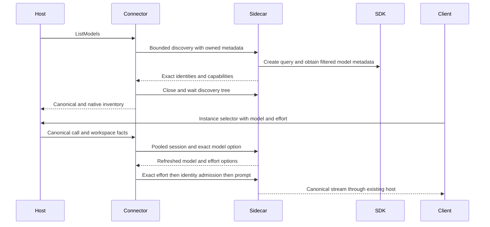

# Design Document

## Overview
Add optional `connectors/claudeagentacp` on the existing ACP subprocess runtime and executable backend-plugin ABI. The operator installs the maintained `@agentclientprotocol/claude-agent-acp` adapter and its bundled official Agent SDK/CLI. No package installation or credential-store access belongs to LIP. API key is the default credential source. Subscription use is an explicit opt-in through either an operator-provisioned token from the official `claude setup-token` flow (opaque secret input, not an OAuth implementation) or the host's existing CLI-owned login.

V1 supports streamed multi-turn text/reasoning, runtime-discovered exact model/effort selection, safe headless policy, and owned process cleanup. The first consumer uses the configured instance `claude-acp` with canonical `anthropic/` model IDs and the existing selector-query effort syntax. The feature stays local single-user and inert until configured. Runtime certification (task 2.1) remains a release prerequisite; its accepted identity controls do not automatically certify the amended model sidecar.

### Goals and Non-Goals
Deliver exact discovered model routing, model-dependent effort, session workspace isolation, compatible-turn reuse and owned-tree retirement. The Deferred list in requirements.md remains out of scope; no runtime installation, credential-store inspection, canonical/ABI changes or new routing syntax is introduced.

## Boundary Commitments
- **Owns:** connector manifest/service/configuration, certified runtime profile, credential sources and configuration roots, environment, connector-owned session settings and host policy, identity and administrator-policy gates, headless policy, discovered inventory; connector-local ESM identity/model bootstrap using the operator-installed pinned adapter library; small opt-in additions within `connector-support/acp` for session metadata, pre-prompt admission and out-of-turn refusal.
- **Reuses:** backend-plugin secrets, per-instance runtime pool, workspace/model/client-session keys, canonical streams, cancellation, process-tree shutdown, existing manifest/conformance checks.
- **Never owned or bypassed:** administrator-managed Claude policy (system/MDM files, registry, policy helpers, organisation server policy). The connector detects and discloses it and refuses it by default; it never masks, disables or overrides it.
- **Unchanged:** core routing/failover/continuity, `pkg/lipapi`, plugin ABI, native Anthropic backend, other ACP connectors' default behavior, multi-user registry (no allowed entry).
- **Dependencies:** exported connector-support ACP, `pkg/lipapi`, backendplugin/modelinventory SDK, YAML and standard library. No root internal imports or provider Go SDK.
- **Stock-host repair:** bounded generic config/runtimebundle/processhost/private-resource-identity/reload wiring for instance-scoped provisioning; no new core package, provider branch, GenericBackendFactoryDeps field or public Options/SDK/ABI change.
- **Deferred:** requirements Deferred list. Out-of-turn refusal and default tools-off are V1 prerequisites, not deferred mitigations.
- **Revalidation Triggers:** adapter or bundled SDK/CLI identity, metadata/options/resolved-model behavior, settings precedence, permission modes, shared transport/session lifetime, manifest posture, applicable upstream usage policy. Re-run sidecar certification on changed extension bytes; preserve accepted historical evidence without treating it as approval of those bytes.

### Out of Boundary and Allowed Dependencies
Core retains routing, B2BUA and failover; public canonical and plugin contracts are unchanged. Administrator authority, OAuth and credential files remain external. Dependencies are the existing ACP module, lipapi, backendplugin/modelinventory SDK, YAML, Go standard library and the pinned operator-installed adapter/SDK through the connector-local sidecar. The connector does not import root internals; core does not import provider SDKs or require Node.

## Architecture and Ownership
| Resource | Owner / construction | Withdrawal and identity |
|---|---|---|
| Plugin process | host processhost | host shutdown/reload, manifest digest |
| Immutable config/secrets | configured connector instance | instance Close; secrets never logged |
| Pool and agent tree | instance Engine / existing RuntimePool | existing reap, divergence replacement, Close kill/wait; workspace/model/client session |
| Negotiated option state | private ACP state on each stdio transport | discarded with transport; session ID and process generation |
| Per-turn handle | `BindSession` | fresh each Open; borrows transport state while runtime claimed |
| Permission responder | immutable connector profile installed at transport construction | no asynchronous work or second lifecycle owner |
| Owned config root | spawning runtime (api_key/token sources) | fresh 0700 directory per agent process; deleted on reap, replacement or Close |
| Host Claude config dir | operator and Claude CLI (host_login source) | external; LIP passes the path only, never reads, copies or refreshes credentials |
| Administrator policy | OS administrator, MDM or organisation owner | external authority; the gate only observes it |

Canonical output stays streaming-first. Before-output errors use existing core failover; after-output failures end the stream without retry. Tool actions and billing are external effects: killing the owned runtime cannot roll them back. Per-instance immutable authentication prevents cross-credential pooling.

## Connector Shape and Files (Requirements 1.3–1.4)
New independent module `connectors/claudeagentacp` mirrors `cursorcliacp` entrypoint/service/conformance shape: go.mod/go.sum, cmd entrypoint and platform stubs, manifest template, release.yaml, internal/service config/service, internal/product adapter/authenv/configroot/policygate/identity/permissions/models/errors/connector plus focused tests. Manifest: `io.golip.backend.claudeagentacp`, kind `claudeagentacp`, `agent_runtime`, `local_only`, `static` credentials, `per_instance`, full profile and only certified claimed platforms. Canonical namespace is `anthropic/`; configured instance IDs, not model namespaces or factory kinds, identify backend routes. The example uses `claude-acp` without reserving that name in core.

Modify shared `handshake.go`, `acp_protocol.go`, `transport_stdio.go`, `subprocess_spec.go` and a small session-options helper. Register the actual module in existing family enumerations: contracttest coverage, lifecycle/ACP architecture, multi-user rejection, cross-platform selection and make-scope scripts. Add disabled `config/examples/claude-agent-acp.yaml` and a short operator doc; clarify the architecture in unsupported-bridges docs without claiming third-party subscription approval.

## File Structure Plan
Existing files retain their responsibilities; the amendment changes only the model seam and its consumers.
- New `connectors/claudeagentacp/adapter-extension/models.mjs` — policy-filtered exact identities and capability preservation on existing sessions; model regressions extend existing `adapter-extension/identity.test.mjs` and `node_test.go` test entrypoints.
- Modified `connectors/claudeagentacp/internal/product/spec.go` and `spec_test.go` — bounded discovery response validation and family-independent canonical/native normalization remain beside the model policy consumer, keeping the approved 100-path feature ceiling without another package or test harness.
- Modified `connectors/claudeagentacp/adapter-extension/bootstrap.mjs` — install the model extension alongside identity admission before connection; reuse upstream disposal.
- Modified `connectors/claudeagentacp/internal/product/spec.go` — remove static names/aliases and publish cloned discovered mappings; resolve and reject using that snapshot, with fresh session options authoritative.
- Modified `connectors/claudeagentacp/internal/product/extension.go` and `adapter.go` — bind all shipped sidecar bytes and certify the amended profile without relaxing runtime identity.
- Modified `connectors/claudeagentacp/internal/service/{engine,service,config}.go` and existing tests — synchronous discovery ownership, actual timestamps/dynamic inventory, removal of manual model inventory, existing stream/pool assembly.
- Modified `connector-support/acp/transport_stdio.go` and existing tests — additive options-aware exported construction for the bounded discovery transport; existing constructor/default behavior unchanged.
- Existing `connector-support/acp/{session_options,acp_protocol,workspace,runtime_pool}.go` — reused negotiation, workspace and pool ownership; amend only if a focused regression demonstrates a gap.
- Existing generic host reload/processhost/runtimebundle files and tests — reuse published-generation draining and retirement; any newly demonstrated shared defect ships separately, not as provider branching.
- Modified `config/examples/claude-agent-acp.yaml`, `docs/claude-agent-acp-backend.md`, connector manifest/release metadata and applicable descriptor/parity tests — canonical namespace, auto-discovery, optional Node and exact packaged profile.

## Components and Interfaces
| Component | Package | Intent | Requirements |
|---|---|---|---|
| Certified deployment | connector product adapter/extension | Optional, hash-bound local runtime and sidecar admission | 1.1, 1.2, 1.3 |
| Configured service and discovered inventory | connector service/product models/spec | Instance routing, exact canonical/native inventory and rejection | 1.4, 4.1, 4.2 |
| AuthEnv and gates | connector product authenv/configroot/policygate/identity | Explicit source, owned roots, policy consent and fresh query identity | 2.1, 2.2, 2.3, 2.4, 2.5, 2.6, 2.7 |
| Headless transport and session metadata | connector product permissions plus shared ACP | Safe permissions, workspace and foreground-only process profile | 3.1, 3.2, 3.3, 3.4, 3.5 |
| Negotiated session options | shared ACP plus connector model sidecar | Exact model-dependent effort, reset and unchanged other connectors | 4.3, 4.4, 4.5 |
| Runtime pool and host generation retirement | shared ACP and existing host owners | Stream/reuse/cancel/failure/retirement | 5.1, 5.2, 5.3, 5.4 |

The sole new exported surface is an options-aware ACP transport constructor taking an existing Process, logger and TransportOptions and returning Transport. It exists because discovery must refuse out-of-turn requests before its reader starts, just like pooled turns (3.3). All model wire types stay connector-private. Existing backendplugin ListModels, modelinventory snapshots and ACP session-options contracts are reused.

## Trust Model and Policy Tiers (Requirements 2.2–2.6, 3.4)
Claude Code applies administrator-managed settings above every other level, and they can run executables (policy helpers, hooks, credential helpers), select providers through their `env` block, and change during a session (hourly server polling; Agent SDK runs apply server policy without the interactive approval dialog). The adapter deliberately mirrors that tier at bootstrap (`applyManagedPolicyEnv`). Any wrapper of the official CLI inherits this behaviour; neutralising it would evade organisation policy. The design therefore separates tiers:

| Tier | Writable by | Connector stance |
|---|---|---|
| Admin: Linux `/etc/claude-code/{managed-settings.json,managed-settings.d/,managed-mcp.json}`; macOS `/Library/Application Support/ClaudeCode/` and managed preferences; Windows `C:\Program Files\ClaudeCode\` and HKLM policy; organisation server policy | root, MDM, org owner | trusted; detected by the gate; refused by default, honoured on opt-in; never bypassed |
| User-writable policy fallbacks: HKCU policy, `/etc/claude-code` on WSL, cached `remote-settings.json` in the config dir | same user | treated as administrator policy by the gate; absent by construction in an owned root |
| User/project/local settings, plugins, skills, `.mcp.json`, hooks, permission rules | same user / repository | excluded by connector-owned session settings and certified |
| Process environment | host | exact allowlist |

A root or same-user attacker is outside the `local_only` threat model. The gate is a consent and disclosure control evaluated before spawn and before each turn; it is not a race-free security boundary.

## Certified Runtime Profile (Requirements 1.1–1.2, 3.1–3.5)
The investigated adapter is 0.89.1 with SDK 0.3.293 and bundled CLI 2.1.293. A minimum version is insufficient: use an explicit certified profile allowlist of exact adapter, SDK and bundled CLI identities (version and SHA-256). Refuse an unknown profile, absent bundled CLI, or an external executable override (`CLAUDE_CODE_EXECUTABLE`). Resolution uses configured path, then `CLAUDE_AGENT_ACP_BIN`, then PATH, with a bounded version probe. Never install or update packages.

The profile constructs `session/new` `_meta.claudeCode.options` exclusively from immutable operator configuration. Add raw `SessionNewMeta` to `HandshakeProfile`, marshalled only when present. Do not copy client extensions into Claude metadata, auth settings, modes, environment, hooks or MCP configuration. Cwd comes from the existing explicit workspace resolver.

Connector-owned session settings:
- `settingSources: []`; explicit SDK `settings` with an empty `env`, no `apiKeyHelper`, empty permission rules, no hooks or plugins; no client-provided SDK overrides.
- `strictMcpConfig: true`, `mcpServers: {}`, `plugins: []`; initialize without filesystem/terminal capabilities; no externally loaded skills or subagent definitions.
- Host policy through the SDK `managedSettings` option (Claude Code "parent settings", the documented channel for an embedding Agent SDK app to add restrictive policy): `allowedProviders: ["anthropic"]`, `disableAllHooks: true`, `permissions.disableBypassPermissionsMode: "disable"`, `allowManagedPermissionRulesOnly: true`. Claude Code ignores parent settings when an administrator source is present; that case is handled by the administrator-policy gate, not by this list.
- `allowDangerouslySkipPermissions: false`; establish and verify a non-bypass session mode before any prompt. The adapter `SettingsManager` reads and watches settings files independently of `settingSources`: certification shows that mode/model changes from project files cannot escalate the connector's profile.
- Deny policy: `tools: []`, not merely permission callback refusal. Allow policy: explicitly certified foreground tools only, no Agent/Task/background tool facilities, no persistent allow rules. Validate permission-request inputs before choosing allow_once; detached inputs are refused. Unknown/unsupported tool forms fail closed.
- Set `CLAUDE_CODE_DISABLE_BACKGROUND_TASKS=1` as defense in depth, never as proof that all work ends with a turn. Foreground tools are operator-trusted local operations; this is not a filesystem or network sandbox.

Each control above is defense in depth with at least one other control for the same effect (owned root, `settingSources: []`, environment allowlist, `tools: []`). Certification records, per control, whether the pinned runtime honours it; a profile is enabled only when every listed effect is shown excluded by at least one honoured control.

## Credential Sources and Configuration Roots (Requirements 2.1–2.4)
| Source (`credential_source`) | Secret | Configuration root | Environment additions |
|---|---|---|---|
| `api_key` (default) | `api_key` required | fresh owned root | `ANTHROPIC_API_KEY`; argv `--hide-claude-auth` |
| `subscription_token` | `claude_oauth_token` required (from `claude setup-token`) | fresh owned root | `CLAUDE_CODE_OAUTH_TOKEN` |
| `host_login` | none | host's `CLAUDE_CONFIG_DIR` or `~/.claude`, unchanged | none; disclosed as same trust and policy as the operator's own CLI |

- Owned root: a new 0700 directory under the instance state directory per spawned process; `CLAUDE_CONFIG_DIR`, `HOME`, `XDG_CONFIG_HOME` and `ANTHROPIC_CONFIG_DIR` point inside it. The runtime pool deletes it on reap, replacement or Close. No host settings, cached server policy, credentials or session files exist at spawn; conversation continuity within a pooled process is unaffected.
- `host_login`: real `HOME` and the host configuration directory are passed through so the CLI uses and refreshes its own stored login (keychain on macOS is keyed to that directory). The connector never reads, copies, symlinks or bind-mounts credential files.
- Base allowlist for all sources: PATH, USERPROFILE, APPDATA, LOCALAPPDATA, SYSTEMROOT, TEMP, TMP, TMPDIR, LANG, LC_ALL, plus HOME/config directory as above. Always scrub `ANTHROPIC_*`, `CLAUDE_CODE_*` (except the variables set above and `CLAUDE_CODE_DISABLE_BACKGROUND_TASKS`), `CLAUDE_CONFIG_DIR`, federation/profile selectors, cloud-provider and key/token/secret-shaped names; operator additions may not reintroduce them.
- Skip the interactive authenticate RPC for every source. Reject literal secrets in config YAML. Secret redaction covers config/log values, errors and stderr.

## Identity and Administrator-Policy Gates (Requirements 2.5–2.7)
- **Policy gate (before spawn, before each turn).** Stat the platform's administrator and user-writable policy locations (tier table), plus `remote-settings.json` in the effective configuration directory (always absent in an owned root, relevant for `host_login`). `admin_policy: refuse` (default) rejects before spawn, naming the source and the `honor` remediation. `admin_policy: honor` launches and records that administrator policy governs credentials, providers, hooks and tools. A changed fingerprint before a turn replaces the runtime and re-runs both gates.
- **Pre-exec consent and diagnostic identity.** The pinned runtime can fetch uncached server policy for every source; require explicit `honor` before version, diagnostic identity or adapter execution. Run the bounded bundled CLI `auth status --json` with the exact prepared environment/root as a diagnostic/source check only. It does not attest the later SDK query. Keep known local/organisation dispositions and disclose otherwise as `honored_potential_server_policy`; never infer absence from Pro/Max labels or an empty cache.
- **Effective identity (each turn, before SDK input).** The connector-owned bootstrap observes the actual session Query using awaited `reinitialize()`, not cached `accountInfo()` or connection auth notifications. Require firstParty plus an unambiguous certified source projection; unknown evidence refuses. Local/cached policy fingerprint changes replace the existing pooled process. Reinitialize observes current-applied state only; remote fetch/polling remains CLI-owned, with unknown remote revision and no latest-policy guarantee. Administrator races after the admission checkpoint remain outside the trust model.
- **Disclosure.** One startup log line and the resolved instance profile carry credential source, runtime identity and policy disposition; never secrets or account e-mail.
- Authentication-required before output is failover-eligible, after output is terminal; remediation names `claude setup-token`, `claude auth login` or the `api_key` secret according to the source.

## Connector-Local Effective Identity Extension (Requirements 2.5–2.6)
Ship project-authored `adapter-extension/bootstrap.mjs` with the connector; Node >=22 and upstream packages remain operator-installed. Reuse pinned `v1AgentApp` handlers and managed-policy bootstrap/disposal behavior, not a copied adapter or new process owner. Resolve the library installation explicitly; reject unsupported module/runtime identities and external overrides. Certification binds the bootstrap and loaded adapter/dependency module closure, SDK and bundled CLI bytes, not merely the original executable entrypoint.

- Private `_golip/effective_identity_v1` request is `{sessionId, checkpointId}`; checkpointId is a fresh cryptographic nonce and also the one-use ticket. Response is `{version:1, sessionId, checkpointId, processGeneration, queryGeneration, observationSequence, provider, credentialSource}`. Process generation is a random bootstrap incarnation, query generation and sequence are positive monotonic integers. Immutable bootstrap configuration supplies the selected source. Return no account e-mail, organisation or raw auth payload.
- Attach state to the existing connection/session: actual query object identity, monotonic generation, one admission ticket and in-flight exclusion. Query replacement, missing/closed query, timeout, cancel, concurrent mutation, failed options or malformed evidence withdraw admission. No notification cache or global registry authorizes input.
- While the existing Go runtime is claimed, apply exact options, then invoke an optional ACP pre-prompt admission seam. Retain process/query generations and last sequence on the stdio transport across BindSession handles. Validate exact version/session/nonce, stable process/query generations, strictly increasing sequence and expected firstParty/source; first valid observation pins generations. Connector-owned prompt `_meta.golipIdentity` carries the exact response tuple. Never copy client metadata. Admission failure kills the runtime and resets history before releasing the existing claim, just as ambiguous options failure does; unopted connectors remain unchanged.
- The bootstrap wraps the dynamic prompt handler: match and consume the exact stored tuple, await a bounded second fresh query observation, reference-check the same query, then delegate. Guard the actual existing Pushable input append synchronously: require the consuming tuple, unchanged session/query/input references and generation, open/non-cancelled state and exactly one user-message append before retiring admission. Refuse internal signed-out respawn during admission; replacement must not publish unguarded input. Disable steer and unsupported load/resume/fork/auth/provider input or mutation routes. Existing upstream prompt awaits cannot bypass the final append check. Failure admits zero user messages and the connector withdraws the ambiguous runtime.
- State transitions: empty -> probing -> issued -> consuming -> consumed. Duplicate/concurrent RPC or prompt refuses; a new sequential checkpoint starts only after consumed. Option changes retire issued evidence, then a new checkpoint follows refreshed options. Mutation, replacement, cancel, timeout or closure -> invalid; cancellation remains available during exclusion. Both observations are bounded; a late completion must reference-check state and cannot issue or revive a ticket. Terminal/disposal cleanup uses existing owners. Tests cover replay, duplicate RPC, mutation between RPC/prompt, delayed CLI-probe-triggered respawn after observation, direct steer, cancellation and late completion with zero SDK input.
- Classify API key only from firstParty plus `ANTHROPIC_API_KEY` and no competing token; injected subscription only from exact `CLAUDE_CODE_OAUTH_TOKEN` and no key. Host login uses the pinned stored-subscription branch's certified evidence and label allowlist without competing sources; absent/unknown/custom labels fail closed. Labels are not policy-absence evidence.

File plan: bootstrap and focused Node tests under `adapter-extension/`; private wire validation in `internal/product/effectiveidentity.go` and tests; small optional seam in shared `subprocess_spec.go`/`acp_protocol.go`; existing resolver, release metadata and service assembly consume them. Prove pre-input rejection for remote provider changes, all source positives/negatives, stale/replaced queries, delayed probe notifications, timeout/concurrency, two-turn policy mutation and cleanup. Certify current-applied identity honestly; do not invent a remote-policy refresh API.

## Server Requests Across the Entire Lifetime (Requirements 3.1–3.3)
Current `ServerRequestHandler` affects active prompt streams only. `newStdioTransport` starts reading immediately and responds `{}` outside prompts. Add an optional protocol transport-options seam, type asserted in `subprocessBackend.ensureProcess` before constructing the transport. `acpProtocol` obtains the Claude opt-in out-of-turn policy from its spec; transport construction stores it before launching the read loop. Existing public constructor and non-opted protocols retain current defaults.

During an active prompt, the existing stream handler selects reject_once (or reject_always) for deny, allow_once only for validated foreground allow-policy inputs; otherwise ACP cancelled outcome. Unknown methods return JSON-RPC method-not-found. Before initialize/session-new, during option-setting, between turns and after terminal, the transport always refuses permission requests and errors unknown requests even under allow policy. Never run arbitrary callbacks or tool work on the reader. Reply through serialized transport writes, and preserve unary/prompt routing and close semantics.

## Negotiated Session Options (Requirements 4.1–4.5)
Retain optional `SessionOptionsSpec` with `EffortConfigID()` and `InitialSessionOptions(model)`; only Claude opts in. No change to canonical API or required `SubprocessProtocol` signatures.

1. Decode `session/new` configOptions including grouped values, current model/effort and each default/current value; absent or malformed required data fails closed. Store a private typed ACP option state on that process's stdio transport, never on shared `acpProtocol`, in a global map, or solely on the fresh per-request handle.
2. `Handshake` uses its resolved model argument, validates it against advertised models and applies exact `model` via `session/set_config_option`. Decode that response's updated configOptions: model changes can alter effort capabilities. Do not validate effort against stale session/new options.
3. Store refreshed options and the post-model default effort in transport state before successful handshake returns its session ID. `BindSession` borrows this state on every Open. All mutation occurs while the existing runtime is claimed, with no second claim or duplicate process owner.
4. For each turn, choose requested effort exactly as canonicalized by existing call semantics, or restore the negotiated post-model default when omitted. Check membership, send `effort`, refresh options from the response, verify the selected value, then send prompt. Unknown options, silent substitutions or unsupported values wrap `lipapi.ErrCapabilityReject` before output. A failed options exchange invalidates that runtime to avoid reuse of ambiguous state.
5. Discard state on transport/process replacement, reap or Close. Fake transports used for the opt-in path must support the same private ACP state contract or return an explicit error. Existing non-opted ACP connectors ignore metadata and retain CLI model / reasoning_effort behavior.

### Runtime-Discovered Model Identity (1.4, 4.1, 4.2)
The pinned SDK supplies `value`, `resolvedModel`, display metadata and model-dependent capability flags. ACP normally advertises moving aliases and omits their exact resolutions. The connector-local model extension wraps the existing session creation handler, derives exact entries only from that session's policy-filtered selectable rows, and replaces model option values with discovered native identities. It preserves the complete capability metadata and uses upstream option rebuilding and query.setModel; it does not invent a model, patch installed modules or select by family name. Raw initialization rows are not a policy bypass: excluded picker rows, current-only fallback entries and managed-denied resolved identities never become selectable. Duplicate resolutions collapse only with compatible capability metadata; malformed or conflicting identities fail closed. Missing resolvedModel is usable only for an already exact native row, not an unresolved alias. Session watches/mutations must not reintroduce fuzzy or moving alias selection; unsupported changed advertisements withdraw the runtime before input.

Canonical normalization is syntax-only, not a model catalog: prepend `anthropic/` to the discovered native ID and render an unambiguous short numeric major/minor version pair as dotted notation, preserving date and context suffixes. This rule applies to arbitrary discovered family stems; existing dotted versions remain unchanged. Unknown grammars retain their discovered native spelling; canonical collisions reject the snapshot rather than pick a winner. Versioned requests resolve only through the resulting mapping, never through upstream fuzzy matching. No production code contains a list of model names or versions.

Discovery uses the same certified Node/sidecar, prepared environment, source and startup gates as turns. A private versioned discovery request creates a tools-off session with connector-owned metadata, returns only bounded exact model IDs/display/capability fields, and sends no prompt. The service invokes it synchronously via the existing process/transport primitives during ListModels (or first execution if no inventory was loaded), with caller cancellation and a maximum 60-second deadline. The workspace is the configured default or an empty owned discovery directory, never an inferred client project. A life-cycle read lease covers spawn through transport close/kill/wait and owned-root removal; instance Close waits for that bounded operation. There is no discovery daemon, ticker, second pool or unowned child. Subsequent turns use the published snapshot without a discovery process per turn; host inventory refresh uses its existing scheduler. Complete validated snapshots replace the connector's map atomically, with actual fetch timestamps. Failed discovery publishes no fabricated defaults, and old inventory never authorizes a model absent from the actual turn session.

The discovery and turn-session options share the same model extension. Each turn still checks exact model membership and verifies the model selection response; refreshed effort options remain authoritative. A moving alias may be used internally to obtain initial metadata but cannot satisfy a client's explicit versioned selection. Default/auto resolves only to the discovered current exact identity, not a hardcoded name.



## Lifecycle and Failure Schedules (Requirements 5.1–5.4)
Reuse existing runtime pool and managed streams: same session continues a two-turn history; divergent history replaces the runtime; session/cancel yields exactly one terminal; pre-output crash may fail over; post-output crash never retries; reap and Close kill/wait the owned tree. Workspace comes from existing canonical session facts, with configured default only as fallback; process cwd and session/new cwd must agree. Pool identity is instance-local workspace/native-model/client-session, with applied-configuration reuse gates. Project switching creates at most one compatible pooled runtime for each key; returning to a compatible key reuses it, not a new process each turn. Certification includes child cleanup and settings-manager watchers. No detached background or subagent support in V1.

Successful host reload removes an instance from the published generation and retires its plugin/pool/tree through existing draining owners; unaffected compatible instances remain live. Rejected reload preserves the active generation. Startup-fixed provisioning-map changes still require restart as specified below: live retirement proof disables/removes backend configuration while retaining startup provisioning rows, rather than bypassing that rule. Proxy shutdown closes every owned instance and discovery operation. No new reload authority is added.

| Failure | Outcome |
|---|---|
| Missing/unknown runtime, invalid config or key | Configure rejection with redacted remediation |
| Known or potential administrator policy under `refuse` | reject before any runtime execution |
| Diagnostic source mismatch / effective query identity mismatch | reject during diagnostic startup / before SDK user input, respectively; discard runtime |
| Unsafe effective profile or pre-prompt server request | reject/refuse before prompt; no authorization side effect |
| Missing/changed model options, invalid effort | capability rejection; discard ambiguous runtime |
| Auth-required before/after first content | pre-output error / single error terminal, respectively |
| Cancel, EOF, idle reap, instance Close | existing quiesce and process-tree cleanup, no second owner |

## Verification Strategy
- Table tests for exact environment/auth flags, rejected additions and redaction, certified profile identity, model inventory, grouped option parsing and permission policy.
- Fake process integration exercises requests immediately on transport construction, during handshake and option-setting, between two turns, and after terminal; none receives empty success. Assert refreshed model-dependent effort and omitted-effort reset, independent concurrent sessions, process replacement and unchanged existing connector behavior.
- Runtime certification against the real adapter and bundled CLI (task 2.1 matrix) verifies: owned-root and allowlist effects; each session-setting and host-policy control; default refusal before any runtime exec for known or potential authority; `honor` disclosure and live-query identity rejection of administrator provider routing before SDK input; per-turn re-gating; tools-off and permitted foreground tools. Fake adapters alone cannot establish this. Package/deployment checks verify deterministic sidecar resolution, Node >=22 rejection diagnostics and bound bootstrap/imported module closure/SDK/CLI identities. Upstream packages remain operator-installed and are not redistributed.
- Operator-run live smoke for each credential source on an unmanaged host: two-turn conversation, identity gate output showing the expected source and first-party provider, usage visible to the operator's account, clean process tree and no credential in logs.
- Lifecycle tests cover two-turn canonical deltas, cancel, crash before/after output, history divergence, idle reap and tree cleanup. Existing generic architecture/conformance checks are extended rather than new connector-specific frameworks.
- Scoped non-race tests locally; remote race and native platform evidence for modified shared transport/lifecycle paths. Build claimed platforms only after native profile evidence.
- Red-first model tests use arbitrary new family/version fixtures to prove no catalog knowledge is needed, version/date/context normalization, deduplication/collision rejection, malformed/empty discovery, managed-denied resolved identities, missing-resolution aliases, timeout/cancel cleanup and unchanged other ACP connectors. Sidecar tests preserve query identity admission and prevent alias/fuzzy or watcher-induced substitution.
- Re-certify the changed sidecar with synthetic provider/credential fixtures and retained security controls before updating its exact hash allowlist; accepted prior certification is a baseline, not approval of modified bytes. A temporary model-validation API failure rejects without fallback and is not evidence that the model is unavailable.
- Built-proxy live proof uses only instance `claude-acp`, disabled alternate backends and one route attempt: enumerate /v1/models and send the three requested canonical 5.5 selectors plus explicit high effort. Bind selected native ID/effort to actual SDK/provider observations; a model's self-description is not proof. These are test cases, never a production allowlist. Record PID/start-time/cwd across same-session repeats, two project keys and a return; disable one of two instances on successful reload, reject an invalid reload, then stop the proxy and check all recorded descendants. Record unproven account billing separately; canonical usage mapping remains deferred.

## Configuration
### Stock host instance provisioning
Stock discovery must provision the same inputs as the connector ABI without inheriting the host environment globally. Add a strict `plugins.backend_discovery.instances` subtree keyed by enabled backend instance ID, with explicit factory `kind`, `secret_refs.<opaque-name>: {env: ENV_NAME}` and `execution_env: [HOME, PATH, ...]`. It accepts references/names only, never literal/default/interpolated secret values or file schemes; malformed diagnostics must not echo scalars. Connector-private config remains opaque.

Schema is mappings with string-tag keys/values and a string sequence for execution_env; reject duplicate keys/names (case-insensitive execution names), aliases and merge keys at every level. kind and reference names are required nonempty strings; each secret ref has exactly one env field. Instance/kind/secret names match `[A-Za-z0-9][A-Za-z0-9_.-]{0,127}`; env references match `[A-Za-z_][A-Za-z0-9_]{0,127}`. Maximum 64 bindings, 32 secret refs and 16 execution names per binding; captured secret values at most 64 KiB each/256 KiB total, execution values at most 16 KiB each/64 KiB total. Missing/empty secret refs fail closed; missing/empty execution values are omitted, with required connector paths subsequently validated by Configure. Reject NULs and duplicate/control replacement; no configurable cap machinery. Errors expose static field/reason and safe index only, never rejected keys/scalars/values.

Exact execution-name allowlist: HOME, PATH, USERPROFILE, APPDATA, LOCALAPPDATA, SYSTEMROOT, TEMP, TMP, TMPDIR, LANG, LC_ALL, XDG_CONFIG_HOME, ANTHROPIC_CONFIG_DIR, CLAUDE_CONFIG_DIR. The last two are directory locators only. Reject all other names, including loader/preload variables, provider/credential selectors and LIP/channel controls. Env refs may select credential variables into SecretBundle only; they never authorize forwarding them into LaunchEnv. Supervisor bootstrap keys remain exclusive.

Use existing HostEnvironment.Lookup at trusted composition to capture only requested values, after verified artifact posture and single-user access checks. Execution context is permitted only for a verified local_only agent_runtime per_instance target and a fixed non-secret name allowlist (home/config directory locators, PATH, temp/platform paths and locale). Reject loader, provider, credential and bootstrap/control names; no concrete-provider switch or arbitrary environment inheritance. Disabled/unconfigured/wrong-kind targets never resolve credentials or launch. Missing/empty selected refs fail closed without essential-provider fallback.

Order: strict structural/target validation -> verified catalog/export -> registered profile and existing access/approval validation -> requested-name-only HostEnvironment.Lookup -> frozen instance/factory input -> factory construction -> peer authentication -> protocol negotiation -> Configure. Both secret and execution captures require authorization before Lookup; manifest posture or CLI mode alone is not approval. Unknown/unconfigured/wrong-kind/builtin/shared targets reject before Lookup, including before authoritative-registry early return; correctly bound disabled rows are inert while malformed disabled rows fail structural validation. Structural check/inventory never capture; selected-instance doctor must explicitly opt into its existing delivery authority. Capture failures release acquired artifacts/staging through current cleanup owners; never use Snapshot/os.Environ or a new background owner.

Clone captured context and SecretBundle into the existing frozen discovered physical input. Reuse authenticated Activate/Dial/Configure secret delivery; secrets never enter launch environment or argv. Add an internal per-activation LaunchEnv input to processhost, empty by default, with context included in resource identity to prevent cross-instance/reload reuse. Supervisor-owned channel variables remain exclusive. This introduces no public SDK/ABI/canonical contract. Reference/config context changes are startup-fixed and require restart; host env rotation is observed only on restart, not advertised as live rotation.

Reject nonempty LaunchEnv for shared-artifact activation before launch; retain unique per-instance physical handles. Deep-clone bundles/maps/bytes and launch values at capture/construction boundaries; resource identity deterministically frames sorted effective key/value pairs. Provisioning-map add/remove/kind/ref/name changes, bound ID/kind changes and disabled-to-enabled transitions require restart before candidate construction or Lookup. Ordinary reload preserves startup snapshots; external value rotation requires restart. Do not extend GenericBackendFactoryDeps.

Files: existing config model/strict decoder, runtimebundle host/catalog/discovered factory composition, frozen resource identity/cloning, processhost activation/environment checks and configreload policy with focused existing tests. Extend the actual packaged-stock-lipstd regression for all three credential sources, host-context isolation, post-peer secret delivery and multi-user pre-Configure refusal. No host credential-file access, shared-plugin environment widening or secret values in diagnostics.

```yaml
plugins:
  backends:
    - id: claude-acp
      kind: claudeagentacp
      config:
        executable: ""
        default_workspace: /home/me/project
        credential_source: api_key   # api_key | subscription_token | host_login
        admin_policy: refuse         # refuse | honor
        permission_policy: deny   # deny | certified foreground allow
        env_allowlist: []
        idle_timeout_seconds: 0
```
Use ConfigureRequest.Secrets for `api_key` or `claude_oauth_token`; no plaintext config fields. Local-only posture excludes multi-user deployments. Neutral docs explain operator responsibility and certified limits without claiming subscription policy approval.
