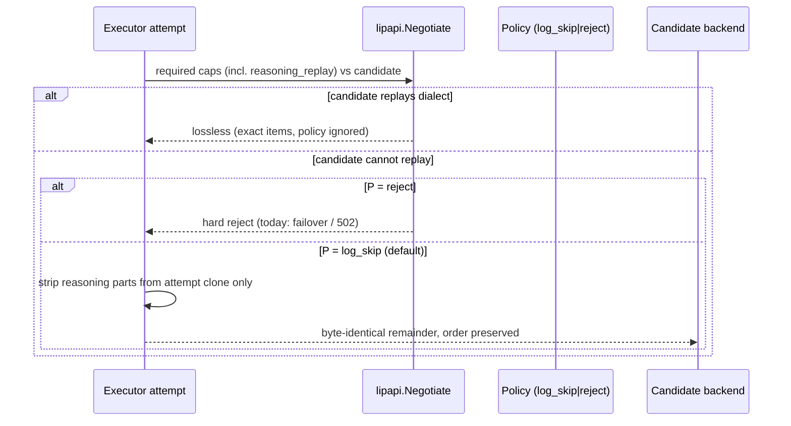

# Design Document: client-reasoning-unrepresentable-policy

## Overview
Agent clients replay model reasoning items in Responses `input`; the frontend
decodes them into `PartReasoning`, which forces a hard `reasoning_replay`
requirement no catalog profile satisfies. Every profile candidate is therefore
rejected before any backend work. This slice adds one per-attempt policy —
`log_skip` (default) or `reject` — enforced in the core executor on the
attempt clone through the existing `lipapi.Negotiate` downgrade seam, reusing
the existing `reject` | `log_skip` vocabulary. Lossless candidates are
untouched; incapable candidates under `log_skip` get everything except the
reasoning parts, byte-identical and order-preserved, with one recorded
downgrade decision. `reject` keeps today's behaviour for strict operators.

### Goals
- Codex-style histories with reasoning items succeed on profile backends under
  the default policy, with a recorded downgrade per stripped attempt.
- One knob, one vocabulary, one accounting: no second knob, no double strip,
  no mutation of the shared call.
- The line-34 reversal (default `log_skip` for client-sent reasoning) is
  explicit in config docs and operator docs.

### Non-Goals
- Deferred items from `requirements.md` (native replay, refusal
  reclassification, per-dialect granularity, extra metrics), each with its
  follow-up issue.

## Boundary Commitments

### This Spec Owns
- The policy value, its default, and its per-attempt enforcement for
  client-sent reasoning in the core executor.
- The strip operation on the attempt clone and the single downgrade record.
- The unification invariant with proxy-restored reasoning (3.1–3.4) and the
  post-strip adjacency expectation (5.1–5.3).

### Out of Boundary
- Replay capability of any backend; the prefix list and family caps stay as
  they are (Track 2 changes them with probe evidence, not here).
- The restore feature's internals and its `on_unrepresentable` scope
  (proxy-restored reasoning only); this slice only constrains their joint
  behaviour per attempt.
- The adjacency quirk's legality rules; the quirk runs after the strip,
  unchanged.

### Allowed Dependencies
- `pkg/lipapi`: `Negotiate`, `ApplyNegotiatedDowngrades`, `CloneCall`,
  capability constants, decision/diagnostic logging.
- Core executor attempt path (`internal/core/runtime/executor_open_attempt.go`
  around the per-attempt clone and negotiation at ~437–558).
- Reasoning-preservation feature config vocabulary (`PolicyReject`,
  `PolicyLogSkip`) and restore entry points, read-only.
- Existing skip telemetry and decision-log helpers.

### Revalidation Triggers
- Changes to `Negotiate` downgradable sets, attempt-clone derivation, or
  failover-after-refusal semantics force re-review of requirements 1–3.
- Any new party reading the policy value forces a single-knob re-check.

## Architecture

### Seams Reused
- `lipapi.Negotiate` downgradable set plus `ApplyNegotiatedDowngrades`: the
  strip rides the existing soft-downgrade path instead of a new stage. The
  design extends the downgradable set to cover `reasoning_replay` **only**
  when the attempt policy is `log_skip`; under `reject` the capability stays
  hard. No existing seam fits better because negotiation is already the
  per-candidate chokepoint.
- Per-attempt clone (`CloneCall` of the baseline at attempt build): the strip
  mutates only the clone, so later candidates negotiate against exact items.
- `reject` | `log_skip` vocabulary from the reasoning-preservation feature:
  reused verbatim; no new enum, no new config name for the same concept.

### Project Boundary Questions (Go LIP)
- Core-owned or plugin-owned? Core-owned: the decision sits in the executor
  attempt path; adapters and the feature plugin are callers, not owners.
- New canonical concept, or adapter-specific behaviour? Neither: a routing
  policy over existing capabilities plus a mechanical strip of existing parts.
- Streaming-first path preserved? Yes: the strip happens before the attempt
  opens; no stream is touched mid-flight.
- Provider SDK leakage avoided? Yes: core sees only `PartReasoning` kinds and
  capability labels; wire types stay in adapters.
- No retry/failover after first client-visible output? Yes: refusal and strip
  both happen pre-output; post-output rules are untouched.
- Secure-session, diagnostics, or startup-security posture affected? Only
  diagnostics: one counter plus content-safe decision entries (4.1–4.3).

### Flow


## File Structure Plan
Concrete paths; implementations (not this spec) touch only these.

### New Files
- None expected: policy value, strip helper, and counter plug into existing
  files. If the strip helper needs a home, it lives next to the executor
  attempt path, not in a new package.

### Modified Files
- `pkg/lipapi/capabilities.go` — conditional `reasoning_replay`
  downgradability gated on the attempt policy; strip helper for reasoning
  parts on a cloned call (hosts StripAndRecord's shared half).
- `internal/core/runtime/executor_open_attempt.go` — read the per-attempt
  policy, negotiate, strip the clone, record the downgrade decision (hosts
  AttemptPolicy enforcement plus StripAndRecord's attempt half; RestoreGate's
  executor side).
- Route/executor config surface — the single policy key, default `log_skip`
  in the standard distribution, `reject` available (exact subtree chosen at
  implementation; must not duplicate `on_unrepresentable`).
- Telemetry wiring — `reasoning_replay_skipped{backend}` counter and
  decision-log call on the strip path.
- `internal/plugins/features/reasoningpreservation/restore.go` — RestoreGate's
  feature side only: withhold unrepresentable restores for a stripped attempt
  under `log_skip`; no change to `on_unrepresentable` scope.
- `docs/reasoning-output-preservation.md` (or the operator config reference)
  — record the default and the line-34 reversal for client-sent reasoning.
- No quirk file changes: OrderGuard's quirk half runs unchanged post-strip.

## Components and Interfaces

| Component | Package | Intent | Requirements |
|-----------|---------|--------|--------------|
| AttemptPolicy | `internal/core/runtime` (config) | Resolve `log_skip`/`reject` per attempt; default `log_skip`; `reject` keeps hard refusal | 1.2, 1.3, 1.4 |
| StripAndRecord | `pkg/lipapi` + executor | Remove reasoning parts from the clone; record one downgrade; lossless passthrough when the candidate replays | 1.1, 1.5, 2.1, 2.2, 3.2, 4.1, 4.2 |
| RestoreGate | feature + executor contract | Withhold unrepresentable restores under `log_skip`; keep `on_unrepresentable` under `reject` | 3.1, 3.3, 3.4 |
| OrderGuard | quirk (unchanged) + strip invariant | Quirk runs post-strip; strip never reorders; illegal remainder refuses | 2.3, 5.1, 5.2, 5.3 |

#### StripAndRecord
```go
// Strips client-sent reasoning parts from the attempt clone only.
// Returns the stripped clone and whether a downgrade was recorded.
func StripReasoningForAttempt(c *Call) (*Call, bool)
```
- Invariants: input call is a per-attempt clone; every non-reasoning item is
  byte-identical and order-preserved; exactly one downgrade record per
  stripped attempt; never reorders (5.3 refuses instead).
- Failure behaviour: any strip that cannot preserve identity/order fails the
  attempt as a refusal, never a partial call.

## Error Handling
- `reject`: today's refusal propagates through existing candidate rejection
  and failover; single-candidate routes keep surfacing `502
  backend_unavailable`. No new error shape.
- `log_skip` strip failure (cannot preserve remainder): treated as a refusal
  of that candidate, not a degraded submit; never a partially restored call.
- Post-strip adjacency illegality that is not the dissolved reasoning shape
  (for example a message trapped between a later call and an earlier output)
  follows the existing quirk refusal path unchanged.

## Testing Strategy
Follow Test Proportionality in `.kiro/steering/testing.md`; tests are evidence
in implementation tasks, not requirements.
- Table tests: policy × capability matrix (`log_skip`/`reject` ×
  replays/cannot-replay × lossless second candidate) asserting strip vs exact
  vs refusal and single downgrade accounting.
- Integration: one end-to-end test through the real frontend (Codex-style
  body with a reasoning item) against a profile backend and the strict
  emulator; one two-candidate test (lossless OpenAI-responses candidate gets
  exact items, profile candidate gets the stripped clone).
- Ordering: the adjacency-quirk test from 5.1 (`callA, reasoning, callB,
  outA, outB` in, `callA, callB, outA, outB` out on `deepseek-responses`, no
  refusal); a trapped-message control still refuses.
- Fail-open/failure: `reject` path returns today's refusal; strip-failure and
  illegal-remainder paths refuse rather than submit partial calls.
- Existing generic architecture rules extended: none; the change rides
  existing negotiation and attempt-derivation rules.

## Configuration
One route/executor-level key with values `log_skip` (default in the standard
distribution) or `reject`, reusing the feature's vocabulary. The feature's
`reasoning_output_preservation.on_unrepresentable` keeps its existing scope
(proxy-restored reasoning) and is not read for client-sent reasoning; the
unification invariant (requirements 3.1–3.4) is enforced behaviourally at the
attempt level, not by merging the two keys. The default change and the
line-34 reversal are recorded in operator docs.
