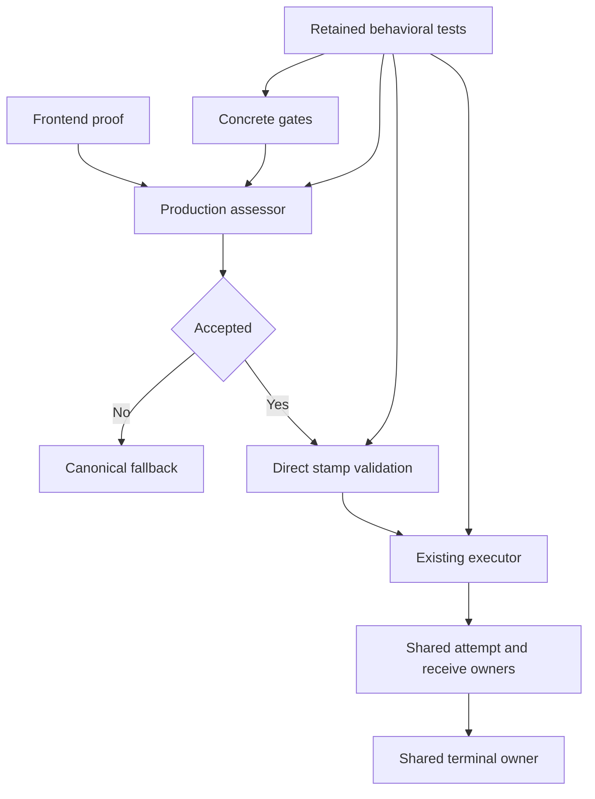

# Design Document

## Overview
Delete verified-unused internal assessment families and the production-resident wire race test entrance. Keep both payload representations and the actual serving gates, production assessor, proof validator, executor and shared lifecycle owners. Retain valuable coverage at these existing surfaces, remove obsolete/vacuous assertions, and correct one misleading current operator explanation.

### Goals
- Retire seven alternative families, exclusively dependent projections and the isolated race-transfer chain.
- Preserve real admission, stamp rejection, recovery, event, cleanup and compatibility behavior.
- Ship a net-shrinking, independently buildable slice; add no policy or test framework.

### Non-Goals
Lifecycle and proof/parity fixes, eligibility consolidation, paid-wire enablement, broader protocol support and measured performance optimization remain outside this slice. No public API/config/dependency changes or historical-evidence rewriting.

## Boundary Commitments
### This Spec Owns
Unused-symbol deletion in `internal/core/largebody` and `internal/core/runtime`, directly dependent test pruning/migration, and the current documentation's harness reference. Maintained behavioral claims belong to existing serving owners, not the retired wrappers.

### Out of Boundary
Concrete assessment gates, serving optional interfaces, dependency census/catalog, `WireTurnFacts`, `Proof`, `Assessment`, accepted stamp, replay storage, real route plans/attempt payloads, ready publication, receive/recovery/terminal policy, provider adapters, composition identity and financial semantics stay unchanged.

### Allowed Dependencies
Reuse current `largebody` gates/validators, runtime production assessor/executor, canonical events and existing package fakes/stock-host tests. Add no package, dependency, provider branch, registry, goroutine, channel, queue, config, generated contract or new architecture rule.

### Revalidation Triggers
A new serving/embedded/alias/ABI consumer; changed sibling-owned proof or lifecycle surface; modified eligibility/census; inability to execute a retained regression; public contract or concurrent serving behavior change. Revalidate the deletion boundary instead of broadening it silently.

## Architecture
### Seams Reused
`runtimebundle.buildLargeBodyAssessor` wires concrete gates into `ProductionLargeBodyAssessor`. Existing `Executor.ExecuteLargeBody` invokes `ValidateExecuteLargeBody`, then shared route planning and attempts. `readyAttempt.Prepare`/`Consume` are the actual transfer capabilities; the discarded `WireTakeStream` is not their replacement.



### Project Boundary Questions
- Core owns generic acceptance/execution; adapter protocol semantics remain in adapters. Composition ownership does not move.
- No new canonical concept; `lipapi.Call` and replay remain intentional representations.
- Streaming remains primary; canonical collection and current wire eligibility remain unchanged.
- Core gains no provider SDK/import/branch and no post-content retry/failover.
- Security/session, startup, diagnostics, billing and boundedness semantics are preserved at the actual implementation baseline. Known sibling defects are not repaired here or reintroduced after their fixes land.

## File Structure Plan
No new production files. Prefer existing tests; no generic harness or new gate.

| Group | Concrete production paths | Change |
| --- | --- | --- |
| A | `internal/core/largebody/authority_gate.go`, `internal/core/largebody/initial_route_gate.go` | Remove `AssessAuthorityGate`, authority/initial assessor constructors, methods and assertions only |
| B | `internal/core/largebody/route_override_gate.go`, `internal/core/largebody/late_selector_gate.go`, `internal/core/largebody/backend_wire_proof.go` | Remove route/late/backend assessor families, backend gate override simulation methods and local `containsString`; keep concrete gates and union logic |
| C | `internal/core/largebody/stamp_validation.go`, `internal/core/largebody/conservative_dependencies.go` | Remove stamp executor wrapper; delete conservative DTO/gate file; keep direct validators and errors |
| D | `internal/core/runtime/executor_execute_large_body.go`, `internal/core/runtime/attempt_session.go` | Remove `wireAttemptInput`, race result/helper, `wireAttemptStream` chain and `WireTakeStream`; keep real executor and ready ownership |

Affected tests, not wholesale file deletions:
- Group A: `internal/core/largebody/authority_gate_test.go`, `initial_route_gate_test.go`, `task12_4_canonical_localturn_secretguard_test.go`, `task12_5_canonical_terminal_decision_test.go`.
- Group B: `internal/core/largebody/route_override_gate_test.go`, `late_selector_gate_test.go`, `backend_wire_proof_test.go`, `internal/core/runtime/large_body_assessor_test.go`. Group B also owns the `BackendWireProofAssessor` and `LateSelectorAssessor` cases in `internal/core/largebody/stamp_validation_test.go`; migrate retained request/domain capability-tamper assertions to direct validation and classify remaining affected claims before deleting those families.
- Group C: remaining stamp-executor-wrapper cases in `internal/core/largebody/stamp_validation_test.go` and conservative-DTO cases in `task12_3_conservative_dependencies_test.go`; move retained census case into `authority_gate_test.go` after Group A.
- Group D: `internal/core/runtime/large_payload_race_differential_red_test.go`, `large_payload_wire_ownership_red_test.go`; use existing `task13_1_execute_large_body_test.go` only if a unique serving claim is missing.
- Existing `compaction_wire_differential_test.go`, `large_payload_wire_recovery_blocker3_red_test.go`, runtimebundle stock-host tests and frontend pipeline suites are verification consumers, not automatic edit targets.
- `docs/large-payload-fast-path.md`: replace its isolated harness reference with actual route-plan/shared-race delegation. Do not revise archived specs, old reports or unrelated operator sections.

Full paths are scoped by the prefix on each bullet. Groups B/C share stamp tests and A/C share authority tests, so tasks are sequential. Migrate all constructor-dependent callers in the same deletion task; do not leave broken builds until the next task. A surviving case can remain in its original file even after obsolete siblings are pruned. Remove unused imports only as consequences of the deletion.

## Components and Interfaces
| Component | Package | Intent | Requirements |
| --- | --- | --- | --- |
| Proven-unused family retirement | `internal/core/largebody` | Remove false authorities; retain concrete gates and optional capability interfaces | 1.1, 1.2, 1.3, 3.4 |
| Serving proof/admission evidence | `internal/core/largebody`, `internal/core/runtime` | Pin bounded supported acceptance, conservative decline, domain/capability facts and direct stamp rejection | 2.1, 2.2, 2.3 |
| Isolated execution-entrance retirement | `internal/core/runtime` | Remove test-only race/transfer chain while preserving actual attempt, receive, commitment and terminal behavior | 1.1, 1.2, 3.1, 3.2, 3.3 |
| Current documentation alignment | `docs` | Describe existing serving path without suggesting a second authority | 1.2 |

No interface signatures change and no new interface is introduced. Removing exported names inside `internal` is permitted only after the complete consumer search; the optional interfaces in `largebody/capability.go` and all public contracts stay. Graph implements edges alone do not establish serving use.

## Claim Disposition and Error Handling
- Preserve unknown/unclassified census, occupied authorities, fresh-session certification, compaction completeness/budgets, required capabilities, and supported streaming-only admission through actual gates/production assessor.
- Port the unique combined late-domain finite/universal/mixed cases to `BackendWireProofGate.Evaluate`; preserve bound rewrite facts to every resolver.
- Port request and domain capability tampering independently to direct validation. Match all unrelated stamp facts and assert the exact disagreement field, `errors.Is(ErrStampDisagreement)` and appropriate typed error; do not let generation drift mask rejection.
- Keep direct stamp field cases not already covered by the real executor; preserve actual domain/source rejection before backend/session effects.
- Delete DTO-only assertions, obsolete blanket response-authority blocker, vacuous unused sentinels, unsupported synthetic parallel weighted-first, harness field equality and retired `WireTakeStream` method tests. Move the real narrow-port census assertion unchanged.
- Keep actual two-turn sequential weighted-first and its store failure, B2 content-winner/handicap/noncooperative-loser/panic cases, real recovery and terminal-outcome tests. Never relax expected terminal/error classifications to ease deletion.
- Before acceptance, current decline/canonical fallback remains; after acceptance, proof disagreement remains terminal. Cleanup and logical outcome ownership stay with current serving owners.
- If deleting a candidate breaks a serving consumer, keep it and revisit the source-bound inventory. Do not add shims, broaden eligibility, restore forwarding exports or fix unrelated failures in this slice.

## Testing Strategy
Tests remain inside the four deletion tasks. Establish before/after characterization for behavior-preserving deletion; no artificial failing test for the absence of a type. New migrated assertions must reject deliberate local faults at the exact gate/validator; scratch mutations are restored before final verification.

1. **Admission/gates**: Keep direct decision tables and `TestProductionLargeBodyAssessor_StreamingOnlyDelivery`, fresh A-leg certification, authority/static disposition and real-gate decline audit. Existing stock-host census tests verify real composition, not manually accepted mocks.
2. **Domain/stamp**: Preserve `TestTask13_1_LiveRouteOverride_ConstrainedToDomain`, immutable rewrite resolver facts and direct stamp/source checks. Add only missing combined-domain and capability-tamper oracles identified above, with a valid accepted control and matching unrelated facts.
3. **Execution**: Keep actual B2 race regressions, sequential weighted-first/store failure, `TestBlocker3_PreOutputRecoverableFailover_Differential`, `TestBlocker3_CloseDuringFailover_NoUnownedAttemptEscapes`, and ownership tests for cancellation/EOF/early close. Commitment behavior is covered at real executor/receive boundaries, not the retired harness.
4. **Boundary evidence**: Refresh repository-wide symbol/embedding/alias/non-Go inventory; build callers; verify zero runtime-source references to removed concepts and net shrink through existing delivery reporting. No new feature-specific AST/string gate or documentation test.

Commands for implementation:
```sh
go test -count=1 ./internal/core/largebody ./internal/core/runtime ./internal/infra/runtimebundle ./internal/plugins/frontends/frontendpipe
go test -count=1 -tags=integration ./internal/infra/runtimebundle -run '^TestStockHost_'
go test -count=1 ./internal/archtest
make dev-contract-check DEV_FRESH=1
make dev-lint PKGS='./internal/core/largebody ./internal/core/runtime'
```
Use existing comprehensive hook/CI gates for coherent delivery. Default/focused tests alone are not final delivery certification. No local race; if any serving concurrency owner changes, add applicable remote CI race evidence or split out the behavior-changing work. No benchmark is required because no performance target is asserted.

## Integration and Migration
Four sequential work units target about nine source and 12–14 test files plus one doc, approximately 1,288 existing production lines retired. These are estimates, not deletion targets. Keep additions small and substantially below removals; use the existing delivery report to check actual production/test/file budgets.

Prefer lifecycle/proof repairs before deletion for coordinated audit delivery. They are not unconditional dependencies for this unused-code slice: record actual implementation base, reconcile overlapping changes and execute all retained claims. If a retained regression needs a corrective repair, integrate that repair first rather than skip or widen this spec. Specifications alone do not discharge code dependencies.

Document-generation approval is not implementation authorization. `ready_for_implementation` remains false and all tasks remain open. No runtime files are changed by this workflow.
