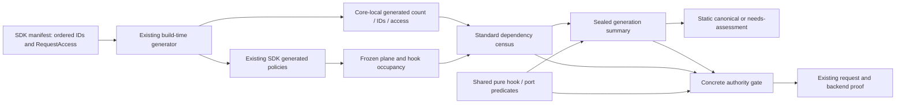

# Design Document

## Overview
Replace handwritten large-body plane count, identity order and access classes with a core-local artifact emitted from the existing SDK manifest. Reuse the existing hook/port compilation predicates in defensive assessment without trusting the compiled summary as the sole authority.

The first consumers ship in the same slice: standard-census construction, production host occupancy assembly, summary compilation and the serving authority gate. Invalid generation fails before installation; invalid runtime census retains existing rejection/canonical selection. No new wire capability or public API is introduced.

### Goals
- One handwritten standard-plane inventory/classification authority; deterministic core output consumed in production.
- Current blocker bits, conservative policy, reason precedence, generation capture and zero-allocation static disposition remain unchanged.
- Defensive gate independently evaluates current hook/port facts through shared pure predicates.

### Non-Goals
No new planes, SDK contracts, wire/response pipeline support, paid-wire support, enum/mask-width expansion, lifecycle repairs, proof/parity repairs, composition nonce repair, alternate-assessor deletion, runtime projection optimization or generator-platform rewrite. Deferred work stays in `requirements.md`; remote issue publication is not part of this request.

## Boundary Commitments

### This Spec Owns
- Build-time derivation of existing core plane metadata from validated SDK manifest declarations.
- Removal of the three handwritten count/order/access authorities, not their existing consumers or internal lookup contracts.
- Hook/narrow-port predicate reuse at the compiler and concrete authority gate.
- Currency and production-occupancy integration through existing generation/testing seams.

### Out of Boundary
- Typed occupancy, custom-port classification, hook-bus chain ownership, and non-negotiable authority policy remain with existing composition/core owners.
- Request proof, selector/backend agreement, stamp terminality, canonical fallback, replay, ready-attempt publication, receive/recovery/terminal billing and downstream commitment remain untouched.
- `resolveLargeBodyAssessorGenID` belongs to proof/parity; unused authority DTO/adapters belong to assessment simplification. Preserve the serving `ProductionLargeBodyAssessor` and concrete `AuthorityAssessmentGate`.

### Allowed Dependencies
The existing build-time `internal/featureplanegen` parses manifest bytes and emits core-local literals. Core neither imports generator nor reads manifest files or mutable SDK declarations at runtime. No concrete plugin/provider import, reflection registry, new process service or public `pkg/` surface.

### Revalidation Triggers
Plane order/access/enum/mask changes, new core-port fields, generator/check flags, frozen occupancy or candidate publication changes, and shared gate edits after sibling implementations require renewed baseline and focused integration checks. File overlap alone is not a prerequisite.

## Architecture

### Seams Reused
`planeInfo`, `extractPlanes`, request-access parsing, formatting, `WriteGeneratedFileAtomic`, CLI `-check`, existing architecture currency/path reporting, `NewStandardDependencyCensus`, `compileHookChains`, `compilePortBlockers`, production builder and concrete gate.

Two evaluations are intentional. The compiler freezes summary bits for cheap pre-capture selection; the authority gate validates seal/pin, summary blockers and independently supplied census facts. Sharing predicate implementations does not merge evaluations or move wire authorization to static disposition.

## Components and Requirement Coverage

| Component | Responsibility | Requirements |
| --- | --- | --- |
| Existing manifest extractor + core emitter | Validate IDs/classes/membership, ordered core output and capacity | 1.1, 1.2, 1.5, 1.6, 4.5 |
| Standard census and plane compiler | Derived inventory, complete-census checks, order-independent mask, protected/conservative planes | 1.1, 1.3, 1.4, 1.5, 2.1, 2.3, 2.4, 4.3, 4.5 |
| Shared hook/port predicates and concrete gate | Independent current-fact checks; existing custom defenses and reasons | 2.2, 2.4, 3.1, 3.2, 3.3, 3.4 |
| Static disposition + production composition | Preserve pre-capture rejection, first consumer and frozen generation behavior | 2.5, 4.1, 4.2, 4.3, 4.4 |
| Generator CLI + existing currency/quality checks | Both artifacts current, read-only check, invalid generation installs neither | 1.1, 1.2, 1.6, 4.5 |

## Design Decisions

### 1. Emit a Core-Local Catalog
Add a small `GenerateWireEligibilityCode(manifestBytes []byte) ([]byte, error)` build-time function to `internal/featureplanegen`. It reuses the existing manifest parse/extraction and closed request-access validation; formatting uses `go/format`. Reusing the parser through a small helper is optional; a generator-platform refactor is not required. Both CLI calls consume the same already-read immutable byte slice.

Emit `internal/core/largebody/plane_catalog_generated.go` in `package largebody`, with the existing generated-file banner, no imports, and:
- `wireEligibilityPlaneOrder = [...]string{...}` in `StandardPlanes` order.
- `WireEligibilityPlaneCount = len(wireEligibilityPlaneOrder)` as a derived constant.
- `standardPlaneV1Access = [WireEligibilityPlaneCount]PlaneAccess{...}` with named existing core access constants.

Map the four accepted SDK annotation names to the four corresponding core names using a closed build-time mapping, not enum casts or a handwritten per-plane switch. This is a class vocabulary bridge, not an inventory. No new access values; retain enum parity coverage.

The current manifest order equals all 28 legacy bit positions. Preserve that mapping with a compatibility fixture recording baseline IDs/order; do not recompute the expected order from the emitted table. Future additions within capacity append to production order; this slice adds none. A 33-plane fixture must fail generation. Emit `var _ [32-WireEligibilityPlaneCount]struct{}` alongside the constants: a negative array length makes overflow a compile error even if generated data is hand-edited. A plain subtraction constant is not a guard. No runtime dynamic registry or mutable exported catalog is added.

`WireEligibilityPlaneID`, `WireEligibilityPlaneIndex`, census constructor and plane compiler retain signatures and algorithms. Remove only the handwritten count/order/access definitions. Existing complete-census unknown/duplicate/missing/unclassified/out-of-range validation and 64-character unknown-ID diagnostic bound remain. Generated core literals never alias public SDK descriptor/list storage.

### 2. Extend the Existing Generation Command
Default regeneration and default `-check` cover SDK and core files. Preserve explicit `-out` compatibility: a caller specifying SDK output remains SDK-only unless it also specifies a new `-eligibility-out` destination. This prevents existing scratch fixtures from overwriting the real core artifact. Custom two-output probes pass explicit destinations for both outputs.

For all selected outputs, generate, validate and format bytes before any installation. `-check` reads and compares all selected files with existing CRLF normalization, fails nonzero for missing/stale artifacts and writes nothing. Emit path-specific failures.

Reuse per-file `WriteGeneratedFileAtomic`; no cross-file atomicity promise. If the second file cannot be installed, return failure; a subsequent read-only `-check` catches drift and successful rerun repairs it. No new rollback/durability manager. Invalid manifest or over-capacity inventory installs neither file.

Extend the existing quality selector to run generation currency when `plane_catalog_generated.go` changes. Extend `MeasureManifestStatus` so existing `IsGeneratedUpToDate` and currency verdict require both default artifacts current; retain the existing SDK `GeneratedPath` field meaning and add the core path to the existing generated-path inventory. Update its existing fixtures/report baseline through explicit update tooling if required; do not create a new architecture check or rewrite metadata in check mode.

### 3. Reuse Predicates, Preserve Independent Assessment
Keep `compileHookChains(HookEligibilityInput)` and `compilePortBlockers(NarrowPortEligibilityInput, bool)` as pure internal helpers. Summary compilation continues to call them. Replace only the gate's handwritten hook OR-expression and narrow-port OR-expression/two-phase check with those same helpers applied to `g.Census` on each evaluation; nonzero blocker masks return the same authority-blocker decision.

Preserve gate order: unsealed -> authority blocker; empty/mismatched expected generation -> generation mismatch; summary blockers -> authority blocker; typed plane checks; current hooks; current narrow ports including two-phase; custom ports. No new reason values. Retain both existing summary checks; removing their small redundancy is not required by this slice.

Do not route defensive typed-plane validation through the complete-census compiler: its stricter validation and error behavior are not currently equivalent. Preserve protected weakening checks even for unoccupied planes. Preserve custom unknown/occupied-blocker policy and occupied substring checks (`local_turn`, `secret_guard`, `terminal_decision`, `terminal.decision`); do not invent a control-tool substring rule.

All four hook chains, including response-part, continue to block when occupied. Correct the misleading `HookBlockers` comment. Retain five conditional narrow-port exemptions and every existing fixed bit; no reflection, I/O, callbacks or new synchronization in helpers/gate/static selection.

### 4. Keep Existing Production Composition
`buildLargeBodyAssessor` continues seeding the standard census and projecting occupancy from frozen contributions, hook lengths, typed core ports, routing/accounting/billing and custom callbacks. No builder replacement or broad occupancy rewrite. The generated default census immediately changes its metadata authority while occupancy remains generation-owned.

Preserve `hasTrafficPlanes`, secure-recorder exemption, exposure-admission/custom-billing blockers, and `CorePorts.AddToCensus` future-field fail-closed behavior. Never read runtime mutable `StandardPlanes` or `Plane*.RequestAccess` for admission.

Static disposition remains constant-time, allocation-free and read-only. Feature-disabled > static-blocker/pin > resolver > gzip > threshold > needs-assessment precedence remains. Body-admission limit is unchanged and threshold is not a new size authorization. Unsupported compositions create no fast-path capture/scanner or wire-backend open.

## File Structure Plan

| Path | Action / one responsibility |
| --- | --- |
| `internal/featureplanegen/plane_eligibility_generator.go` | New: core output emitter with closed class bridge and capacity check |
| `internal/featureplanegen/plane_generator.go` | Modify only if a small shared extraction seam is needed; existing SDK generation contract stays |
| `internal/featureplanegen/plane_eligibility_generator_test.go` | New: emitter derivation/invalid-input/order/capacity claims |
| `scripts/generate-feature-planes.go` | Modify: selected two-output generation/check/install CLI |
| `scripts/test-generate-feature-planes.sh` | New bounded CLI fixture if no existing script owns this seam; scratch destinations only |
| `scripts/quality-checks.sh`, `scripts/test-quality-checks.sh` | Modify: select new generated output for existing currency command; existing fake-Go test |
| `internal/core/largebody/plane_catalog_generated.go` | New generated-only core metadata |
| `internal/core/largebody/eligibility.go` | Modify: remove handwritten count/order; keep validation/bit helpers and fix response-hook comment |
| `internal/core/largebody/authority_gate.go` | Modify: remove handwritten access table; reuse predicates in concrete serving gate |
| `internal/core/largebody/eligibility_test.go`, `internal/core/largebody/authority_gate_test.go` | Extend: independent compatibility and current-census regression cases |
| `internal/archtest/plane_report.go`, `internal/archtest/plane_report_test.go` | Modify: existing currency/path contract covers second generated file |
| `testdata/architecture/extension_planes_baseline.json` | Explicit generated-path baseline update if its existing checker requires it |
| `internal/infra/runtimebundle/build_large_body_assessor_test.go` | Add/extend bounded production composition sentinel; builder behavior not redesigned |

Manifest/SDK generated bytes should not change on an unchanged baseline. Only core generated bytes are new. No public interface changes; new build-time function belongs to an internal package. No new architecture layer, config field, state table, goroutine, channel or cleanup action.

## Testing Strategy
Tests live within their implementation tasks. First characterize current behavior; new emitter/integration claims fail before implementation. Existing selected allocation and conservative suites remain witnesses, not additional feature ratchets.

| Claim / requirement | Cheapest observation | Plausible regression to reject |
| --- | --- | --- |
| One declaration supplies ID/access; deterministic order; 32-bit capacity (1.1, 1.2, 1.5, 1.6) | Small synthetic generator fixtures, production compatibility fixture and CLI scratch outputs | Hardcoded 28 count, missing new entry, wrong class map, 33rd-bit truncation; malformed declaration partially installed |
| Compiler validation/order/labels (1.3, 1.4, 4.5) | Existing pure compiler table cases | Removed unknown/duplicate/missing/access checks, shuffled bits, unbounded diagnostic ID |
| Conservative planes/hooks and allowed exceptions (2.1-2.4) | Existing gate/compiler tables, occupied metadata-only positive | Response hook accidentally accepted, protected class weakened, exemption always blocked |
| Independent current facts despite clean summary (3.1, 3.2) | Gate given valid clean summary plus separately altered census | Gate trusts summary instead of reevaluating hook/port/two-phase facts |
| Custom defenses and reason order (3.3, 3.4) | Existing custom-port/seal/pin cases | Wire-safe marked protected occupied port accepted, generation reason masked |
| Serving occupancy/frozen isolation (4.2, 4.3) | Real production builder with bounded frozen contributions and existing host/frontend sentinel | Newly derived catalog unoccupied despite registered response hook; mutable descriptor changes admitted decisions |
| Early decisions/resources/cost (2.5, 4.1, 4.4) | Existing static reason tests, no-capture/frontend sentinel and allocation ratchet | Resource creation on static rejection, wire authorization from static disposition |
| Both artifacts checked and legacy custom output safe (1.2, 1.6, 4.5) | CLI scratch fixtures + existing currency/quality tests | Stale core passes check, check writes output, custom SDK output clobbers repository core file |

Reuse `TestWireEligibility_PlaneAccessParityWithFeature`, existing blocker-2/protected-plane/narrow-port/static ratchets and stock-host tests where present. Use hardcoded independent outcomes; no expected masks calculated by the shared predicate being tested. Characterization witnesses may preexist and pass before the refactor; newly missing behavior must be observed RED. No production wire-support toggle as a test workaround.

Implementation validation: scoped generator/SDK/largebody package suites; applicable runtime/runtimebundle/frontendpipe selections; generator `-check`; CLI/quality fixtures; existing architecture currency tests; `make dev-contract-check`; normal complete delivery gates/CI selected under `docs/development-iteration.md`. No local race run. A deterministic composed host sentinel is sufficient here; no live-provider latency or billing-impact claim.

## Delivery and Migration
- One PR from the task baseline; estimated 350-650 added non-test lines including generated core metadata, roughly 15-25 changed paths including tests/automation, well below 100 Go-file hard gate and ~1,500-line slice guidance.
- Four sequential 1-3 hour leaf tasks: generated core catalog + serving census consumer; command/currency integration; defensive predicate reuse; explicit production integration and compatibility. Each includes its own tests, not a standalone certification task.
- No data/schema migration. Regenerate/check artifacts; compiled binaries hold immutable metadata until rebuilt. Rebaseline with sibling implementation commits before editing overlapping symbols.
- Specification approval is automatic as requested; implementation and PR delivery are not authorized by this generation workflow. `ready_for_implementation` remains false until separately authorized.
