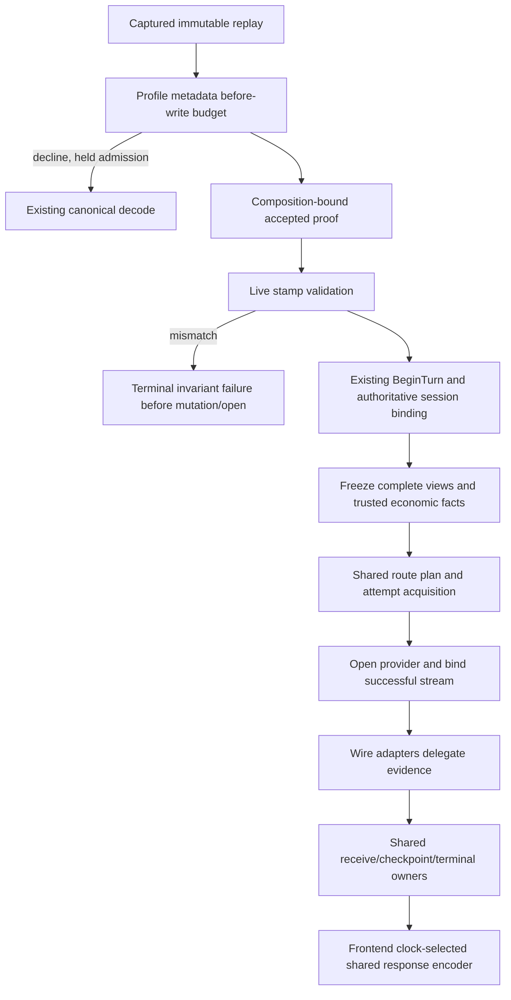

# Design Document

## Overview
Repair bounded proof and trusted-fact parity at five existing seams: frontend metadata retention, assessor construction identity, admitted views, successful provider acquisition, and response encoding. The two payload representations remain intentional; both keep the shared route, attempt, receive, and terminal owners.

Before acceptance, uncertain proof retains same-permit canonical fallback. After acceptance, stamp disagreement fails before mutation/open and never causes canonical re-execution. Missing economic identity remains absent. This slice does not activate paid wire execution.

### Goals
- Charge retained metadata before allocation and preserve streaming prompt identity.
- Bind accepted proof to one immutable composition incarnation.
- Carry complete trusted session views and StoreID into existing request facts.
- Preserve provider evidence through acquisition wrappers and existing consumers.
- Use configured OpenAI response clocks without mutating semantic seeds.

### Non-Goals
Lifecycle repairs belong to the completed `../archive/large-payload-lifecycle-correctness/` prerequisite, integrated in the implementation base; assessment deletion, manifest-derived eligibility consolidation, broader profiles/paid-wire activation, and live benefit measurements remain the follow-up briefs in requirements. No new execution owner, generic registry, resource pool, persistence, worker, public API/ABI, or config is added.

## Boundary Commitments
### This Spec Owns
- Metadata bounds in the existing three certified profiles, composition stamp identity, and trusted fact/capability transfer along the accepted-wire path.
- OpenAI Responses/Chat creation-time precedence at existing frontend encode seams.
### Out of Boundary
- Replay-root/reader cleanup, cancellation disposal, logical success audit, unlink failure, financial funding/finality, native usage interpretation, and affinity/routing policy.
- Resumed-session support, unknown protocol shapes, removal of census blockers, and canonical materialization/performance redesign.
### Allowed Dependencies
Existing frontendpipe/largebody/jsonshape, runtime secure-session/execctx/recvTurnFacts/attemptTx, core metering/execbackend contracts, SDK metering, runtimebundle construction, and standard library. Core does not import frontend/backend implementations; no new platform plane or public contract is needed.
### Revalidation Triggers
Reconcile whenever lifecycle, billing financial-safety, request/receive ownership, feature classification, or host publication work moves these shared seams. Changes to identity interpretation, optional stream methods, or metadata accounting require focused serving regressions and existing architecture/contract checks.

## Architecture
### Seams Reused
| Seam | Change | Authority retained |
| --- | --- | --- |
| Profile shared counter / bounded writer | Budget nested strings and raw metadata before writes | Frontend owns field interpretation; shared leaf mechanics only count bytes |
| `buildLargeBodyAssessor` returned identity | Fresh construction nonce, immutable for that build | Host manager still publishes/pins/retires; snapshot publisher still owns economics |
| `newRecvTurnFacts` | Supply complete resolved views and stamped StoreID | Request facts freeze and project; no context reads after freeze |
| `attemptTx` successful-open boundary | Reuse trusted binding before wrapping | Existing attempt lifecycle and terminal evidence remain sole owners |
| Two wire stream adapters | Delegate optional evidence capabilities | Provider queues and existing consumers own retention/drain |
| OpenAI handler encode options | Sample response clock once | Frontend shared encoder cores own wire response fields |

### Project Boundary Questions
- Core owns neutral composition acceptance, routing facts, and evidence attribution; frontends own wire metadata and clock fields; adapters interpret native usage.
- No new canonical concept or provider-specific core branch. Provider SDKs remain at backend edges.
- Streaming stays primary; existing non-stream writers collect the same event stream. Production wire eligibility remains streaming-only.
- Commitment/recovery rules remain unchanged; never retry after client-visible content.
- Secure-session facts improve, not session authorization policy. Identity validation remains before BeginTurn. Diagnostics do not gain prompt/path/secret output.

### Flow

## Components and Interfaces
| Component | Package | Intent | Requirements |
| --- | --- | --- | --- |
| Certified metadata writers | frontendpipe + three frontend profiles | Cumulative pre-write bound, existing safe fallback and streaming identity | 1.1, 1.2, 1.3, 1.4 |
| Composition acceptance identity | runtimebundle + existing stamp validation | One bounded nonce per composition, pinned isolation and rollback | 2.1, 2.2, 2.3, 2.4 |
| Admitted wire views | core/runtime | Freeze authoritative session, principal, scope, workspace before planning | 3.1, 3.2, 3.3, 3.4 |
| Economic fact stamping and acquisition | core/runtime | Freeze trusted StoreID, reuse per-B-leg successful-open binding | 4.1, 4.2, 4.4, 4.5 |
| Wire evidence adapters | core/runtime | Preserve capability, native/rich/legacy evidence and checkpoint consumer access | 4.3, 4.4, 4.5 |
| OpenAI response-time selection | OpenAI Responses/Chat frontends | Existing encode options choose one response timestamp; seeds unchanged | 5.1, 5.2, 5.3, 5.4 |

No public interface changes. Existing internal `ManagedEventStream`, provider binder, observation source, rich evidence source, and usage source contracts remain the integration surface. Private helpers are permitted only for repeated fact/binding projection, not another pipeline or lifecycle authority.

### Metadata Accounting
- Wrap nested role/type and OpenResponses status/store string sinks in existing `BudgetBoundedWriter` using the profile's single `totalFactBytes` and effective budget.
- Replace raw envelope capture's write-then-check in both event handlers and chunk hooks with the same before-write budget path. Check using remaining-budget arithmetic before addition so oversized writes cannot overflow the counter.
- The counter is cumulative for this scan: Reset/TrimSpace does not refund bytes. Count decoded retained metadata strings; raw envelope slices retain their existing raw-byte accounting. A conservative decline is safe; do not weaken final aggregate validation to compensate.
- The optional small content-array cache remains independently bounded; streamed prompt/content hashing is not retained metadata. No ReadAll, full prompt Call, or body-proportional metadata allocation is introduced.
- At limit the writer accepts; limit+1 rejects before touching the buffer/counter. Preserve `errors.Is(ErrSemanticFactBudgetExceeded)` through scanner/profile wrapping and existing frontend fallback.

### Composition Identity
- Allocate a bounded collision-resistant nonce using standard-library `crypto/rand.Text()` once per `buildLargeBodyAssessor` construction; prefix identifies composition scope. Remove economic publisher dependency and global fallback counter from this mechanism.
- Reuse the existing returned `genID` for census, summary, authority gate, assessor `GenerationID`/candidate-domain identity, and executor generation fields. Do not allocate separate identities at each projection.
- Do not substitute host-manager publication sequence: startup and reload compile the assessor before successful publication assigns that sequence. Do not predict/reserve IDs or move manager lifecycle for this fix.
- Existing stamp validation runs before PrepareSecureSession. Rejected foreign stamp closes its source through existing failure ownership but performs no BeginTurn or backend open, and never canonical fallback.
- Economic refresh, replacement publication, and failed candidate rollback do not mutate old assessor/executor identity. Nonces are ephemeral incarnation IDs, not persisted config fingerprints or credentials.

### Complete Admitted Facts
- Build wire `execctx.Views` after `prep.BindSession`: copy `prep.Principal()` as appropriate, Scope from `prep.Scope`, Session from `boundSession`, Workspace from `prep.Workspace`. `Views` has no HasPrincipal field; preparation's principal-presence flag remains separate from view availability.
- A prepared bound view is valid independently of whether a principal exists; do not keep `recvViewsOK = pOK`. Secure-session authorization remains in preparation, and genuinely absent identities retain existing missing-identity policy.
- Freeze through `newRecvTurnFacts` before `buildRoutePlan`; its existing defensive clones and write-only `projectContext` remain authoritative for hooks, routing, parallel and replacement attempts.
- Stamp trusted StoreID through `stampBillingStoreID` on the prepared wire request once before constructing/finalizing its receive facts. Transfer both value and stamped marker using the existing input seam; empty is a frozen absence, not permission to resolve later.
- Never import body metadata as StoreID, principal, authority, or authoritative session. Existing BillingCallID/account/pricing/policy semantics and eligibility blockers remain untouched.

### Provider Evidence Binding and Delegation
- Factor the existing canonical successful-open identity construction into a private runtime helper used by canonical and wire acquisition. It receives the actual request ID (`wp.requestID` for wire), trusted frozen StoreID/BillingCallID and B-leg facts, open time, and existing runtime receive time.
- Call only for `err == nil && stream != nil`, once per successful provider stream, before wire adapters and before downstream publication/consumption. Adapter-internal pre-read drafts remain provider-owned until this existing bind makes them attributable.
- Both wire adapters delegate `BindEconomicEvidence`, `DrainUsageEvidence`, `DrainEconomicObservations`, `DrainEconomicEvidenceRecords`, and `AccountingEvidenceEnabled`. Do not import streampeek into core; mirror its small concrete delegation pattern locally, sharing only private leaf code if useful.
- Rich records delegate unchanged when present. Otherwise lift native observations into existing `execbackend.EconomicEvidence{Observation: observation}` carriers, exactly matching the canonical native-only path. Consumers prefer rich sources: returning nil for native-only streams would shadow their observations. Never drain rich and native APIs for the same batch or invent coverage/reason values.
- Explicit underlying accounting-state method wins; absent explicit state, recognize genuine underlying rich/native/legacy capability. No evidence capability means false, even though the adapter itself exposes no-op drain methods. Legacy usage drain remains independent.
- No new queue/checkpoint API: observations reach existing live/terminal consumers, bounded dedupe/capture-loss handling and durable checkpoint queue. Preserve source order, revision/coverage, absent evidence, and per-attempt attribution for parallel losers/cancellation/replacement.
- Close/Cancel ownership and ordering are unchanged by forwarding. Adapters never independently terminalize, persist, rate, drain during construction, or retain another evidence copy.

### Response Clock Selection
- OpenAI handler wire-writer closures construct their existing protocol `EncodeOptions` from ResponseContext IDs and deterministic timestamp, then override creation time with `Exec.WallClock` when available, as canonical `BuildEncodeOpts` does.
- Pass those options into private option-aware wire encoding helpers sharing the existing encoder cores. Existing direct `WireWrite*` convenience functions retain deterministic fallback and remain usable without an executor dependency.
- Sample only once per selected response writer, before its first frame; reuse the scalar throughout encoding. Do not sample inside Recv/frame callbacks or rewrite `ResponseStateSeeds`/Proof identity.
- Preserve existing canonical zero/default normalization when options select zero; nil clock retains deterministic seeds. Keep IDs, carriers, model precedence, framing, and OpenResponses timestamp policy unchanged.
- Existing non-stream collectors use the same option-aware selection, but production assessor still declines non-stream wire delivery.

## File Structure Plan
### Modified Production Files
- `internal/plugins/frontends/frontendpipe/proofmechanics.go` — overflow-safe before-write budget arithmetic; retain existing sentinel contract.
- `internal/plugins/frontends/openairesponses/profile.go`, `openailegacy/profile.go`, `openresponses/profile.go` — budget nested strings and raw metadata capture before writes (all paths under the frontend directory).
- `internal/infra/runtimebundle/build_large_body_assessor.go` — construct one composition identity and remove economic/global sequence aliasing.
- `internal/core/runtime/executor_execute_large_body.go` — complete admitted views/StoreID handoff, shared successful-open binding call, both adapter capability delegates.
- `internal/core/runtime/executor_open_attempt.go` — shared private binding projection with unchanged canonical consumer.
- `internal/plugins/frontends/openairesponses/handler.go`, `openailegacy/handler.go` — wire clock/encode-option selection in existing closures.
- `internal/plugins/frontends/openairesponses/encode_stream.go`, `openairesponses/encode_nonstream.go`, `openailegacy/encode.go` — private option-aware wire writers and existing shared core reuse.

### Existing Tests Extended
- `frontendpipe/proofmechanics_test.go`, `candidate_assessment_test.go`, `large_payload_proof_bound_characterization_test.go`; each frontend `profile_test.go` — limit boundaries, repeated items, adversarial strings, same-permit fallback/identity.
- `runtimebundle/build_large_body_assessor_test.go`, `large_payload_host_characterization_test.go`; existing runtime stamp tests — same-publisher builds, cross-execute rejection, refresh/pin/rollback isolation.
- Existing runtime `large_body_assessor_test.go`, `recv_turn_facts_test.go`, affinity tests — bound-session routing and frozen projection across attempts.
- Existing `phase5_terminal_evidence_test.go`, `provider_evidence_f6_*` and wire tests — StoreID once, real native parser/binder, rich/native/legacy/disabled adapters, sibling/replacement terminal evidence.
- Existing OpenAI encoder/handler and `e2e_lane1_conformance_test.go` / `e2e_lane2_conformance_test.go` — eligible streaming fixed-clock and direct non-stream writer parity; stable seeds/carriers.
- New adjacent `internal/plugins/frontends/openairesponses/response_clock_parity_test.go` and `internal/plugins/frontends/openailegacy/response_clock_parity_test.go` isolate clock work from concurrent profile-test edits; shared existing helpers remain read-only during that wave.
- No new production file/package is planned. Do not create a new harness or documentation assertion suite.

## Error Handling
Before acceptance, budget/unsupported proof follows existing canonical fallback and validation. Accepted stamp mismatch is `ErrStampDisagreement`/existing invariant mapping, never a re-execution trigger. Absent StoreID/capability returns existing absence, not zero-valued fabricated evidence. Evidence capture failure remains with existing bounded attempt/checkpoint diagnostics and terminal policy. No new raw prompt, filesystem, credential, provider-error, or unbounded identity logging.

## Testing Strategy
Each implementation task records claim/source/mutant and RED→GREEN evidence; extend existing serving/family harnesses rather than a frontend×backend matrix.

| Claim | Observation and concrete mutant |
| --- | --- |
| 1.1–1.4 | Profile tables at limit/limit+1, whitespace and escaped/chunk-split role/type/status/store, many small items; raw-capture limit; legitimate large text hashes equal canonical. HTTP fallback proves one permit, zero wire opens, one canonical execution or normal decode rejection. Restore raw buffer or post-write charge → fail. |
| 2.1–2.4 | Two real compositions sharing populated/empty publisher; foreign accepted proof → no BeginTurn/open; old pinned composition after replacement still accepts; discarded candidate/snapshot refresh leaves old identity unchanged. Restore publisher ID → foreign composition test fails. |
| 3.1–3.4 | Production assessor→executor fresh-session affinity under ignore/fail-closed; assert actual session-key binding and backend selection; truly absent identity and bare/replacement context use frozen views. Omit bound Session or tie validity to pOK → fail. |
| 4.1–4.5 | Canonical/wire acquisition with actual Responses parser plus existing terminal sink: trusted store resolves once (including empty), per-B-leg bind before consumption, exact native quantities/lineage, no duplicate observations. Rich partial/unsupported records, native-only, legacy-only, disabled/no-source adapters; initial/parallel/cancel/pre-output replacement, first/pre-read and late evidence. Omit bind/delegate or rich fallback/accounting flag → fail. |
| 5.1–5.4 | Fixed clock 1700000000 through real eligible Responses/Chat handlers: all SSE creation fields match; advancing clock queried once; nil/zero/default semantics match canonical; existing non-stream writer same precedence. IDs/seeds/carriers unchanged; non-stream production assessment still declines. Restore deterministic-only writer → fail. |

Local feedback: focused `go test -count=1`, complete affected package suites, parser fuzz where practical, existing allocation ratchets, and `make dev-contract-check` on the coherent implementation. Remote GitHub CI exclusively owns race evidence; do not run/bypass the detector locally.

Full HTTP receive-replacement sentinel depends on lifecycle source-lifetime repair; direct shared-acquisition replacement proves local fact/evidence behavior without it, but does not discharge that sentinel. Sequence lifecycle integration first for final delivery acceptance, or keep acceptance explicitly pending. No standalone verification task or live-provider benchmark is required.

Before coding and after accepted tasks, run the delivery-plan command in gap analysis; actual growth decides whether to split. Existing fast-path enablement/defaults, body/admission limits, protocol certification, and financial finality remain unchanged.
