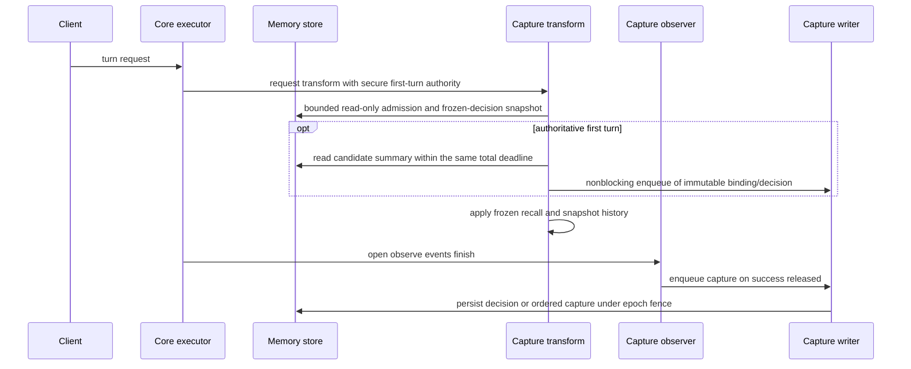
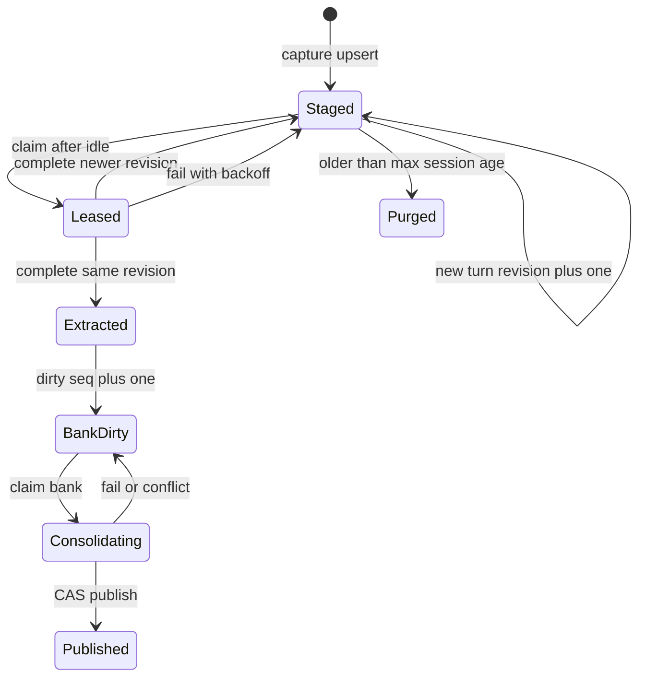

# Design Document: proxy-codex-memory

> Size note: this design deliberately exceeds the 300-line budget, with owner approval recorded in `internal/qa/kirospec/budget.go`. It is written so that a small model can implement each task without re-deriving decisions. Section numbers (§N) are referenced from `tasks.md`.

## Overview

Proxy Memory is a proxy-side re-implementation of OpenAI Codex memory, version 1 (`codex-rs/memories`). It covers learning (capture, then phase 1 extraction, then phase 2 consolidation) and reading (first-turn summary injection plus on-demand memory tools), with Codex's defaults. It adds no improvements. Codex keeps memory in `~/.codex/memories`; this feature keeps it in the proxy's durable database, one **bank** per `(tenant, principal, project)`. Inputs are only traffic that passes through the proxy. The proxy may serve many users, never reads client files, and treats client paths as opaque labels.

- **First consumer**: Codex, Claude Code and OpenCode sessions whose requests carry a project path (the `X-LIP-Workspace` header or their standard environment block), for allowlisted principals.
- **Degradation**: Eligibility, project or storage failure leaves the request fail-open. A missing first-turn snapshot is explicitly diagnosed and never repaired from the current bank on a resumed turn. Background failures keep the last published memory. Capture never touches the response stream.

### Goals
- Strict isolation: every artifact is owner-keyed, and every query carries the owner predicate (Requirement 1).
- Codex version 1 parity for phase 1 and phase 2 prompts, defaults, selection and redaction (Requirements 3–5).
- Once-per-session injection, frozen for the A-leg (Requirement 6).
- `memory_list/read/search/add_note` over MCP, plus list, status and forget controls (Requirements 7, 8).

### Non-Goals
All items in the `requirements.md` Deferred list, notably:
- proxy-executed tools;
- a user-wide layer;
- import;
- skills;
- usage ranking and citations;
- transcript retention after extraction;
- project aliases;
- withdrawing injected memory from running sessions;
- sub-agent classification;
- fairness and quotas;
- encryption at rest and admin plaintext access;
- dashboards.

## Boundary Commitments

### This Spec Owns
- Feature `proxy-memory`: config, eligibility, project derivation, transcript rendering, redaction, prompts and parsers, worker orchestration, the memory service (documents, search, notes, list, status, forget), and counters.
- Persistence family `proxy-memory`: tables, migrations, owner-predicated queries, lease claims, CAS publish, forget fence.
- featurehost composition: process store, collector and bounded first-turn snapshot cache; generation planes (request transform, stream observer), lifecycle, and HTTP handler projection.
- HTTP handler package for `/v1/lip/memory…` (REST and MCP), and its mount.
- Secure first-turn authority projected through the existing request metadata view.

### Out of Boundary
- Authentication and principal resolution (consumed as-is).
- Conversation-view bootstrap/projection semantics (not used for Proxy Memory recall).
- Auxiliary execution, routing, failover, billing and accounting of auxiliary calls (consumed as-is).
- Agents' native memory, client configuration of MCP servers, and all Deferred items.

### Allowed Dependencies
- The feature `internal/plugins/features/proxymemory` may import `pkg/lipapi` and `pkg/lipsdk/...`, the Go stdlib, `gopkg.in/yaml.v3`, and `github.com/prometheus/client_golang/prometheus`. It must **not** import `internal/core/...`, `internal/infra/...` or `internal/standardplugins/...` (archtest closure rule).
- The infra package `internal/infra/proxymemorystore` may import the feature package (types and the `Store` contract), `internal/bunmigrate`, `github.com/uptrace/bun` and its dialects, and the stdlib.
- The HTTP package `internal/stdhttp/proxymemoryhttp` may import the feature package, `pkg/lipsdk/transport/httpauth` and `pkg/lipsdk/scope`.
- featurehost may import all of the above plus `internal/infra/conversationview`.
- Core and `pkg/lipsdk/session` remain provider-neutral; only the validated secure first-turn bit is projected to the existing feature request view.

### Revalidation Triggers
- Changes to secure `BeginResult.IsNew` projection or request-transform ordering relative to `snapshotAndProject`.
- Changes to `response.StreamOutcome` values.
- Changes to `PrincipalScopeView` fields.
- Changes to the `sessionwire` workspace extension keys.
- Changes to `lipapi` message, item or event shapes.

## Architecture

### Seams Reused
| Seam | Use | Requirement |
|---|---|---|
| `lipfeature.PlaneRequestTransforms` | Bounded read-only first-turn recall and request-history snapshot; prepend frozen recall before model I/O | 3.1, 6.1–6.5 |
| `lipfeature.PlaneStreamObserverFactories` | Released assistant output, plus outcome gating | 3.1, 3.4 |
| `featurehost.GenerationInput.BackgroundClient` | Phase 1 and phase 2 auxiliary model calls | 4.1, 4.7, 5.1, 5.8 |
| Continuity Bun DB (`featurehost` `bunDB`) | Borrowed handle for the new tables | 1.5, 1.7 |
| Secure `BeginResult.IsNew` projected through the existing request view | Authoritative first-turn identity; timestamp-derived `SessionView.IsNew` is not used | 2.4, 6.1, 6.5 |
| Auth middleware with `httpauth.ScopeFromContext` | Caller identity for REST and MCP | 7.6, 8.1 |
| `featurehost.HostProjections` → `contract.HTTPOperationsInput` → stdhttp mux | Generation-bound HTTP handler | 7.1, 8.1 |

New seams, each tied to a requirement:
- **One new persistence family**: Requirements 1.5, 4.6 and 5.3 need durable owner-keyed state with leases and CAS. No existing store models user-owned data that outlives A-legs.
- **One new HTTP surface**: Requirements 7 and 8 need a client-authenticated endpoint. Terminal policy is the precedent.
- **One secure-session projection field**: Requirements 2.4 and 6 need the authenticated new-session decision from `BeginResult.IsNew`; timestamp-derived A-leg recency is not authoritative.

### Project Boundary Questions (AIProxer)
- **Core-owned or plugin-owned?** Plugin-owned. Core only projects the secure first-turn bit.
- **New canonical concept?** No. It uses existing `lipapi` content and the steering overlay.
- **Streaming-first preserved?** Yes. Capture observes final events read-only, and there is no buffering or holdback.
- **Provider SDK leakage?** None. Auxiliary calls are canonical calls routed by selector.
- **No retry after first output?** Unchanged. The feature never retries client turns.
- **Secure-session, diagnostics or startup posture?** Startup validation only: the feature refuses enablement without a durable continuity DB or routes.

### Dependency Direction
`pkg/lipapi`, `pkg/lipsdk` → feature `proxymemory` → (`internal/infra/proxymemorystore`, `internal/stdhttp/proxymemoryhttp`) → `internal/standardplugins/featurehost` → `internal/infra/runtimebundle` (consumes only `featurehost.HostProjections` and `contract`) → `internal/stdhttp` (mount). Arrows mean "is imported by". Nothing imports upward.

### Flows





## File Structure Plan

### New Files
**Feature** (`internal/plugins/features/proxymemory/`):
- `doc.go`: package documentation and the isolation contract.
- `config.go`: `ID`, `Config`, `DecodeConfig`, `(Config) Validate`, defaults (§1).
- `owner.go`: `Principal`, `Owner`, `Eligibility`, `CheckEligible` (§2).
- `project.go`: `Project`, `DeriveProject`, `NormalizePath`, `ProjectKey` (§3).
- `redact.go`: `Redact` (§4).
- `transcript.go`: `Entry`, `RenderHistory`, `AssistantAccumulator`, `EncodeTranscript` (§5).
- `truncate.go`: `ApproxTokens`, `TruncateTokens` (§6).
- `prompts.go`: `//go:embed` of templates; `BuildPhase1Request`, `ParsePhase1`, `BuildPhase2Request`, `ParsePhase2`, `RenderInjection` (§7).
- `templates/codex/stage_one_system.md`, `templates/codex/stage_one_input.md`, `templates/codex/consolidation.md`, `templates/codex/read_path.md`, `templates/codex/ad_hoc_instructions.md`: verbatim upstream copies (§7.1).
- `templates/codex/NOTICE.md`: Apache-2.0 attribution (§7.1).
- `templates/proxy_phase2_header.md`, `templates/proxy_phase2_footer.md`, `templates/proxy_read_path.md`: proxy adaptations (§7.3, §7.4).
- `store.go`: the consumer-owned `Store` interface and record types; sentinel errors; `SummaryName` (§8, §7.3).
- `capture.go`: `Capture` (request transform, stream observer factory, pending map, shared bounded queue, writer) (§9).
- `decision_cache.go`: `DecisionCache`, the bounded process-owned cache of immutable first-turn decisions and their durable-write state (§9).
- `worker.go`: `Worker` (lifecycle, tick, phase 1, phase 2, purge) (§10).
- `service.go`: `Service` (list, status, documents, read, search, add note, forget) (§11).
- `metrics.go`: `Metrics`, event constants, `NewPrometheusCollector` (§13).
- `*_test.go`: per-component tests (see Testing Strategy).

**Infra** (`internal/infra/proxymemorystore/`):
- `doc.go`.
- `store.go`: `Store` (a `bun.DB` wrapper), `New`, `EnsureSchema`, and the compile assertion `var _ proxymemory.Store = (*Store)(nil)` (§12).
- `migrations.go`: the migration registry (`var migrations = migrate.NewMigrations()`) and `EnsureSchema` (§12.1).
- `20261016000000_proxy_memory_baseline.go`: registers the baseline migration with the DDL for both dialects (§12.1). The name **must** match `^\d{14}_.*\.go$`, or `internal/archtest` database-parity discovery cannot find the migration root.
- `sessions.go`, `banks.go`, `service_queries.go`, `purge.go`: query implementations (§12.2–§12.6).
- `admission.go`: the admission read, the first-turn commit, the erasure-epoch helpers and the retired-binding maintenance (§12).
- `store_test.go` (SQLite, default) and `store_postgres_test.go` (PostgreSQL-direct, same gating as `internal/infra/conversationview/bun_store_postgres_test.go`).
- `contract_test.go`: a shared contract suite run by both engines.

**HTTP** (`internal/stdhttp/proxymemoryhttp/`):
- `handler.go`: `NewHandler(svc *proxymemory.Service) http.Handler`, with REST routing (§11.2). `NewHandler(nil)` returns nil.
- `mcp.go`: the JSON-RPC 2.0 MCP server (§11.3).
- `handler_test.go`, `mcp_test.go`.

**Composition**:
- `internal/standardplugins/featurehost/proxy_memory.go`: process wiring helpers, `compileProxyMemory`, and request-plane composition (§14).
- `internal/standardplugins/featurehost/proxy_memory_test.go`.
- `internal/stdhttp/proxy_memory_mount.go`: mount when the handler is non-nil (§14.4).

**Docs**:
- `docs/proxy-memory.md`: operator and user guide, covering config, client MCP setup, the forget limits, and "disable native memory" (§16).

### Modified Files
- `pkg/lipsdk/session/view.go`, `internal/core/execctx/submit_views.go`, `internal/core/runtime/executor_prepare_secure.go`: project `BeginResult.IsNew` as authoritative first-turn metadata (§9, §14).
- `internal/standardplugins/featurehost/runtime.go`: process-owned memory store, metrics and first-turn snapshot cache (§14).
- `internal/standardplugins/featurehost/process.go`: construct the store and collector when `bunDB != nil` (§14.2).
- `internal/standardplugins/featurehost/generation.go`: call `compileProxyMemory`, compose bootstraps, append planes, lifecycle and projection (§14.3).
- `internal/standardplugins/featurehost/inputs.go`: `HostProjections.ProxyMemoryHTTP http.Handler`.
- `internal/infra/runtimebundle/compile_generation.go`: copy `hostProjections.ProxyMemoryHTTP` into `HTTPOperationsInput.ProxyMemory`.
- `internal/stdhttp/contract/http_input.go`: `HTTPOperationsInput.ProxyMemory http.Handler`.
- `internal/stdhttp/handler.go`: call `mountProxyMemory(mux, in.Operations.ProxyMemory)` right after `installTerminalDecisionPolicy`.
- `internal/standardplugins/standard_table.go`, `internal/standardplugins/features_install.go`: register `proxymemory.ID` with a validating factory that returns an empty bundle (precedent `featureModelSystemPrompt`).
- `internal/testkit/dbparity/catalog.go`: new component `proxy-memory` (§12.7).
- `internal/testkit/dbparity/catalog_test.go`, `internal/testkit/dbparity/inventory_test.go`: raise the pinned component count from 9 to 10 and add `proxy-memory` to the expected ID lists. Also update the `DefaultCatalog` doc comment ("all 9" becomes "all 10").
- `config.yaml`: a disabled example row (§1.3).

## Components and Interfaces

| Component | Package | Intent | Requirements |
|---|---|---|---|
| Config | `features/proxymemory` | Decode and validate the feature subtree | 1.1, 1.7, 1.8 |
| Eligibility | `features/proxymemory` | Principal allowlist, local and fallback refusal, Origin check, established session | 1.2, 1.3, 1.4, 1.9 |
| ProjectDeriver | `features/proxymemory` | Workspace hint or harness cwd to an opaque key | 2.1, 2.2, 2.3, 2.5 |
| Redactor | `features/proxymemory` | Codex `redact_secrets` port | 3.3, 4.3, 7.5 |
| TranscriptRenderer | `features/proxymemory` | Codex phase 1 item filter and serialization | 3.1, 3.2, 3.6 |
| Prompts | `features/proxymemory` | Build and parse phase 1 and 2 calls; render injection | 4.2, 5.1, 6.1 |
| Capture | `features/proxymemory` | Transform, observer, pending map, queue, writer | 2.4, 3.1–3.7, 8.6 |
| Worker | `features/proxymemory` | Phase 1, phase 2 and purge loop with leases | 4.1–4.8, 5.1–5.8 |
| Service | `features/proxymemory` | Documents, search, notes, list, status, forget | 7.2–7.5, 8.1–8.6 |
| Metrics | `features/proxymemory` | Bounded event counter; content-free logs | 1.6, 2.6, 3.5, 3.6, 5.9, 6.4 |
| MemoryStore | `infra/proxymemorystore` | Owner-predicated persistence, leases, CAS, fence | 1.5, 4.3–4.8, 5.2–5.7, 8.3, 8.6 |
| MemoryHTTP | `stdhttp/proxymemoryhttp` | REST controls and MCP endpoint | 7.1–7.6, 8.1–8.5 |
| Composition | `standardplugins/featurehost`, `stdhttp`, `runtimebundle`, `core/runtime` | Wiring, request-plane composition, prerequisites | 1.6, 1.7, 2.4, 6.1–6.5 |

### §1 Config (`config.go`)
```go
const ID = "proxy-memory"

type Config struct {
	Principals          []string      // required, non-empty; "*" alone means every eligible principal
	AllowLocalPrincipal bool          // default false
	ExtractRoute        string        // required route selector
	ConsolidateRoute    string        // required route selector
	MinIdle             time.Duration // default 6h      (Codex min_rollout_idle_hours)
	RecallTimeout       time.Duration // default 50ms; total request-path admission and recall read budget
	MaxSessionAge       time.Duration // default 240h    (Codex max_rollout_age_days=10)
	MaxUnusedAge        time.Duration // default 720h    (Codex max_unused_days=30)
	MaxRawMemories      int           // default 256     (Codex max_raw_memories_for_consolidation)
	PollInterval        time.Duration // default 5m
	Phase1Batch         int           // default 8: max sessions processed per tick, one claim at a time
	Phase2Batch         int           // default 4: max banks processed per tick, one claim at a time
	Phase1InputTokens   int           // default 150000  (Codex DEFAULT_ROLLOUT_TOKEN_LIMIT)
	Phase2InputTokens   int           // default 150000
	Phase2NoteBytes     int           // default 65536  (notes sent per consolidation)
	SummaryTokens       int           // default 2500    (Codex summary token limit)
	MaxTranscriptBytes  int           // default 8388608 (Codex MAX_ROLLOUT_BYTES)
	Lease               time.Duration // default 1h      (Codex JOB_LEASE_SECONDS)
	RetryBackoff        time.Duration // default 1h      (Codex JOB_RETRY_DELAY_SECONDS)
	AuxTimeout          time.Duration // default 10m
	MaxOutputBytes      int           // default 1048576 (auxiliary result cap)
	MaxNoteBytes        int           // default 8192
	MaxReadBytes        int           // default 65536
	MaxSearchResults    int           // default 50
}
func DecodeConfig(n yaml.Node) (Config, error) // strict: unknown keys rejected; snake_case keys below
func (c Config) Validate() error               // returns a *ConfigError naming the field
```
- **YAML keys** (snake_case, strings for durations parsed with `time.ParseDuration`): `principals`, `allow_local_principal`, `extract_route`, `consolidate_route`, `min_idle`, `recall_timeout`, `max_session_age`, `max_unused_age`, `max_raw_memories`, `poll_interval`, `phase1_batch`, `phase2_batch`, `phase1_input_tokens`, `phase2_input_tokens`, `phase2_note_bytes`, `summary_tokens`, `max_transcript_bytes`, `lease`, `retry_backoff`, `aux_timeout`, `max_output_bytes`, `max_note_bytes`, `max_read_bytes`, `max_search_results`.
- **Validation**:
  - `principals` non-empty; each entry trimmed and non-empty; `"*"` only as the sole entry.
  - `extract_route` and `consolidate_route` non-empty after trim (Requirement 1.8).
  - All durations > 0, and `min_idle < max_session_age`. `recall_timeout` defaults to 50 ms and bounds the complete admission/summary read, including connection-pool acquisition.
  - All ints > 0. `summary_tokens ≤ 4000`, `max_transcript_bytes ≤ 64 MiB`, `aux_timeout < lease`, `max_note_bytes ≤ phase2_note_bytes` (one largest note must fit so deferred notes progress).
  - Do **not** accept a nested `enabled` key. Enablement is the outer registration (precedent `modelsystemprompt.DecodeConfig`).

### §1.3 Config example (added to `config.yaml` and docs, disabled)
```yaml
    - id: proxy-memory
      enabled: false
      config:
        principals: ["alice", "bob"]   # per-user API-key principal IDs; never list a shared key
        extract_route: "openai:gpt-5-mini"
        consolidate_route: "openai:gpt-5"
```

### §2 Eligibility (`owner.go`)
```go
type Principal struct{ TenantID, PrincipalID string }
type Owner struct{ TenantID, PrincipalID, ProjectKey string }

type Ineligible string // bounded reason, used only as a counter label value
const (
	IneligibleUnknownPrincipal Ineligible = "unknown_principal"
	IneligibleInternal         Ineligible = "internal_origin"
	IneligibleFallback         Ineligible = "fallback_principal"
	IneligibleLocal            Ineligible = "local_principal"
	IneligibleNotAllowlisted   Ineligible = "not_allowlisted"
)
// LocalFallbackPrincipalID mirrors internal/core/auth.LocalUnknownOSPrincipalID ("lip_local_unknown").
// The feature cannot import core; featurehost_test asserts the two constants are equal.
const LocalFallbackPrincipalID = "lip_local_unknown"

func CheckEligible(cfg Config, sc scope.PrincipalScopeView) (Principal, Ineligible, bool)
```
Rules, applied in order (Requirements 1.2–1.4):
1. If `!sc.PrincipalID.IsKnown()` or `strings.TrimSpace(sc.PrincipalID.String()) == ""`, the reason is `unknown_principal`.
2. If `sc.Origin == scope.OriginInternal`, the reason is `internal_origin` (Requirement 3.7).
3. If the principal ID equals `LocalFallbackPrincipalID`, the reason is `fallback_principal`.
4. If `sc.SubjectKind == scope.SubjectLocal && !cfg.AllowLocalPrincipal`, the reason is `local_principal`.
5. If the allowlist is not `["*"]` and does not contain the principal ID (exact, case-sensitive), the reason is `not_allowlisted`.
6. Otherwise the request is eligible. `TenantID` is `sc.TenantID.String()` when `sc.TenantID.IsKnown()`, otherwise `""`.

The request-path caller (the capture transform) also requires an **established session** (Requirement 1.9):
```go
func HasSession(v session.SessionView) bool // strings.TrimSpace(v.AuthoritativeSessionID) != "" || strings.TrimSpace(v.ClientSessionHint) != ""
```
If it returns false, count `inject_no_session` or `capture_no_session` and skip. Clients that send neither value get a fresh A-leg on every request, so each request would otherwise become its own "session".

### §3 Project derivation (`project.go`)
```go
type Project struct{ Key, Label string }
func DeriveProject(call *lipapi.Call) (Project, bool)
func NormalizePath(p string) string
func ProjectKey(normalized string) string // hex(sha256("proxy-memory/v1\x00" + normalized))
```
Order (Requirements 2.1, 2.2):
1. **Workspace hint**: for keys `project_dir`, `workspace_path`, `cwd`, `project` in that order (the same order as `sessionwire.existingWorkspaceExtensionKeys` and `connector-support/acp/workspace.go`), if `call.Extensions[key]` decodes as a JSON string that is non-blank, use it.
2. **Instruction line**: scan `call.Instructions`, then `call.Messages` with role system or developer, then `call.Items` of kind message with role system or developer, in order. In each text part, scan the lines. The first line whose `strings.TrimSpace` starts with `Working directory:` or `Primary working directory:` supplies the value after the colon, trimmed.
3. **Codex environment context**: scan user-role text parts in `call.Messages`, then user-role message `call.Items` content parts. The first part whose `strings.TrimSpace(text)` **starts with** `<environment_context>` and contains `<cwd>…</cwd>` supplies the inner text, trimmed. Text that merely contains the tag elsewhere does not count, so rendered transcripts are not mistaken for a live environment block.

**Normalization**:
- Trim the value.
- Replace `\` with `/`.
- Collapse runs of `/` into one.
- Remove a trailing `/` unless the whole value is `/`.

Values that are empty after normalization, longer than 4,096 bytes, not valid UTF-8, or that contain control characters are rejected, and the next source is tried. `Label` is the normalized value; `Key = ProjectKey(Label)`. No filesystem call is ever made (Requirement 2.5).

### §4 Redaction (`redact.go`)
`func Redact(s string) string` applies, in this order, exactly as in Codex `codex-rs/secrets/src/sanitizer.rs`:
1. `(?i:\bBearer)[ \t]+[A-Za-z0-9._~+/-]{16,}=*` → `Bearer [REDACTED_SECRET]`;
2. `sk-[A-Za-z0-9]{20,}` → `[REDACTED_SECRET]`;
3. `\bAKIA[0-9A-Z]{16}\b` → `[REDACTED_SECRET]`;
4. `(?i)\b(api[_-]?key|token|secret|password)\b(\s*[:=]\s*)(["']?)[^\s"']{8,}` → `${1}${2}${3}[REDACTED_SECRET]`.

The regexes are compiled once at package init into package-level `*regexp.Regexp` vars. This is immutable data, which is allowed.

### §5 Transcript rendering (`transcript.go`)
```go
type Entry struct {
	Type      string `json:"type"`                // "message" | "function_call" | "function_call_output"
	Role      string `json:"role,omitempty"`      // "user" | "assistant" (message only)
	Text      string `json:"text,omitempty"`      // message text; parts joined with "\n"
	Name      string `json:"name,omitempty"`      // tool name (call/output)
	CallID    string `json:"call_id,omitempty"`
	Arguments string `json:"arguments,omitempty"` // tool call arguments (raw JSON text)
	Output    string `json:"output,omitempty"`    // tool output text
}
func RenderHistory(call *lipapi.Call) []Entry
type AssistantAccumulator struct{ /* unexported */ }
func (a *AssistantAccumulator) Observe(ev lipapi.Event)
func (a *AssistantAccumulator) Entries() []Entry
func EncodeTranscript(entries []Entry, maxBytes int) (transcript string, truncated bool, err error)
```
**`RenderHistory`** (Codex `should_persist_response_item_for_memories` plus `sanitize_response_item_for_memories`, Requirements 3.1, 3.2):
- **Skip entirely**: `call.Instructions`; messages and items with role `system` or `developer`; reasoning parts and items; compaction, extension and item-reference items.
- **`call.Messages`** (in order), for role `user` and `assistant`:
  - text parts → `Text`, joined with `\n`;
  - `image_ref` → `[image omitted]`; `file_ref` → `[file omitted]`;
  - `PartJSON` with `ToolCallID != ""` → a separate `function_call` entry (`Name=ToolName`, `CallID`, `Arguments=string(Content)`), emitted after the message's text entry;
  - `PartToolResult` → a `function_call_output` entry (`CallID`, `Name`, `Output` = the JSON string value when `Content` is a JSON string, else `string(Content)`).
- **Role `tool` messages** → `function_call_output` entries built from their tool-result parts.
- **`call.Items`** (when `call.HasItemAuthority()`):
  - message items with role user or assistant: text content parts → `Text`; image, file and video content → placeholders;
  - `tool_call` → `function_call` from `ToolCall{CallID, Name, Arguments}`;
  - `tool_result` → `function_call_output` from `ToolResult.Output`, or the text of `ToolResult.Parts`.
- **Fragment filter** (user role only): drop any text part whose trimmed text starts with `# AGENTS.md instructions` and ends with `</INSTRUCTIONS>` (ASCII case-insensitive), or starts with `<skill>` and ends with `</skill>`. A message left with no text and no tool entries is dropped.

**`AssistantAccumulator.Observe`**:
- `EventTextDelta` appends `ev.Delta` to the current assistant text.
- `EventToolCallStarted` opens a call (`ToolCallID`, `ToolName`).
- `EventToolCallArgsDelta` appends `ev.Delta` to that call's arguments.
- `EventItem` with `Item.Kind == tool_call` records the full call.
- Everything else is ignored, including reasoning.
- `Entries()` returns one assistant `message` entry (if the text is non-empty), followed by `function_call` entries in first-seen order.

**`EncodeTranscript`**:
1. Apply `Redact` to every string field and remove NUL bytes (Requirement 3.3).
2. Marshal as a JSON array (`json.Marshal`, compact).
3. If the result exceeds `maxBytes`, drop entries from the **front** until it fits, keeping the newest (Codex reverse scan, Requirement 3.6).
4. If a single remaining entry still exceeds the limit, truncate its longest string field with `TruncateTokens(field, maxBytes/8)`.

The result is always a valid JSON array.

### §6 Token truncation (`truncate.go`)
- `ApproxTokens(s) = (len(s)+3)/4`. This is the Codex byte-per-token approximation.
- `TruncateTokens(s, limit)`:
  - if `ApproxTokens(s) ≤ limit`, return `s`;
  - otherwise keep the first `limit*2` bytes and the last `limit*2` bytes, each adjusted to UTF-8 rune boundaries, joined by `"\n…[" + strconv.Itoa(removedTokens) + " tokens truncated]…\n"`.

### §7 Prompts (`prompts.go`, `templates/`)
#### §7.1 Vendored templates
Copy verbatim from `github.com/openai/codex` at commit `0df4aa67781ae45a3c97befa4db48b734afe46d9`:
- `codex-rs/memories/write/templates/memories/stage_one_system.md` → `templates/codex/stage_one_system.md`;
- `…/memories/stage_one_input.md` → `templates/codex/stage_one_input.md`;
- `…/memories/consolidation.md` → `templates/codex/consolidation.md`;
- `codex-rs/memories/write/templates/extensions/ad_hoc/instructions.md` → `templates/codex/ad_hoc_instructions.md`;
- `codex-rs/ext/memories/templates/memories/read_path.md` → `templates/codex/read_path.md` (reference only; not rendered).

`templates/codex/NOTICE.md` states the source URL, the commit, the Apache-2.0 licence (with its text or link), and that these files are unmodified. Templates are rendered by literal replacement of `{{ name }}` tokens, with `strings.ReplaceAll` per known variable. Unknown `{{ … }}` tokens are left as-is.

#### §7.2 Phase 1
```go
type Phase1Input struct {
	SessionRef  string // "session-" + first 12 hex of sha256(a_leg_id); never the raw A-leg ID
	ProjectLabel string
	Transcript  string // EncodeTranscript output
}
func SessionRef(aLegID string) string // "session-" + first 12 hex chars of sha256(aLegID)
func BuildPhase1Request(cfg Config, in Phase1Input) (auxiliary.Request, error)
type Phase1Output struct{ RawMemory, RolloutSummary, RolloutSlug string }
func ParsePhase1(text string) (Phase1Output, error)
```
- **System message**: `stage_one_system.md`.
- **User message**: `stage_one_input.md`, with `rollout_path` → `SessionRef`, `rollout_cwd` → `ProjectLabel`, and `rollout_contents` → `TruncateTokens(Transcript, cfg.Phase1InputTokens)`.
- **Call**:
  - `Route{Selector: cfg.ExtractRoute}`;
  - `ToolChoice{Mode: lipapi.ToolChoiceNone}`;
  - `Options{ReasoningEffort: "low", ResponseMIMEType: "application/json"}`;
  - `call.Validate()` must pass.
- **Request**:
  - `Role: "proxy_memory_phase1"`, `Visibility: "private"`;
  - `SessionMode: auxiliary.SessionModeDetached`;
  - `DisablePlugins: []string{ID, CaptureHandlerID}`, where `CaptureHandlerID = "proxy-memory.capture"`. Suppression matches handler IDs exactly. Capture would skip these calls anyway, because they are `OriginInternal`.
- **`ParsePhase1`**:
  - Strip one surrounding Markdown code fence if present (a ```` ``` ```` or ```` ```json ```` line at the start, ```` ``` ```` at the end).
  - Decode into a struct with `DisallowUnknownFields`. `raw_memory` and `rollout_summary` must be strings, and `rollout_slug` may be a string or null.
  - Reject a blank `rollout_summary`.
  - Apply `Redact` to all three fields, and remove NUL bytes.
  - Slug normalization (Codex `ROLLOUT_SLUG_MAX_LEN = 60`): lowercase; map non-`[a-z0-9]` runs to `-`; trim `-`; cut to 60. An empty slug becomes `session`.

#### §7.3 Phase 2
```go
type Phase2Input struct {
	CurrentSummary, CurrentMemoryMD string
	Extractions []Extraction        // selected, ascending (GeneratedAtMS, ALegID)
	Notes       []Note              // ascending CreatedAtMS
	PreviousNames []string          // bank.ConsolidatedNames
}
type Phase2Output struct{ MemoryMD, MemorySummary string }
func ParsePhase2(text string) (Phase2Output, error)
func SummaryName(e Extraction) string // defined in store.go (task 1.3); time.UnixMilli(e.GeneratedAtMS).UTC().Format("2006-01-02T15-04-05") + "-" + e.SessionRef[8:14] + "-" + e.RolloutSlug
```
**System message** = `proxy_phase2_header.md` + `consolidation.md` (rendered) + `proxy_phase2_footer.md`, where:
- `memory_root` → `memory`;
- `phase2_workspace_diff_file` → `CHANGES`;
- `memory_extensions_folder_structure` → the content of the Codex `EXTENSIONS_FOLDER_STRUCTURE` block with `{{ memory_extensions_root }}` → `memory/extensions`, followed by a line stating that the only extension is `ad_hoc`, whose instructions and notes are provided inline in section `AD-HOC NOTES`;
- `memory_extensions_primary_inputs` → the `EXTENSIONS_PRIMARY_INPUTS` block, same substitution.

Copy both blocks verbatim from `codex-rs/memories/write/src/lib.rs` (`mod prompt_blocks`) into `prompts.go` constants, with an attribution comment.

**`proxy_phase2_header.md`** (proxy-authored, a derived work) says:
- you are running as a single stateless call without tools;
- the memory folder's current files and all inputs are provided inline in the user message as sections;
- you must perform the same consolidation and return the complete new contents of `memory/MEMORY.md` and `memory/memory_summary.md`.

**`proxy_phase2_footer.md`** says:
- the instructions above about reading files, running commands, `git`, deleting files, or creating `skills/` do not apply: skills are not supported, so do not create or reference them;
- return only a JSON object `{"memory_md": "<full MEMORY.md>", "memory_summary": "<full memory_summary.md>"}`;
- `memory_summary` must follow the format rules above, including the first line `v1`;
- if there is nothing to remember, return empty strings.

**User message** = the following sections, in order, each introduced by a line `===== <NAME> =====`:
1. `CURRENT memory/memory_summary.md`;
2. `CURRENT memory/MEMORY.md`;
3. `CHANGES`: lines `added: rollout_summaries/<name>.md` and `removed: rollout_summaries/<name>.md`, computed from `SummaryName` of the consolidation window's extractions versus `PreviousNames` (a document left out of this prompt by the input budget is not reported as removed, and a document that left the window is), plus `notes: <n> new ad-hoc notes`;
4. `memory/raw_memories.md`: Codex format, with `# Raw Memories` and then for each extraction `## Thread \`<SessionRef>\`` followed by its raw memory;
5. `memory/rollout_summaries/`: for each extraction, `--- rollout_summaries/<name>.md ---` followed by `session: <SessionRef>`, `cwd: <ProjectLabel>`, `updated_at: <RFC3339>`, a blank line, then the summary;
6. `AD-HOC NOTES`: the content of `ad_hoc_instructions.md`, then each note as `--- extensions/ad_hoc/notes/<created RFC3339>-<note_id[:8]>.md ---` followed by the note.

**Input budget** (Requirement 5.9; no mid-text cuts):
- Notes are included oldest first, in full, while their total size stays within `cfg.Phase2NoteBytes` (default 65,536). Notes that do not fit are **not sent and not consumed**.
- Extractions are exactly the outstanding (not yet acknowledged) ones, oldest first, as whole raw-memory and rollout-summary pairs, while `ApproxTokens(user message) ≤ cfg.Phase2InputTokens`. Extractions that do not fit are left out of `raw_memories.md` and `rollout_summaries/` and stay outstanding. Every extraction still in the consolidation window keeps its name in `ConsolidatedNames`: a cap or budget omission neither consumes nor deletes the fact that its content was consolidated. §12.5 makes that obligation durable: `PublishBank` advances `consolidated_seq` only when no in-window extraction remains unacknowledged.
- If the message still exceeds the budget with zero extractions, `CURRENT memory/MEMORY.md` is cut with `TruncateTokens` to the remaining budget.
- Any omission or cut counts `phase2_truncated` and logs one Warn record with the counts only.

`BuildPhase2Request` returns the IDs of the notes and the names of the extractions it actually included:
```go
func BuildPhase2Request(cfg Config, in Phase2Input) (req auxiliary.Request, included Phase2Included, err error)
type Phase2Included struct{ NoteIDs, SummaryNames []string; Truncated bool }
```

**Call**: `Route{Selector: cfg.ConsolidateRoute}`, `ReasoningEffort: "medium"`, `ResponseMIMEType: "application/json"`, `ToolChoiceNone`. Request `Role: "proxy_memory_phase2"`; the rest as in phase 1.

**`ParsePhase2`**:
- Fence strip.
- Strict decode of `{memory_md, memory_summary}` (both strings).
- Apply `Redact` to both.
- Remove NUL bytes (`\x00`) from both. Steering validation and PostgreSQL `TEXT` both reject NUL.
- Reject `len(memory_md) > 262144` or `len(memory_summary) > 32768`.

#### §7.4 Injection
`func RenderInjection(cfg Config, summary, scopeID string) string` renders `templates/proxy_read_path.md`. That template is the Codex `read_path.md` structure adapted as follows:
- The decision boundary, quick memory pass (as tool calls), quick-pass budget, verification rules and "answering from memory" rules are kept verbatim except for path wording.
- The layout lists `memory_summary.md` (provided below), `MEMORY.md` (search with `memory_search`, read with `memory_read`) and `rollout_summaries/<name>.md` (read with `memory_read`).
- Every tool call must pass `scope: "{{ memory_scope }}"`.
- Updating memories: only on an explicit user request, call `memory_add_note` once with a short note.
- Drop citations, `rollout_path` JSONL instructions and skills.
- Add: "If the memory tools are not available in this session, use the summary only."
- Keep the `========= MEMORY_SUMMARY BEGINS/ENDS =========` block, with `{{ memory_summary }}` = `TruncateTokens(summary, cfg.SummaryTokens)`.

### §8 Store contract (`store.go`)
```go
var (
	ErrNotFound  = errors.New("proxymemory: not found")
	ErrLeaseLost = errors.New("proxymemory: lease lost")
	ErrInvalid   = errors.New("proxymemory: invalid input") // Service input validation only
)
type SessionCapture struct {
	Owner        Owner
	ProjectLabel string
	ALegID       string
	Transcript   string // redacted JSON array
	ActivityMS, SourceSeq int64
}
type UpsertOutcome int // UpsertStored | UpsertOwnerMismatch | UpsertForgotten | UpsertStale
type ClaimedSession struct {
	Owner Owner; ProjectLabel, ALegID, Transcript string
	Revision, LastActivityMS, SourceSeq int64; LeaseOwner string
}
type Extraction struct {
	Owner Owner; ALegID, SessionRef, RawMemory, RolloutSummary, RolloutSlug string
	SourceUpdatedMS, GeneratedAtMS int64
}
type Note struct{ NoteID, Text string; CreatedAtMS int64 }
type ClaimedBank struct {
	Owner Owner; ProjectLabel string; Version, DirtySeq int64
	MemoryMD, MemorySummary string; ConsolidatedNames []string; LeaseOwner string
}
type Publication struct {
	MemoryMD, MemorySummary string; ConsolidatedNames []string
	ConsumedNoteIDs []string; PublishedAtMS int64
}
type BankStatus struct {
	ScopeID, ProjectLabel string; Version, PublishedAtMS int64
	PendingSessions, Extractions, PendingNotes int
}
type Documents struct {
	MemoryMD, MemorySummary string
	RolloutSummaries map[string]string // key: SummaryName(e)+".md"
	ProjectLabel string
}
type ClaimQuery struct {
	NowMS, IdleBeforeMS, NotBeforeMS, LeaseUntilMS int64; LeaseOwner string; Limit int
}
type Store interface {
	ReadAdmission(ctx context.Context, q AdmissionQuery) (AdmissionSnapshot, error)
	CommitFirstTurn(ctx context.Context, job FirstTurnJob) (bool, error)
	UpsertSession(ctx context.Context, c SessionCapture) (UpsertOutcome, error)
	PublishedSummary(ctx context.Context, o Owner) (summary string, version int64, err error) // ErrNotFound when no bank or empty summary
	ClaimSessions(ctx context.Context, q ClaimQuery) ([]ClaimedSession, error)
	CompleteSession(ctx context.Context, s ClaimedSession, e Extraction) error // ErrLeaseLost
	FailSession(ctx context.Context, s ClaimedSession, retryAtMS int64) error
	ClaimBanks(ctx context.Context, q ClaimQuery) ([]ClaimedBank, error)
	ConsolidationInput(ctx context.Context, b ClaimedBank, sinceMS int64, limit int) (ConsolidationBatch, error)
	PublishBank(ctx context.Context, b ClaimedBank, p Publication) error // ErrLeaseLost; acknowledges only p.Acknowledged
	FailBank(ctx context.Context, b ClaimedBank, retryAtMS int64) error
	Purge(ctx context.Context, nowMS, sessionsBeforeMS, extractionsBeforeMS int64, limit int) (int, error) // fence rows are never purged
	ListBanks(ctx context.Context, p Principal) ([]BankStatus, error)
	BankStatus(ctx context.Context, o Owner) (BankStatus, error) // ErrNotFound
	Documents(ctx context.Context, o Owner) (Documents, error)   // ErrNotFound
	AddNote(ctx context.Context, o Owner, n Note) error          // ErrNotFound when no bank
	Forget(ctx context.Context, o Owner, nowMS int64) error      // ErrNotFound when no bank and no rows
}
```
**Invariant**: every method's SQL includes `tenant_id = ? AND principal_id = ?` (plus `project_key = ?` where scoped), or operates on a row reached by primary key **and** re-checks the owner columns or the lease owner. `ScopeID` equals `Owner.ProjectKey`.
### §9 Capture (`capture.go`)
```go
type Capture struct{ /* cfg, store, metrics, now, logger, pending, queue */ }
func NewCapture(cfg Config, store Store, m *Metrics, now func() time.Time, log *slog.Logger) *Capture
func (c *Capture) Transform() request.Transform                    // ID "proxy-memory.capture", Order 1000, FailOpen
func (c *Capture) ObserverFactory() response.StreamObserverFactory // ID "proxy-memory.capture", Order 1000, FailOpen
func (c *Capture) Start(ctx context.Context) error                 // starts the single writer goroutine
func (c *Capture) Stop(ctx context.Context) error                  // closes `done` (never the queue); waits for the writer or ctx
```
- **Request transform**: use `RequestMeta.Session.AuthoritativeFirstTurn`, populated only from secure `BeginResult.IsNew`; never use timestamp-derived `SessionView.IsNew` as authority. Skip ineligible and sessionless requests. In one read-only `Store.ReadAdmission` call, read active A-leg state, the immutable binding and saved first-turn decision (when present), `a_legs.next_b_seq`, and the applicable owner/project erasure epoch. Only an authoritative first turn may derive a candidate project or read its published summary. A resumed request may use a cached project only to validate that cache entry's epoch; it must not derive or reread a summary. The `recall_timeout` deadline starts before the store call and covers pool acquisition and every query. On read failure, fail open with an unavailable-decision diagnostic; do not start a goroutine or enqueue a write without an observed epoch.
- **Frozen decision**: use an already persisted decision first, then a matching process-cache snapshot. An authoritative first turn with no decision freezes exactly one of `matched` (the bounded rendered injection and summary version), `no_summary`, `no_project` or `unavailable`. Cache it immediately and enqueue a `FirstTurnJob` before returning. The writer persists the binding and decision only if owner, active A-leg, project and erasure epoch still match and the decision is still unset. The decision's eligibility is settled before the request is mutated: a decision the bounded queue refused is dropped before it can become durable, so it authorizes neither an injection nor a transcript capture, and the request continues without recall; a decision whose durable write failed is in its terminal failed state and is never replayed on a later request. A resumed request with no authoritative decision omits recall and counts `inject_decision_unavailable`; it never reads the current bank to fill the gap.
- **Injection**: mutate the model-bound canonical call in this transform. For legacy authority, prepend the system instruction. When `Items != nil`, prepend one system message item in `Items`, preserve all existing item order and `PreviousResponseID`, and do not set `Instructions` or `Messages`.
- **Capture admission**: map the read-only `next_b_seq` snapshot to a positive source sequence (`max(1, next_b_seq+1)`). This sequence is the only order authority; completion time is used only for idle activity. Equal snapshots are ambiguous and the monotone store CAS accepts at most one; lower-order late completions are stale and dropped without reread/retry. Successful release advances activity even when its content loses the source-sequence CAS.
- **Foreground boundary**: no request-path binding write, bootstrap commit, queue-capacity wait or writer completion wait is permitted, and the store contract has no synchronous binding or capture-reservation write at all. Queue overflow, write failure, timeout, unavailable decision, epoch mismatch, stale order and retired-A-leg rejection are content-free and observable; nothing claims durability for work that is not committed.
- **Pending map**: mutex-guarded `map[string]pendingTurn`, cap 1,024. On insert at the cap, evict the oldest by `at` and count `capture_dropped_pending`. Entries older than 10 minutes are evicted on each insert.
- **`ObserverFactory.Open(ctx, meta)`**:
  - **Look up without removing** `pending[meta.TraceID+"\x00"+meta.ALegID]`. If it is absent, return a no-op observer.
  - Otherwise return an observer holding a copy of the pending turn and a fresh `AssistantAccumulator`.
  - Every B-leg of the turn (retry, failover, parallel branch) gets its own observer over the same pending turn. Losers and failed attempts finish with `OutcomeFailed`, `OutcomeCancelled`, `OutcomeClosed`, `OutcomeReplaced` or `OutcomeGateReplaced`, and record nothing (Requirement 3.4). Their observers simply drop their accumulator.
  - The pending entry is deleted only when an observer finishes with `OutcomeSuccessReleased`. Entries for turns that never succeed are removed by the 10-minute TTL.
- **`Finish(ctx, OutcomeSuccessReleased)`**:
  - Build `captureJob{owner, label, aLegID, entries: slices.Concat(pending.entries, acc.Entries()), activityMS: now().UnixMilli(), sourceSeq: pending.sourceSeq}`. Completion time schedules idleness only; it never replaces the admission order. The entries hold string references only, with no encoding, so this costs O(entries).
  - Delete the pending entry.
  - Send without blocking: `select { case <-c.done: /* stopped */ ; case c.queue <- job: ; default: count capture_dropped_queue; log Warn "proxy-memory capture dropped" (no content) }`. The queue channel is **never closed**, so a late `Finish` cannot panic (Requirement 3.5).
  - Return nil. `Observe` never returns an error and never blocks.
- **Writer** (single goroutine, lifecycle ctx). For each `captureJob`:
  1. `transcript, truncated, err := EncodeTranscript(job.entries, cfg.MaxTranscriptBytes)`. This does the redaction, NUL removal and newest-first truncation **off the request path**. If `truncated`, count `capture_truncated` and log one Warn record with the byte counts only (Requirement 3.6).
  2. Call `store.UpsertSession(ctx, SessionCapture{…, ActivityMS: job.activityMS, SourceSeq: job.sourceSeq})` with a 5 s per-write timeout.

  Outcomes:
  - `UpsertStored` → `capture_recorded`;
  - `UpsertOwnerMismatch` → `capture_owner_mismatch` (Requirement 2.4);
  - `UpsertForgotten` → `capture_forgotten` (Requirement 8.6); `UpsertStale` → `capture_stale` plus a bounded content-free debug diagnostic;
  - error → `capture_error`, with a log entry (no content).

`captureJob` also carries the observed erasure epoch. The writer validates the epoch, immutable binding, active A-leg and Forget fence in the same transaction as `UpsertSession`; it never repairs a stale job by rereading or assigning a new sequence. The bounded queue carries both first-turn decision jobs and successful-release capture jobs, so the decision job is admitted before any capture from that request. Queue overflow is reported as a dropped admission/capture and never delays the request.

  The writer loop is `for { select { case <-done: drain what is already queued until the stop ctx expires; return; case job := <-queue: handle(job) } }`.

### §10 Worker (`worker.go`)
```go
type Worker struct{ /* cfg, store, aux auxiliary.BackgroundClient, metrics, now, log, leaseOwner */ }
func NewWorker(cfg Config, store Store, aux auxiliary.BackgroundClient, m *Metrics, now func() time.Time, log *slog.Logger) *Worker
func (w *Worker) Start(ctx context.Context) error // generates leaseOwner (16 random bytes, hex); starts loop
func (w *Worker) QuiescePhase() bool               // true: stop when the generation retires (precedent keepwarm)
func (w *Worker) SafeUnderCandidateOverlap() bool  // true: leases make overlapping generations safe
func (w *Worker) Stop(ctx context.Context) error  // cancels loop; waits until exit or ctx done
func (w *Worker) Tick(ctx context.Context)        // one iteration; exported for tests
```
**Loop**: `time.NewTicker(cfg.PollInterval)`. The first `Tick` runs **after one `PollInterval`**, never at `Start`, because lifecycles start while the generation is still a candidate that may be rolled back. The worker is its own lifecycle with `QuiescePhase() == true`, so a retired generation stops extracting with stale config (§14.3).

**`Tick`** runs these steps in order:
1. **Purge**: `store.Purge(ctx, now, now-MaxSessionAge, now-MaxUnusedAge, 500)`. Count the result as `phase1_purged` (Requirements 4.8, 5.2).
2. **Phase 1**: repeat up to `Phase1Batch` times. Claim **one** session with `store.ClaimSessions(ClaimQuery{NowMS: now(), IdleBeforeMS: now()-MinIdle, NotBeforeMS: now()-MaxSessionAge, LeaseUntilMS: now()+Lease, LeaseOwner, Limit: 1})`, re-reading `now()` per claim; stop when nothing is claimed; then process it before claiming the next. Each lease (1 h) therefore always exceeds that item's `AuxTimeout` (10 m). Processing:
   1. `req := BuildPhase1Request(cfg, Phase1Input{SessionRef(aLeg), label, transcript})`.
   2. `ctx2 := scope.WithScope(ctx, ownerScope(s.Owner))`, where `ownerScope` = `PrincipalScopeView{SubjectKind: SubjectService, PrincipalID: Known(p), TenantID: Known(t) or Unknown, Origin: OriginInternal}` (Requirement 4.7).
   3. `id, err := aux.SubmitCollect(ctx2, req, SubmitOptions{CoalesceKey: "proxy-memory/p1/" + leaseOwner + "/" + aLeg + "/" + rev, Timeout: AuxTimeout, MaxOutputBytes: MaxOutputBytes})`, then `collected, err := aux.Await(ctx2, id)`, then `aux.Forget(id)`.
   4. If the collection has tool calls, a terminal error, or `ParsePhase1` fails, treat it as a failure.
   5. On success: `store.CompleteSession(s, Extraction{…, GeneratedAtMS: now, SourceUpdatedMS: s.LastActivityMS})`. `ErrLeaseLost` counts `phase1_lease_lost`; otherwise count `phase1_succeeded`.
   6. On failure: `store.FailSession(s, now+RetryBackoff)` and count `phase1_failed` (Requirement 4.5).
3. **Phase 2**: repeat up to `Phase2Batch` times: claim **one** bank (`Limit: 1`), then process it:
   1. `batch := store.ConsolidationInput(b, now-MaxUnusedAge, MaxRawMemories)`: `batch.Extractions` are the outstanding extractions, oldest first, and `batch.WindowNames` every in-window name.
   2. If `Extractions` and `Notes` are empty: `PublishBank` with the retained identity set, then count `phase2_published_empty` (Requirement 5.6).
   3. Otherwise build with `BuildPhase2Request`, which returns `included` (the oldest prefix of the outstanding batch), and submit as in phase 1 (CoalesceKey `proxy-memory/p2/<leaseOwner>/<projectKey>/<dirtySeq>`), then `ParsePhase2`. If `included.Truncated`, count `phase2_truncated`.
   4. On success, `PublishBank` with `ConsolidatedNames` = the included names plus the previously consolidated names still in `batch.WindowNames`, `ConsumedNoteIDs = included.NoteIDs`, `Acknowledged` = the carried extraction revisions and `WindowSinceMS` = the read window. An omitted outstanding extraction refuses the attempt. Count `phase2_published`, or `phase2_lease_lost` on `ErrLeaseLost`.
   5. On failure: `FailBank(b, now+RetryBackoff)` and count `phase2_failed` (Requirement 5.5).

A `Tick` never panics outward: recover, count `worker_panic`, and log. Each claimed attempt bounds preparation, queue wait and execution to `min(AuxTimeout, remaining lease minus a small settlement reserve)`. Add optional `auxiliary.SubmitOptions.Deadline time.Time`: zero preserves detached execution semantics; a nonzero absolute deadline bounds queue residence plus execution, and an expired queued job never invokes the runner. The process scheduler owns that deadline independently of parent cancellation; worker `Await` uses the same bound. Existing scheduler workers/pins remain the only async owners; no renewal goroutine or feature branch in core. Verify queued expiry, in-flight cancellation, zero-value compatibility, and worker propagation with deterministic clock/barrier tests.

### §11 Service and HTTP
#### §11.1 Service (`service.go`)
```go
type Service struct{ /* cfg, store, metrics, now */ }
func NewService(cfg Config, store Store, m *Metrics, now func() time.Time) *Service
func (s *Service) Caller(sc scope.PrincipalScopeView) (Principal, bool)  // CheckEligible without a project
func (s *Service) List(ctx context.Context, p Principal) ([]BankStatus, error)
func (s *Service) Status(ctx context.Context, p Principal, scopeID string) (BankStatus, string, error) // status + published summary
func (s *Service) Read(ctx context.Context, p Principal, scopeID, path string, startLine, endLine int) (string, error)
func (s *Service) Search(ctx context.Context, p Principal, scopeID, query string) ([]SearchHit, error)
func (s *Service) Paths(ctx context.Context, p Principal, scopeID string) ([]string, error) // document paths in fixed order
func (s *Service) AddNote(ctx context.Context, p Principal, scopeID, text string) error
func (s *Service) Forget(ctx context.Context, p Principal, scopeID string) error
type SearchHit struct{ Path string; Line int; Text string }
```
- **`scopeID`** must match `^[0-9a-f]{64}$`; otherwise return `ErrNotFound`. The owner is `Owner{p.TenantID, p.PrincipalID, scopeID}`. Every error not owned by the caller maps to `ErrNotFound` (Requirements 7.2, 8.5).
- **Document paths**: `MEMORY.md`, `memory_summary.md`, and `rollout_summaries/<SummaryName>.md` from `Documents.RolloutSummaries`. Any other path returns `ErrNotFound`.
- **`Read`**:
  - Lines are 1-based and inclusive; `0` means unbounded.
  - Output is `"<n>: <line>\n"` per line.
  - The output is cut at `MaxReadBytes` with a final `…[truncated]` line (Requirement 7.3).
- **`Search`**:
  - Case-insensitive substring match of the trimmed query, which must be non-empty and at most 256 bytes.
  - Searches every document in path order, then line order.
  - Stops at `MaxSearchResults`; each hit's `Text` is cut to 400 bytes (Requirement 7.4).
- **`AddNote`**: trim; reject empty text or text over `MaxNoteBytes` with `ErrInvalid`; `Redact`; `NoteID` = 16 random bytes in hex; `store.AddNote` (Requirement 7.5).
- **`Forget`**: `store.Forget(owner, now)`, then count `control_forget` (Requirements 8.3, 8.6).

#### §11.2 REST routes (`internal/stdhttp/proxymemoryhttp/handler.go`)
Mounted at `/v1/lip/memory` and `/v1/lip/memory/`. Caller: `httpauth.ScopeFromContext(r.Context())`, then `svc.Caller`. A missing scope gives **401** `{"error":"unauthenticated"}`. An ineligible caller gives **404** `{"error":"not_found"}`, so the response does not reveal whether memory exists (Requirement 7.6).

| Method and path | Response |
|---|---|
| `GET /v1/lip/memory` | 200 `{"banks":[{"scope","project_label","version","published_at","pending_sessions","extractions","pending_notes"}]}` |
| `GET /v1/lip/memory/{scope}` | 200 `{"scope",…,"memory_summary"}`; 404 when not found |
| `DELETE /v1/lip/memory/{scope}` | 204; 404 when not found |
| `POST /v1/lip/memory/mcp` | MCP (§11.3) |
| other | 405 for an unsupported method, 404 for an unknown path |

JSON bodies are capped at 1 MiB with `http.MaxBytesReader`. Responses use `Content-Type: application/json`. Times are RFC 3339 UTC.

#### §11.3 MCP endpoint (`mcp.go`)
Streamable HTTP transport, JSON response mode only.
- **Transport**:
  - `POST` with a body that is a single JSON-RPC 2.0 object. Batches are rejected with error `-32600`.
  - Requests with an `id` get `200 application/json`. Notifications (no `id`, e.g. `notifications/initialized`) get `202` with an empty body.
  - `GET` and `DELETE` return 405.
  - No session ID is issued.
- **Methods**:
  - `initialize`: returns `{"protocolVersion": <the client's requested version if it is "2025-06-18" or "2025-03-26", else "2025-06-18">, "capabilities": {"tools": {}}, "serverInfo": {"name": "aiproxer-memory", "version": "1"}}`.
  - `ping`: returns `{}`.
  - `tools/list`: returns the four tools below.
  - `tools/call`: dispatches by `params.name`.
  - Anything else returns `-32601`.
- **Tools** (input schemas are JSON Schema objects; `scope` is a required string on all):
  - `memory_list {scope}` lists the document paths, one per line.
  - `memory_read {scope, path, start_line?, end_line?}` maps to `Service.Read`.
  - `memory_search {scope, query}` returns hits as `path:line: text` lines, or `no matches`.
  - `memory_add_note {scope, note}` returns `saved`.
- **Results**: `{"content":[{"type":"text","text":…}],"isError":false}`. Service errors return `isError: true` with text `not found` or `invalid input`. Unknown tools return `-32602`.
- Each successful tool call counts `tool_call`.

### §12 Persistence (`internal/infra/proxymemorystore`)
#### §12.1 Schema
`EnsureSchema(ctx, db)` uses `bunmigrate.Migrate` with `bun_proxy_memory_migrations` and one baseline `20261016000000`. The baseline creates the session bindings, sessions, extractions, notes, banks, fence, owner-scoped erasure epochs and the extraction ledger `(a_leg_id TEXT PRIMARY KEY, tenant_id TEXT NOT NULL, principal_id TEXT NOT NULL, project_key TEXT NOT NULL, recorded_at_ms BIGINT NOT NULL, source_activity_ms BIGINT NOT NULL, last_activity_ms BIGINT NOT NULL DEFAULT 0, source_seq BIGINT NOT NULL)` with owner index; completion records the claimed sequence and exact activity atomically, and purge retains the ledger. `source_activity_ms` is the exact activity of the extracted source and never changes meaning; `last_activity_ms` is the separate, monotone activity watermark of the A-leg: a successful release advances it even when the extraction already deleted the session row, so a stale release or a regressed clock can never make the session idle-eligible before its newest release. The binding row also carries the frozen first-turn decision: `first_turn_outcome TEXT NOT NULL DEFAULT ''`, `first_turn_injection TEXT NOT NULL DEFAULT ''`, `first_turn_summary_version BIGINT NOT NULL DEFAULT 0` and `first_turn_epoch BIGINT NOT NULL DEFAULT 0`. The erasure epoch table is `proxy_memory_erasure_epochs(tenant_id TEXT NOT NULL, principal_id TEXT NOT NULL, project_key TEXT NOT NULL, epoch BIGINT NOT NULL, PRIMARY KEY (tenant_id, principal_id, project_key))`. Bindings survive retention and never relabel. This feature is unshipped, so one baseline is the whole schema: no compatibility migration or heuristic reconstruction. Timestamps use unix milliseconds; source sequences are counters, not timestamps.
```sql
CREATE TABLE IF NOT EXISTS proxy_memory_sessions (
 a_leg_id TEXT PRIMARY KEY, tenant_id TEXT NOT NULL, principal_id TEXT NOT NULL, project_key TEXT NOT NULL,
 project_label TEXT NOT NULL, transcript TEXT NOT NULL, revision BIGINT NOT NULL,
  last_activity_ms BIGINT NOT NULL, source_seq BIGINT NOT NULL, lease_owner TEXT NOT NULL DEFAULT '', lease_until_ms BIGINT NOT NULL DEFAULT 0,
 attempts INTEGER NOT NULL DEFAULT 0, next_attempt_ms BIGINT NOT NULL DEFAULT 0);
CREATE INDEX IF NOT EXISTS proxy_memory_sessions_owner ON proxy_memory_sessions(tenant_id, principal_id, project_key);
CREATE INDEX IF NOT EXISTS proxy_memory_sessions_activity ON proxy_memory_sessions(last_activity_ms);
CREATE TABLE IF NOT EXISTS proxy_memory_extractions (
 a_leg_id TEXT PRIMARY KEY, tenant_id TEXT NOT NULL, principal_id TEXT NOT NULL, project_key TEXT NOT NULL,
 session_ref TEXT NOT NULL, raw_memory TEXT NOT NULL, rollout_summary TEXT NOT NULL, rollout_slug TEXT NOT NULL,
  source_updated_ms BIGINT NOT NULL, source_seq BIGINT NOT NULL DEFAULT 0, generated_at_ms BIGINT NOT NULL);
CREATE INDEX IF NOT EXISTS proxy_memory_extractions_owner ON proxy_memory_extractions(tenant_id, principal_id, project_key, generated_at_ms);
CREATE TABLE IF NOT EXISTS proxy_memory_notes (
 note_id TEXT PRIMARY KEY, tenant_id TEXT NOT NULL, principal_id TEXT NOT NULL, project_key TEXT NOT NULL,
 note TEXT NOT NULL, created_at_ms BIGINT NOT NULL);
CREATE INDEX IF NOT EXISTS proxy_memory_notes_owner ON proxy_memory_notes(tenant_id, principal_id, project_key, created_at_ms);
CREATE TABLE IF NOT EXISTS proxy_memory_banks (
 tenant_id TEXT NOT NULL, principal_id TEXT NOT NULL, project_key TEXT NOT NULL, project_label TEXT NOT NULL,
 version BIGINT NOT NULL DEFAULT 0, memory_md TEXT NOT NULL DEFAULT '', memory_summary TEXT NOT NULL DEFAULT '',
 published_at_ms BIGINT NOT NULL DEFAULT 0, consolidated_names TEXT NOT NULL DEFAULT '[]',
 dirty_seq BIGINT NOT NULL DEFAULT 0, consolidated_seq BIGINT NOT NULL DEFAULT 0,
 lease_owner TEXT NOT NULL DEFAULT '', lease_until_ms BIGINT NOT NULL DEFAULT 0,
 attempts INTEGER NOT NULL DEFAULT 0, next_attempt_ms BIGINT NOT NULL DEFAULT 0,
 PRIMARY KEY (tenant_id, principal_id, project_key));
CREATE TABLE IF NOT EXISTS proxy_memory_fence (
 a_leg_id TEXT PRIMARY KEY, tenant_id TEXT NOT NULL, principal_id TEXT NOT NULL, forgotten_at_ms BIGINT NOT NULL);
```
There are no foreign keys to `a_legs`: memory outlives A-leg retirement.
#### Admission read and first-turn commit
- **`ReadAdmission`** (one read-only repeatable-read transaction, bounded by the caller's single deadline):
   1. `SELECT next_b_seq FROM a_legs WHERE a_leg_id = ?`. A missing row is `ErrNotFound`.
   2. `SELECT … FROM proxy_memory_session_bindings WHERE a_leg_id = ?`. A binding of another owner is `ErrNotFound`; no binding is not an error.
   3. The project is the persisted binding, or — only for an authoritative first turn — the derived candidate, or the process-cached project for a replayed decision. A resumed request with neither has no project authority.
   4. `SELECT epoch FROM proxy_memory_erasure_epochs WHERE <owner>`. An absent epoch is zero.
   5. A persisted decision is returned only when its recorded epoch equals the observed epoch.
   6. Only an authoritative first turn without a persisted decision reads the candidate bank's published summary and version. A failed summary read is reported as unavailable, never as an empty summary.
- **`CommitFirstTurn`** (one transaction):
   1. Create a missing zero epoch row, then lock and read the owner-scoped epoch. A different epoch than the job's drops the job.
   2. Read the authoritative `a_legs` row; a retired A-leg drops the job. The read is not a row lock: memory is advisory, and locking a mandatory core row would serialize memory writes against core continuity writes.
   3. `SELECT 1 FROM proxy_memory_fence WHERE a_leg_id = ?`; a fenced A-leg drops the job.
   4. Upsert the binding with the frozen decision. An existing decision of the same owner, project and epoch is never overwritten: a matching decision is durable success and a different one is dropped. A conflicting binding insert is re-read once and compared, never replaced.

#### §12.2 `UpsertSession` (one transaction)
1. Create or lock the owner-scoped erasure epoch and read it; a capture whose observed epoch differs is stale and is dropped. The epoch lock is the transaction's first statement, so a deferred read-then-write transaction owns its write lock before it reads.
2. `SELECT 1 FROM proxy_memory_fence WHERE a_leg_id = ?`. If a row exists, return `UpsertForgotten`.
3. Read the durable first-turn binding of the A-leg: a binding with a different owner returns `UpsertOwnerMismatch`; a missing binding, an empty decision, or a decision epoch that differs from the current erasure epoch returns `UpsertUnbound` — the capture is dropped, never repaired, because a binding that does not exist cannot be reconstructed from a capture. The A-leg's liveness and next B-leg sequence are read from the **core** database through the narrow `CoreALegs` view **before** this transaction starts, because the memory database is isolated from the core one and a memory transaction must never hold a core connection.
4. `SELECT tenant_id, principal_id, project_key FROM proxy_memory_extractions WHERE a_leg_id = ?`. If a row exists with a different owner, return `UpsertOwnerMismatch` (Requirement 2.4). This keeps an A-leg in its first bank even after its session row was deleted by a successful extraction.
5. `SourceSeq` is the positive per-A-leg admission order observed by the request transform as `a_legs.next_b_seq + 1` from the same read-only snapshot that admitted the turn. It is not a response timestamp and not a worker-queue order. Overlapping snapshots are ambiguous: the monotone session/extraction CAS accepts at most one and drops the conflicting capture without reread or retry. It orders accepted requests, not arbitrary client forks by inferred transcript richness. Response clocks determine idle scheduling only. Probe live session and ledger: owner mismatch returns `UpsertOwnerMismatch`; a sequence not strictly newer than either returns `UpsertStale`. Otherwise run:
```sql
INSERT INTO proxy_memory_sessions (a_leg_id, tenant_id, principal_id, project_key, project_label, transcript, revision, last_activity_ms, source_seq)
VALUES (?,?,?,?,?,?,1,?,?)
ON CONFLICT (a_leg_id) DO UPDATE SET transcript = excluded.transcript,
  revision = proxy_memory_sessions.revision + 1, last_activity_ms = CASE WHEN proxy_memory_sessions.last_activity_ms > excluded.last_activity_ms THEN proxy_memory_sessions.last_activity_ms ELSE excluded.last_activity_ms END, source_seq = excluded.source_seq,
  attempts = 0, next_attempt_ms = 0
WHERE proxy_memory_sessions.tenant_id = excluded.tenant_id
  AND proxy_memory_sessions.principal_id = excluded.principal_id
  AND proxy_memory_sessions.project_key = excluded.project_key AND proxy_memory_sessions.source_seq < excluded.source_seq
```
   Before content probes, an owner-predicated update advances an existing row's activity on a stale/duplicate successful release only when the timestamp increases, bumping revision without changing transcript/source order or lease; a leased old revision therefore cannot delete that newer activity. The same release advances the durable ledger's monotone activity watermark, so a release that arrives after the extraction deleted the session row still moves the watermark. Accepted newer content preserves the maximum live/recorded source activity despite clock regression. On `RowsAffected == 0`, re-read row/ledger to distinguish owner mismatch from stale sequence. After success re-read the ledger; if covered, remove only matching owner/sequence content. Claims include `SourceSeq`; extraction/ledger publication is sequence-monotone and rejects a mismatched source activity payload. Newer admissions can recreate the session (R3.1, R4.3–4.4).

On PostgreSQL (READ COMMITTED), a concurrent `Forget` can commit between step 2 and step 5, so a just-forgotten A-leg may get a new session row. That row can never become memory, because the epoch check of step 1, the fence check of step 2, `CompleteSession` and `Purge` all refuse it (§12.4, §12.6).

#### §12.3 Claims (`ClaimSessions` repeats up to `Limit` times)
1. Select one candidate:
```sql
SELECT a_leg_id FROM proxy_memory_sessions
WHERE last_activity_ms <= ? /*IdleBeforeMS*/ AND last_activity_ms >= ? /*NotBeforeMS*/
  AND next_attempt_ms <= ? /*NowMS*/ AND (lease_owner = '' OR lease_until_ms < ? /*NowMS*/)
  /* append "AND a_leg_id NOT IN (?, …)" only when the skip list is non-empty: an empty IN () is invalid SQL on PostgreSQL */
ORDER BY last_activity_ms ASC, a_leg_id ASC LIMIT 1
```
   No row ends the loop.
2. Take the lease conditionally:
```sql
UPDATE proxy_memory_sessions SET lease_owner = ?, lease_until_ms = ?, attempts = attempts + 1
WHERE a_leg_id = ? AND (lease_owner = '' OR lease_until_ms < ?) AND last_activity_ms <= ? AND last_activity_ms >= ? AND next_attempt_ms <= ?
RETURNING tenant_id, principal_id, project_key, project_label, transcript, revision, last_activity_ms, source_seq
```
   A returned row is the exact idle transcript/revision/activity leased by this statement; there is no separate post-lease load. No row means another instance won or the candidate left the window: skip it. A newer capture after this atomic snapshot stays pending when the older revision completes (Requirement 4.4).

`ClaimBanks` is the same two-step, with this candidate query:
```sql
SELECT tenant_id, principal_id, project_key FROM proxy_memory_banks
WHERE dirty_seq > consolidated_seq AND next_attempt_ms <= ? AND (lease_owner = '' OR lease_until_ms < ?)
ORDER BY (dirty_seq - consolidated_seq) DESC, tenant_id, principal_id, project_key LIMIT 1 OFFSET ?
```
`OFFSET` equals the number of lost races in this call. The conditional update is `… WHERE tenant_id=? AND principal_id=? AND project_key=? AND dirty_seq > consolidated_seq AND (lease_owner = '' OR lease_until_ms < ?)`. Bank claims need no `RETURNING`; session claims use it on both supported engines to obtain the coherent transcript snapshot.

#### §12.4 `CompleteSession` (one transaction; PostgreSQL uses `SELECT … FOR UPDATE`)
1. `SELECT revision FROM proxy_memory_sessions WHERE a_leg_id=? AND lease_owner=? AND tenant_id=? AND principal_id=? AND project_key=?` (`FOR UPDATE` on PostgreSQL). No row returns `ErrLeaseLost`; this covers a concurrent forget.
2. `SELECT 1 FROM proxy_memory_fence WHERE a_leg_id=?`. If a row exists, delete the session row and return `ErrLeaseLost` (Requirement 8.6).
3. Upsert into `proxy_memory_extractions`, scoped to the owner:
```sql
INSERT INTO proxy_memory_extractions (...) VALUES (...)
ON CONFLICT (a_leg_id) DO UPDATE SET session_ref=excluded.session_ref, raw_memory=excluded.raw_memory,
  rollout_summary=excluded.rollout_summary, rollout_slug=excluded.rollout_slug,
   source_updated_ms=excluded.source_updated_ms, source_seq=excluded.source_seq, generated_at_ms=excluded.generated_at_ms
WHERE proxy_memory_extractions.tenant_id=excluded.tenant_id AND proxy_memory_extractions.principal_id=excluded.principal_id
   AND proxy_memory_extractions.project_key=excluded.project_key AND proxy_memory_extractions.source_seq <= excluded.source_seq
```
   `RowsAffected == 0` means owner mismatch or stale source: roll back with `ErrLeaseLost`. In the same transaction upsert the owner-scoped ledger's source watermark and recorded time; the watermark cannot decrease, and a rejected ledger update also rolls back. Ledger contains identity/timing metadata, never transcript or memory content.
4. Upsert into `proxy_memory_banks` for the owner: insert with `project_label` and `dirty_seq=1`; on conflict set `dirty_seq = dirty_seq + 1`.
5. `DELETE FROM proxy_memory_sessions WHERE a_leg_id=? AND revision=?` with the claimed revision. If it affects 0 rows (a newer turn arrived), run `UPDATE … SET lease_owner='', lease_until_ms=0, attempts=0, next_attempt_ms=0 WHERE a_leg_id=?` (Requirements 4.3, 4.4).

`FailSession` settles the failure of one claimed revision: `UPDATE … SET lease_owner='', lease_until_ms=0, next_attempt_ms=CASE WHEN revision=? THEN ? ELSE next_attempt_ms END WHERE a_leg_id=? AND lease_owner=? AND tenant_id=? AND principal_id=? AND project_key=?`. The retry gate belongs to the claimed revision: when a newer stored revision is present, the obsolete lease is released and the newer revision keeps its own retry gate, so the failed extraction of an older revision never postpones a newer, healthy transcript.

#### §12.5 `PublishBank` (one transaction)
1. `UPDATE proxy_memory_banks SET version=version+1, memory_md=?, memory_summary=?, published_at_ms=?, consolidated_names=?, lease_owner='', lease_until_ms=0, attempts=0, next_attempt_ms=0 WHERE tenant_id=? AND principal_id=? AND project_key=? AND lease_owner=? AND version=?`; `RowsAffected == 0` returns `ErrLeaseLost` (Requirement 5.3). `consolidated_seq` is unchanged by this statement.
2. Acknowledge carried store-assigned revisions using owner, A-leg, `extraction_revision` and generation time. A replaced revision stays outstanding. Delete only consumed note IDs; residual notes retain #1299's independent transactional `dirty_seq` bump.

When no in-window extraction remains outstanding, a third statement advances `consolidated_seq` to the claimed `DirtySeq` on the exact row this CAS wrote (`… AND lease_owner='' AND version=?`); otherwise the bank stays dirty. `ConsolidationInput` selects `SELECT … FROM proxy_memory_extractions WHERE <owner> AND generated_at_ms >= ? AND consolidated_at_ms = 0 ORDER BY generated_at_ms ASC, a_leg_id ASC LIMIT ?`, the in-window summary names, and all notes for the owner ordered by `created_at_ms`.

#### §12.6 Forget, purge and service queries
- **`Forget`** (one transaction):
   1. Advance the owner-scoped erasure epoch, so a first-turn decision queued before this call fails its epoch check even when its A-leg had no binding to fence.
   2. Fence A-leg IDs from durable project bindings (including admitted sessions without captures), sessions, extractions and extraction ledger, scoped by owner, with `INSERT … SELECT … WHERE <owner> ON CONFLICT DO NOTHING`.
   3. Delete sessions, extractions, notes, banks and ledger rows with `WHERE <owner>`. Scrub the matching bindings before taking the bank lock: clear `project_label`, `first_turn_outcome`, `first_turn_injection`, `first_turn_summary_version` and `first_turn_epoch`, and keep the row as content-free identity — owner columns and project key — so the erased A-leg keeps its fence without keeping the owner's memory text. Permanent fences remain. Session/extraction/binding work precedes bank locks, preserving PostgreSQL lock order.
   4. If every delete affected 0 rows, return `ErrNotFound`.
- **`Purge`**:
  - `DELETE FROM proxy_memory_sessions WHERE last_activity_ms < ?sessionsBefore AND (lease_owner='' OR lease_until_ms < ?nowMS)`.
  - For extractions with `generated_at_ms < ?`: select up to `limit` distinct owners; for each owner in a transaction, delete the expired rows and bump that bank's `dirty_seq`.
  - `DELETE FROM proxy_memory_sessions WHERE a_leg_id IN (SELECT a_leg_id FROM proxy_memory_fence)`, which removes sessions re-created by the race described in §12.2.
  - `DELETE FROM proxy_memory_session_bindings WHERE a_leg_id IN (SELECT b.a_leg_id FROM proxy_memory_session_bindings b LEFT JOIN a_legs a ON a.a_leg_id = b.a_leg_id WHERE a.a_leg_id IS NULL ORDER BY b.a_leg_id LIMIT ?limit)`, the bounded retired-binding maintenance. Only binding metadata is removed; the learned memory of a retired A-leg outlives its retirement.
  - Fence rows are **never** deleted. Each row is about 100 bytes, and keeping them is what makes forget durable: a client that resumes a forgotten A-leg weeks later and resends the old history is still refused (Requirements 8.3, 8.6).
  - Return the total rows deleted.
- **`PublishedSummary`**: `SELECT memory_summary, version FROM proxy_memory_banks WHERE <owner>`. A missing row or an empty summary returns `ErrNotFound`.
- **`ListBanks`**: the banks for `(tenant_id, principal_id)`, with counts from three `COUNT(*)` subqueries scoped by the same owner.
- **`Documents`**: the bank row plus all extractions for the owner; the map key is `SummaryName(e)+".md"`. This uses `proxymemory.SummaryName`, which needs `SessionRef`, `GeneratedAtMS` and `RolloutSlug`. Content is `"session: …\ncwd: <label>\nupdated_at: …\n\n" + rollout_summary`.
- **`AddNote`**:
  1. `SELECT 1` from banks for the owner. A missing bank returns `ErrNotFound`.
  2. Insert the note.
  3. Bump `dirty_seq`.

#### §12.7 dbparity registration
Add a `Component` to `DefaultCatalog()`:
- `ID: "proxy-memory"`;
- `SourceRoots` and `TestPackages`: `internal/infra/proxymemorystore`;
- `StoreContracts`: `internal/plugins/features/proxymemory.Store`;
- `MigrationRoots`: `internal/infra/proxymemorystore`;
- `Capabilities` (`Common`), each with evidence `internal/infra/proxymemorystore/contract_test.go`: `owner-isolated-queries`, `lease-claim-at-most-one`, `cas-publish`, `forget-fence`.

Update the catalog's component count wording only if a test pins it.

### §13 Metrics (`metrics.go`)
`Metrics` holds one `prometheus.CounterVec` named `lip_proxy_memory_events_total` with label `event`. Event values (closed set, constants):
  - injection: `inject_matched`, `inject_no_summary`, `inject_ineligible`, `inject_no_session`, `inject_no_project`, `inject_decision_unavailable`, `inject_dropped_queue`, `inject_decision_dropped`, `inject_error`;
- capture: `capture_recorded`, `capture_no_session`, `capture_dropped_queue`, `capture_dropped_pending`, `capture_truncated`, `capture_owner_mismatch`, `capture_forgotten`, `capture_unbound`, `capture_stale` (refusal counted and content-free debug logged), `capture_error`;
- phase 1: `phase1_succeeded`, `phase1_failed`, `phase1_lease_lost`, `phase1_purged`;
- phase 2: `phase2_published`, `phase2_published_empty`, `phase2_truncated`, `phase2_failed`, `phase2_lease_lost`;
  - other: `tool_call`, `control_forget`, `worker_panic`, `store_unavailable`.
  The injection counters report the **applied** decision, not a committed one: the durable first-turn write happens on the background writer. `inject_dropped_queue` counts a decision the bounded writer queue refused, `inject_decision_dropped` counts a queued decision write the store rejected as stale, and `capture_unbound` counts a capture refused because the A-leg has no durable first-turn binding for its owner. `store_unavailable` counts a **current** storage failure only: a replayed frozen decision never counts there, because the current read succeeded.

`(*Metrics).Inc(event string)` is nil-safe. `NewPrometheusCollector()` returns `*Metrics`, which implements `prometheus.Collector` (precedent `keepwarm.NewPrometheusCollector`).

### §14 Composition
#### §14.1 Core seam
Proxy Memory uses no core bootstrap producer. The pre-existing
`runtime.ConversationBootstrap` port stays owned by `model-system-prompt`.

#### §14.2 Process
The memory store lives in an **isolated** database, never in the continuity database. The composition root owns it: `internal/infra/featuredb` carries the contract and `internal/infra/db` implements it. On SQLite the memory store gets its own file (`sqlite_path`, by default `proxy-memory.db` next to the continuity file), because the continuity database has a single connection and one writer: an advisory memory transaction on the same file would hold the connection the mandatory core path needs. On PostgreSQL it uses the same logical database on a **dedicated** pool, so an advisory write can never starve the mandatory pool. The core facts the store needs (the A-leg's liveness and next B-leg sequence) are read through the narrow `proxymemorystore.CoreALegs` view, **outside** every memory transaction, so a memory transaction never holds a core connection.
In `featurehost/process.go`, the process keeps the core Bun DB handle (`r.coreDB`), the feature database opener (`in.FeatureDatabases`) and one process-owned memory-database pool. Generation reloads reuse a handle by acquisition key and database identity; schema is applied once per identity. Process close publishes a terminal state before stopping dependents and closing owned handles, refusing later acquisition and disposing unpublished, duplicate or schema-failed handles. SQLite configuration resolving to the continuity file, including existing symlink/hardlink aliases, is refused before opening. The isolated feature database is durable: a non-durable SQLite target (the in-memory database) is refused both by the feature configuration validation and by the opener, so an enabled Proxy Memory feature can never run on an ephemeral database.

After the keepwarm collector: `r.proxyMemoryMetrics = proxymemory.NewPrometheusCollector()` and `r.proxyMemoryDecisionCache = proxymemory.NewDecisionCache(...)`; register the collector with `in.MetricsRegistry` when non-nil. With no registry, it stays unregistered but usable. The A-leg retirement callback evicts the retired A-leg's decision-cache entry without waiting for memory SQL. It registers under the core's keyed retirement-observer seam (`b2bua.RetirementObserverProcess`), and the published generation registers its prompt-cache and conversation-view cleanup under `b2bua.RetirementObserverGeneration`: the store composes its observers, so neither registration displaces the other and a candidate that never publishes cannot retarget the active callback. The worker's bounded maintenance removes bindings whose authoritative A-leg row no longer exists. Learned extractions and banks survive A-leg retirement.

#### §14.3 Generation (`proxy_memory.go`)
```go
type proxyMemoryGeneration struct {
	planes     func(lipfeature.FrozenPlaneSet) (lipfeature.FrozenPlaneSet, error)
	lifecycles []lipplugin.Lifecycle // [capture writer (stops at generation Close), worker (QuiescePhase)]
	http       http.Handler
}
func (r *Runtime) compileProxyMemory(in GenerationInput) (proxyMemoryGeneration, error)
```
**`compileProxyMemory`**:
- Find an enabled registration with `ID == proxymemory.ID` or `FactoryKind == proxymemory.ID`. If there is none, return the zero value.
- Decode and validate the config.
- Require the core continuity database (`r.coreDB`), the feature database opener and a process-owned decision cache, and resolve the isolated memory database (applying its schema once per identity). Otherwise return `fmt.Errorf("featurehost: proxy-memory requires a durable SQLite or PostgreSQL continuity store")` (Requirement 1.7). Proxy Memory no longer requires or writes `conversationview.BootstrapStore` state.
- Require `in.BackgroundClient != nil`. Otherwise return an error naming the background auxiliary client.
- Build the store over the isolated memory database and the narrow core A-leg view, then build `Capture` with the shared process decision cache, `Worker`, `Service` with the same cache for Forget invalidation, and `proxymemoryhttp.NewHandler(svc)`.
- `planes`: `cs := p.ToContributions()`; `Contribute(cs, PlaneRequestTransforms, proxymemory.ID, []request.Transform{capture.Transform()})`; `Contribute(cs, PlaneStreamObserverFactories, proxymemory.ID, []response.StreamObserverFactory{capture.ObserverFactory()})`; `cs.Freeze()`.
- `lifecycles`: two separate values.
  - `captureLifecycle{capture}`: `Start` = `capture.Start`, `Stop` = `capture.Stop`. `SafeUnderCandidateOverlap() == true`, no `QuiescePhase`, so it stops only at generation Close and in-flight turns of a retiring generation can still be captured.
  - `*Worker`: `QuiescePhase() == true` and `SafeUnderCandidateOverlap() == true`, so it stops when the generation is retired. Precedent: `keepwarmGenerationLifecycle` in `featurehost/keepwarm.go`.
- Background submits from the worker goroutine carry no generation pin. `Worker.Stop` cancels its loop ctx, and an in-flight `Await` returns `ctx.Err()`, followed by `aux.Forget(id)`. A detached job that is still running may finish in the scheduler, but its result is discarded. This is acceptable because nothing is persisted without the worker's `CompleteSession` or `PublishBank`.

**Request transform and lifecycle**: the generation contributes `capture.Transform()` and `capture.ObserverFactory()` to their existing planes. It does not produce a `ConversationBootstrap`; the generic model-system-prompt bootstrap remains composed as before. `Capture.Handle` performs the bounded read-only admission snapshot and, only for secure `AuthoritativeFirstTurn`, freezes a decision from the summary in that same snapshot. It applies the exact frozen injection before upstream I/O, records history only when an owner/project binding is available, and nonblockingly enqueues the immutable first-turn job before returning. The cached decision state is monotone: a consumer failure is terminal, so the producer's publication mark can never resurrect a failed decision, and a queue publication is linearized with the writer's shutdown, so a stopped writer admits no further work. The shared writer persists first-turn jobs and successful-release capture jobs in FIFO admission order. `captureLifecycle` starts/stops the writer with generation lifecycle; the decision cache outlives generation reloads with the featurehost process.

In **`CompileGeneration`**:
- `bootstrap, err := r.modelSystemPrompt(in)`; `pm, err := r.compileProxyMemory(in)`. Proxy Memory does not add a bootstrap producer.
- After the session-classifier binding: `if pm.planes != nil { outPlanes, err = pm.planes(outPlanes) }`.
- `outLifecycles = append(outLifecycles, pm.lifecycles...)`.
- `HostProjections.ProxyMemoryHTTP = pm.http`.

#### §14.4 HTTP plumbing
- `contract.HTTPOperationsInput.ProxyMemory http.Handler`.
- `runtimebundle/compile_generation.go` sets `ProxyMemory: cand.operations.hostProjections.ProxyMemoryHTTP`. Verify the field path while implementing; the precedent is `KeepwarmAdmin`.
- `stdhttp/proxy_memory_mount.go`: `func mountProxyMemory(mux *http.ServeMux, h http.Handler) { if h == nil { return }; mux.Handle("/v1/lip/memory", h); mux.Handle("/v1/lip/memory/", h) }`.

#### §14.5 Registration
- `standard_table.go`: add `{ID: proxymemory.ID, Factory: featureProxyMemory}`.
- `features_install.go`: `featureProxyMemory(n)` runs `DecodeConfig` and `Validate`, and returns an empty `FeatureBundle{SchemaVersion: V1}`.

## Error Handling
- **Request path**:
  - The transform and the bootstrap never return errors to core, except that `model-system-prompt` errors keep their behaviour.
  - The observer `Observe` and `Finish` return nil.
  - Every swallowed error is counted and logged with `slog` at Debug for expected outcomes and Warn for store errors. Logs carry only bounded fields: `event`, `reason`, `error_kind`. They never carry paths, principal IDs, A-leg IDs or memory text (Requirement 2.6).
- **Startup and reload**: invalid config or missing prerequisites fail `CompileGeneration`, so the candidate is rejected and the active generation stays (Requirements 1.7, 1.8).
- **Background**:
  - Every failure leaves the persisted state as it was, plus `attempts` and `next_attempt_ms` (Requirements 4.5, 5.5).
  - Lease expiry (1 h) recovers work from crashed instances.
- **HTTP**: 401, 404 or 405 as in §11.2. 500 `{"error":"unavailable"}` for store errors, with a counted `store_unavailable`.

## Security Considerations
- **Isolation**:
  - The owner predicate is in every query (§8 invariant).
  - The scope ID is the project key, which cannot be inverted (SHA-256 with a domain prefix). It is checked together with the caller's principal, so knowing another user's scope ID gives nothing.
  - Not-found and not-owned responses are identical.
- **Origin**: `OriginInternal` requests are ineligible, so memory calls are never captured or injected (Requirement 3.7).
- **Redaction**: Codex patterns on all stored text. This is best effort, as in Codex. The docs say so.
- **Prompt injection**: as in Codex, the stage-one prompt forbids following instructions in transcripts, and memory is presented as possibly stale. No elevated authority is granted.
- **Operators**: the docs warn never to allowlist shared keys, and state that memory is stored in plaintext in the proxy database.

## Testing Strategy
Follows Test Proportionality: table tests for decisions, one integration test per seam, and fail-open tests.
- **Config**: a decode/validate table covering defaults, every required field, the wildcard rules, unknown keys and a nested `enabled`.
- **Eligibility**: a table of the six rule outcomes, plus a featurehost test asserting `LocalFallbackPrincipalID == auth.LocalUnknownOSPrincipalID`.
- **Project**: a table covering hint priority, each harness pattern, start-anchored `<environment_context>` (embedded text is ignored), normalization and rejects.
- **Redact**: one case per Codex pattern, ported from Codex's tests, plus a no-match case.
- **Transcript**: role and item filtering, the AGENTS.md and skill fragment filter, placeholders, tool call and result mapping for both message and item authority, newest-first truncation, and valid JSON.
- **Prompts**: phase 1 and phase 2 requests carry the route, options, `DisablePlugins` and rendered variables; parsers accept fenced and unfenced JSON and reject unknown fields and blank summaries; the injection contains the scope and the truncated summary.
- **Store** (shared contract suite, SQLite by default, PostgreSQL-direct by tag):
  - **Two-principal isolation**: same project path and same A-leg collision attempts across every method.
  - Upsert revision bumps and owner mismatch.
  - Claim at-most-once with two lease owners.
  - Complete versus newer revision.
  - CAS publish conflict.
  - Forget plus fence, with a concurrent `CompleteSession` returning `ErrLeaseLost`.
  - Forget erases the persisted first-turn injection, its outcome, version and epoch, and the workspace label, while the binding row keeps only content-free identity; a decision queued before the Forget cannot refill the erased snapshot, and the advanced epoch refuses it.
  - The bounded maintenance removes only bindings whose authoritative A-leg row is gone, keeps the active ones, and leaves the learned memory of a retired A-leg intact.
  - Purge.
- **Capture**: transform plus observer join; failover (first B-leg `OutcomeFailed`, second `OutcomeSuccessReleased`) records exactly one turn; non-success outcomes alone record nothing; full queue counts and logs a drop without blocking; `Finish` after `Stop` does not panic; no-session requests are skipped; the transform does not mutate the call.
- **Worker** (fake `BackgroundClient` and fake clock): no tick at `Start`, idle gating, one claim at a time, success path, invalid JSON leading to backoff, empty bank publish, only included notes consumed, truncation counted, owner scope present on the submit ctx with `OriginInternal`.
- **Service and HTTP**: REST status codes, not-found equivalence across principals, MCP `initialize`, `tools/list` and `tools/call` happy paths and errors, and notifications returning 202.
- **Composition**:
  - **Async first-turn integration**: secure first turns read one bounded admission/summary snapshot, freeze positive and negative decisions locally, then enqueue binding/decision persistence without waiting. Resumed turns replay only a persisted or same-process frozen decision and never reread the bank. Verify missing decision, queue overflow, reload, Forget epoch fencing and owner isolation.
  - **Stalled writer**: with the first-turn persistence blocked, a composed generation still completes the request against a real stub backend, so the memory write never holds inference.
  - **Bounded recall**: a stalled reader consumes no more than the configured total `recall_timeout` budget. The 50 ms default stays a proposal until enabled/disabled concurrent benchmarks on SQLite and fresh-schema PostgreSQL validate it; such measurements do not certify cross-node consistency or remote race safety.
  - Item-authoritative injection preserves the original item order and `PreviousResponseID`, and never also sets legacy instructions.
  - Composite ordering with `model-system-prompt`.
  - Enablement without a DB fails compile.
- **Sentinel**: one end-to-end test through `CompileGeneration`, with an injected fake `BackgroundClient` and clock, a package-local worker hook for a manual `Tick`, and a stub backend:
  1. principal A's Codex-shaped session is captured;
  2. a manual `Tick` with a fake aux client runs extraction and consolidation;
  3. a new Claude-Code-shaped session for A in the same project receives the overlay;
  4. the same flow for principal B with the same path receives nothing.
- **Existing generic rules extended**: the dbparity catalog entry (§12.7). No new archtest or qa rules.

## Requirements Traceability

| Requirement | Components | Sections |
|---|---|---|
| 1.1, 1.7, 1.8 | Config, Composition | §1, §14.3, §14.5 |
| 1.2–1.4, 1.9 | Eligibility | §2 |
| 1.5 | MemoryStore, Service | §8, §12 |
| 1.6 | Metrics, Capture, Composition | §9, §13, §14.3 |
| 2.1–2.3, 2.5 | ProjectDeriver | §3 |
| 2.4 | Capture, MemoryStore | §9, §12.2 |
| 2.6 | all | Error Handling |
| 3.1–3.2, 3.6 | TranscriptRenderer | §5 |
| 3.3 | Redactor | §4 |
| 3.4, 3.5 | Capture | §9 |
| 3.7 | Eligibility | §2 |
| 4.1–4.8 | Worker, Prompts, MemoryStore | §7.2, §10, §12.3–§12.4, §12.6 |
| 5.1–5.9 | Worker, Prompts, MemoryStore | §7.3, §10, §12.5 |
| 6.1–6.5 | Composition, Prompts | §7.4, §14.1, §14.3 |
| 7.1–7.6 | Service, MemoryHTTP | §11 |
| 8.1–8.6 | Service, MemoryHTTP, MemoryStore | §11, §12.6 |

## §16 Documentation
`docs/proxy-memory.md` covers:
- what it does (Codex parity), and its requirements (durable continuity DB, auth with per-user keys);
- the config example (§1.3) with all keys and defaults;
- client setup:
  - `X-LIP-Workspace` is optional;
  - adding the MCP server URL `https://<proxy>/v1/lip/memory/mcp` with the user's API key header in Codex (`[mcp_servers.aiproxer_memory] url=… http_headers=…`), Claude Code (`claude mcp add --transport http …`) and OpenCode (`mcp` remote entry);
- disable native memory in agents;
- the REST controls;
- limits: forget does not withdraw memory already injected into running sessions; redaction is best-effort; memory is stored in plaintext;
- the counter list.
