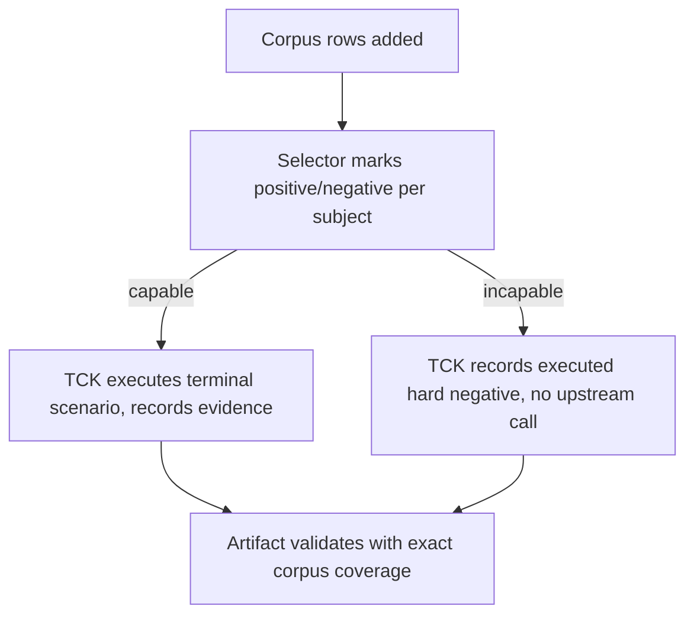

# Design Document

## Overview

Promote the five terminal-semantics concerns into `BaselineScenarioCorpus` as versioned metadata-only scenarios. The connector TCK and backend-family harnesses consume the corpus through the existing selection and certification seams, so terminal coverage is inherited. Subjects without the required capabilities select the new scenarios negative. The test-only matrices keep enforcing per-family behavior on top of the shared corpus IDs.

### Goals

- Five additive corpus scenarios with stable IDs, transports, and capability requirements.
- Connector TCK executes the new scenarios green for capable connectors and records hard negatives otherwise.
- Existing certifications still validate with exact corpus coverage and no new failures.
- Matrices remain the enforcement layer; builders stay in runners; no core import changes.

### Non-Goals

- Cancellation, refusal, empty-turn, error-taxonomy, WebSocket rows, per-connector executable rows, and new feature values remain deferred follow-ups.
- No canonical event, terminal translation, billing, routing, or B2BUA change.

## Boundary Commitments

### This Spec Owns

- Scenario metadata rows in `pkg/lipsdk/contract` and their capability/transport declarations.
- Selection-rule additions in the shared selector and execution branches in the connector TCK runner.
- Traceability from matrix cells to corpus IDs.

### Out of Boundary

- Canonical model (`pkg/lipapi`), adapter translation logic, core orchestration, billing/usage policy.
- Matrix covering tests keep their builders and assertions; this slice only anchors them to corpus IDs.
- Optional executable connectors gain coverage through the shared TCK, not per-connector rows.

### Allowed Dependencies

- Existing `pkg/lipsdk/contract` types, the shared selector, the connector contract test runner, and the in-process TCK harnesses. Standard library only; no new module or dependency.

### Revalidation Triggers

- Re-run connector certification and the corpus schema, selection, and traceability checks whenever corpus rows, selection rules, or TCK evidence assertions change.

## Architecture

### Seams Reused

| Seam | Change | Why no new seam |
| --- | --- | --- |
| `BaselineScenarioCorpus` | Five additive rows | The corpus is the existing shared metadata source |
| Shared scenario selector | Capability gating for the new IDs | Selection already maps capabilities to positive/negative |
| Connector TCK runner | Execute/record branches for the new scenarios | Certification already iterates the full corpus exactly once |
| Matrix registries | Corpus-ID anchors on existing cells | Matrices stay the enforcement layer by design |

### Project Boundary Questions (Go LIP)

- Core-owned or plugin-owned? Neither new: SDK contract metadata plus runner-owned builders; core untouched.
- New canonical concept, or adapter-specific behaviour? Neither: terminal semantics already exist canonically; this slice only names shared certification scenarios.
- Streaming-first path preserved? Yes: streaming-transport scenarios execute over the existing streaming path; no separate non-streaming executor.
- Provider SDK leakage avoided? Yes: the contract package keeps zero provider imports; SDK/wire types stay in backend/connector edges.
- No retry/failover after first client-visible output? Unchanged: scenarios assert terminal outcomes; recovery policy is out of scope.
- Secure-session, diagnostics, or startup-security posture affected? No.

### Flow

## File Structure Plan

### Modified Files

- `pkg/lipsdk/contract/scenarios.go` — five additive scenario rows only.
- `pkg/lipsdk/backendplugin/contracttest/contracttest.go` — execution and evidence branches for the new scenarios.
- `internal/testkit/contract/semantic/features.go` — selection-rule coverage only if the shared selector needs it; otherwise untouched.
- `internal/testkit/contract/frontend/terminal_semantics_matrix_test.go` — corpus-ID anchors on existing cells.
- `internal/testkit/contract/backend/terminal_semantics_matrix_test.go` — corpus-ID anchors on existing cells.

### New Files

- None. Metadata rows extend the existing corpus; builders already live in runners.

## Components and Interfaces

| Component | Package | Intent | Requirements |
|-----------|---------|--------|--------------|
| Terminal corpus rows | `pkg/lipsdk/contract` | Versioned scenario metadata with prerequisites and expected evidence | 1.1, 1.2, 1.3, 1.4 |
| Selection rules | shared selector seam | Capability/transport gating into positive/negative sets | 2.1, 2.2, 2.3, 2.4, 2.5 |
| Connector certification | `pkg/lipsdk/backendplugin/contracttest` | Execute terminal scenarios, record evidence, keep exact coverage | 3.1, 3.2, 3.3, 3.4 |
| Enforcement layer | test-only matrix registries | Per-family covering tests anchored to corpus IDs | 4.1, 4.2, 4.3, 4.4 |

### Scenario rows

| ID | Feature | Transport | Requires |
|----|---------|-----------|----------|
| `terminal-clean-text` | text | http | none |
| `terminal-clean-tool-call` | tools | http | tools capability |
| `terminal-output-limit` | text | http | none |
| `terminal-upstream-error` | errors | streaming | streaming capability |
| `terminal-usage-reported` | usage | streaming | streaming capability |

- IDs are versioned by prefix: future semantic changes add new IDs; existing rows stay byte-identical.
- Feature labels reuse existing values, so no subject's feature matching changes shape.
- Existing feature and transport constants are reused; no new exported contract surface beyond the rows.

## Error Handling

New scenarios fail certification exactly like existing ones: execution failure records a failure entry and invalidates the artifact. Incapable subjects take the established hard-negative path (executed, rejected, no upstream activation), which is not a failure. Missing or duplicate IDs fail the corpus schema check before any runner executes.

## Requirements Traceability

| Requirement | Summary | Components | Interfaces |
|-------------|---------|------------|------------|
| 1.1–1.4 | Versioned corpus rows | Terminal corpus rows | `BaselineScenarioCorpus` rows |
| 2.1–2.5 | Transport and selection rules | Selection rules | Positive/negative sets |
| 3.1–3.4 | Connector TCK inheritance | Connector certification | Certification artifact validation |
| 4.1–4.4 | Matrices stay enforcement | Enforcement layer | Corpus-ID anchors |
