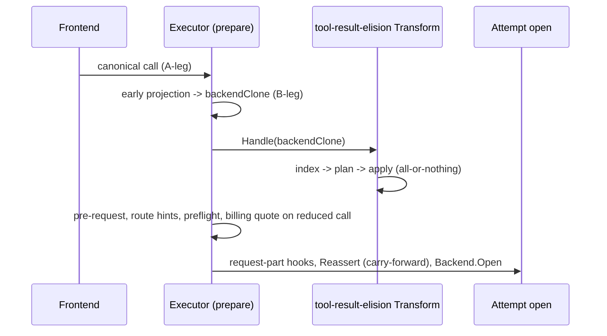

# Design Document: tool-result-elision

## Overview
An opt-in feature plugin removes repeated tool output from the model-bound request. A tool result whose payload is byte-identical to an earlier result of the same tool, still present in the same request, is replaced in place by a short marker naming the earlier call. The client conversation is untouched, and the replacement is lossless because the earlier copy remains readable by the model.

The first consumer is any full-history agent harness (Chat Completions, Anthropic Messages, Responses with full input) on a deployment that enables the `tool-result-elision` row. When the feature cannot decide safely it forwards the result, or the whole request on error, exactly as without the feature.

### Goals
- Fewer model-bound bytes on long sessions with repeated tool output, with unchanged A-leg transcripts and continuation records.
- Decisions are a pure function of history plus configuration: byte-stable across append-only turns, restarts and instances, with no stored state.
- Done: duplicate results outside the protected rounds are elided in batches, steering keeps its position, preflight and billing see the reduced call, and counters are exported.

### Non-Goals
- Every item in the `requirements.md` Deferred list (uneventful class, superseded reads, lossy truncation and coverage caps, retrieve tool, structural-cause publication, admin surfaces, large-payload wire parity, multimodal).

## Boundary Commitments

### This Spec Owns
- Duplicate detection, the protected-round predicate, the batch frontier, marker text and in-place payload replacement for both canonical tool-result shapes.
- The feature's configuration subtree, validation and defaults.
- Four bounded counters and their export.
- A prerequisite in core `conversationprojection`: preserve a proven rewritten after-message boundary when stored identity/occurrence resolution drifts to a different duplicate (3.4), before executor integration.

### Out of Boundary
- A-leg, ingress clone, continuation records, secure-session recording: never touched (the transform receives only the projected B-leg clone).
- Tool calls and arguments, reasoning, compaction, extension and reference items, and any non-tool-result text.
- Conversation-view identity/persistence, exclusion, provenance cleanup and missing-anchor policies; routing, billing and accounting rules (they simply observe the smaller call). Only the narrow Reassert precedence contract below changes.
- Provider-specific behaviour: no backend, model or provider-name branching.

### Allowed Dependencies
- `pkg/lipsdk/request.Transform` and `pkg/lipsdk/feature` planes (`PlaneRequestTransforms`).
- `pkg/lipapi` canonical types and existing tool-call helpers (no new `pkg/lipapi` or `pkg/lipsdk` API).
- `internal/standardplugins` registration and `featurehost` process ownership for the collector; `prometheus.Registerer`.
- Core reuses its own frozen baseline/provenance and structural-lineage machinery; neither core nor the feature imports the other's implementation.

### Revalidation Triggers
- Changes to `conversationprojection.Reassert` carry-forward rules or to where early projection runs relative to `request_wide_shaping`.
- Changes to `lipapi.Part`/`ToolResultItem` tool-result representation, or to item identifiers and references.
- Large-payload eligibility rules for `request_transforms`.

## Architecture

### Seams Reused
- **`request.Transform` at `request_wide_shaping`** (`internal/core/runtime/executor_prepare_secure.go`). It runs once per request on `backendClone` after early conversation-view projection and before pre-request admission, route hints, context estimation, billing quote and per-attempt hooks. That gives B-leg-only scope (1.3), reduced pre-dispatch checks (5.4) and one decision for all candidates (4.2). It is chosen over the per-attempt `RequestPartHook` because the decision must not depend on the candidate and must precede preflight.
- **Conversation-view reassertion carry-forward** (`internal/core/conversationprojection/{reassert,lineage,projection}.go`). Existing structural lineage can distinguish rewritten tool results by stable call identity, but currently a still-resolving stored occurrence wins even at the wrong duplicate. Task 5.1 changes only this request-local conflict precedence (3.4); the contract below applies before task 6. No part-level primitive is added to core.
- **Feature-owned collector registered by `featurehost`** (`internal/standardplugins/featurehost/process.go`, keep-warm precedent) for counters (5.1).
- **Configuration-generation attribution** already wired into the prompt-cache collapse diagnostic (`NoteConfigGeneration`). A delayed-result barrier retiring can also admit multiple batches in one pass; configuration changes are not their only cause. Structural-cause publication remains deferred.

No new seam, plane, store or SDK contract is introduced.

### Project Boundary Questions (AIProxer)
- **Ownership:** elision policy is plugin-owned (`internal/plugins/features/toolresultelision`); generic placement preservation is core-owned (`conversationprojection`, task 5.1); composition registers the row and collector. Core has no elision-specific branch.
- **Canonical concept:** none new. The feature edits existing canonical tool-result payloads.
- **Streaming:** request-side only; the stream path is unaffected.
- **Provider SDK leakage:** none; the feature imports `pkg/lipapi` and `pkg/lipsdk` only.
- **Retry after output:** none; no extra provider calls.
- **Secure-session / diagnostics / startup security:** no secure-session change. Diagnostics are content-free counters only; startup security is unchanged.

### Flow


## File Structure Plan

### New Files
- `internal/plugins/features/toolresultelision/doc.go`: package contract, determinism argument, safety rules.
- `.../toolresultelision/config.go`: `Config`, `DecodeConfig`, defaults, validation, `ID = "tool-result-elision"`.
- `.../toolresultelision/index.go`: pure trajectory index over legacy messages or items, covering tool-call rounds, result locations, resolved tool names and payload views.
- `.../toolresultelision/plan.go`: pure planner, covering duplicate detection, protected rounds and batch frontier → ordered elision list.
- `.../toolresultelision/apply.go`: in-place replacement on a working copy; validates the result; returns a counts summary.
- `.../toolresultelision/marker.go`: deterministic marker rendering and bounds.
- `.../toolresultelision/transform.go`: `request.Transform` implementation (Order, FailOpen) and the counter recorder.
- `.../toolresultelision/metrics.go`: `PrometheusCollector` with closed-enum series.
- `.../toolresultelision/bundle.go`: `FeatureBundle(cfg, recorder)`.
- `config/examples/tool-result-elision.yaml`: disabled-by-default example plus an enabled snippet.

### Modified Files
- `internal/core/conversationprojection/projection.go`: resolve the proven carried-anchor conflict consistently for legacy and item-message placements during Reassert only.
- `internal/core/conversationprojection/reassert.go`, `lineage.go`: align contract comments with the narrow precedence change; retain existing proof/refusal guards.
- `internal/core/conversationprojection/lineage_transform_stable_test.go`: focused duplicate-occurrence regression and revised conflict expectation; reuse existing exact/no-rewrite and refusal coverage.
- `internal/core/runtime/tool_result_elision_integration_test.go`: retain the existing task-6 regression as the first consumer of the prerequisite.
- `internal/standardplugins/standard_table.go`, `features_install.go`: register the row and factory.
- `internal/standardplugins/featurehost/process.go`, `runtime.go` (and its generation binding): construct and register one process-owned collector and hand its recorder to the generation's bundle.
- `internal/plugins/features/README.md`: one short section (enablement, what is elided, what is never touched).

## Components and Interfaces

| Component | Package | Intent | Requirements |
|-----------|---------|--------|--------------|
| Config | `toolresultelision` | Decode, defaults, validation; reject unknown fields | 1.1, 1.4, 4.4 |
| Index | `toolresultelision` | Locate results, rounds, call resolution, payload bytes | 2.4, 3.1 |
| Planner | `toolresultelision` | Duplicates, protection, batch frontier | 2.1, 2.2, 3.1, 3.2, 3.3, 4.1, 4.2, 4.3 |
| Applier + Marker | `toolresultelision` | In-place replacement; deterministic marker | 2.1, 2.3, 2.5 |
| Reassert placement | `conversationprojection` | Proven rewritten boundary wins over duplicate-occurrence drift | 3.4 |
| Transform | `toolresultelision` | Stage handler; all-or-nothing; fail-open | 1.2, 1.3, 5.3, 5.4 |
| Recorder/Collector | `toolresultelision` + `featurehost` | Content-free counters | 5.1, 5.2 |

#### Reassert placement contract (task 5.1 prerequisite)
- **Admissible evidence:** only the caller-supplied request-frozen filtered baseline and matching early after-message provenance (`ResolvedAnchor` equals the stored anchor) may establish lineage. Resolve the stored anchor in that baseline, require a distinguishable anchored slot, and retain the existing whole-trajectory structural proof: authority, partitions, cardinality/order, roles, kinds, ordered part shapes, stable IDs/references and tool identities all remain compatible. For items, compare the anchored frozen descriptor against every other frozen item using the same structural comparator: any match refuses carry-forward. IDs are optional; a unique nonempty ID suffices, but a uniquely distinguishable ID-less shape also qualifies. Payload equality is not the proof.
- **Narrow conflict:** when that proof yields a resolvable current anchor for the original rewritten slot, use it if the stored identity/occurrence now resolves to a different slot. For example, rewriting the second of three content-identical tool results can make stored occurrence 2 select the protected third result; distinct stable call IDs prove the second slot is still the original boundary. Return the effective carried anchor in projection evidence without mutating the snapshot or stored identity.
- **Unchanged paths:** plain `Project` and Reassert without admissible carry-forward retain exact resolution. If exact and carried resolution select the same boundary, keep the stored anchor/evidence. Existing missing-exact carry-forward still works. Stable-prefix placement, same-boundary overlay order/count, exclusions and provenance cleanup remain unchanged.
- **Refusal/ambiguity:** never prefer an ordinal/index merely because lengths match. Insertions, deletions, distinguishable reorders, structural/stable-reference changes, absent frozen evidence, an unresolved original anchor or an indistinguishable anchored slot permit no carried override. Same-shaped legacy slots or ID-less item slots cannot prove which message moved: retain exact resolution if available, otherwise apply the existing configured missing-anchor policy (including fail-closed denial). Unrelated matching descriptors do not veto a distinguishable anchored slot. A derived anchor that cannot resolve is not permission to guess; existing resolution errors and cleanup collision failures remain fail-closed. Do not weaken proof guards to obtain elision success.
- No invented turns, model-authored reordering, store rereads, global identity changes, new public API, or unrelated projection policy changes. This contract does not claim that every payload replacement preserves part shape; the existing structural checks remain authoritative.

#### Planner contract
```go
// BuildPlan is pure: same call + same Config => same ordered []Elision.
func BuildPlan(idx Index, cfg Config) []Elision

type Elision struct {
	Loc         ResultLoc // message/part index or item index
	EarlierCall string    // call ID of the earliest identical result (kept verbatim)
	Bytes       int       // original payload size in bytes
}
```

**Payload identity (owner-authorized F1–F3 repair).** Comparison uses representation tags and length-delimited exact fields, separately from original payload byte count. Legacy Text-only and Content-only results have distinct identities; dual-carrier inputs and auxiliary payload fields are conservatively excluded from both anchors and candidates. Item Output and Parts are distinct representations. Supported Parts are ordered plain `text` parts without auxiliary fields: identity frames count, kind and each Text boundary; payload size sums Text bytes only. Other kinds, auxiliary fields and simultaneous Output/Parts stay verbatim. This preserves fidelity rather than choosing a backend's precedence or claiming concatenation is equality; requirements 2.1/2.3/2.5 are unchanged.

**Call resolution.** The tool name comes from the originating tool call located by call ID in an earlier assistant turn, read from assistant `PartJSON` tool-call parts or `ToolCallItem`s, falling back to the result's own name field only when that located call's own name is empty. An unknown call ID (no earlier call) or a reused call ID (two or more earlier calls) does not identify an origin: the result is ineligible with round zero, and a Round-0 entry never anchors or elides (2.4). If assistant tool-call rounds cannot be recognised for the request shape, the planner returns an empty plan.

**Anchor-side prefix-locality (owner-authorized F6 repair).** An anchor may be named only while its call ID still identifies exactly one earlier call and its retained result at the marker's batch-flush position. The index numbers the trajectory's call and result carrier events and records, per call ID, the order of its first repeat event: a second call registration carrying the ID (including a call with no result), or a second result carrier of it — counting every indexed carrier, ineligible ones (non-text, exact-replay, legacy named orphan results) included. A pending member whose named ID first repeated at or before the flush position is dropped before admission, so the marker's "earlier tool call" reference stays unique (2.1). The flush snapshot includes the batch's own trigger event: an admission that crosses `min_batch_bytes` while being a second carrier of a pending member's named ID disqualifies that member, because the request the marker is published in already contains two carriers. A repeat after the trigger is append-like and leaves that flush unchanged. This never re-anchors the earliest occurrence and never retracts a completed batch (4.1).

**Exact-replay exclusion (2.4).** A result is excluded and counted `skipped_exact` when:
- its item has a non-empty `Item.ID`;
- any `ItemKindItemReference` targets it;
- the call carries an unresolved `PreviousResponseID`. The delta-only case is a no-op: there is no earlier history to deduplicate against.

**Duplicate key.** The key is `(toolName, sha256(framedIdentity))`, with exact identity equality confirmed on hash match. Identity framing is never charged as removed payload. The first occurrence wins and is never elided (2.2). A later occurrence references the **first** occurrence's call ID, so markers never chain.

**Protected rounds (3.1).** Number assistant turns that contain at least one tool call. Results whose originating call belongs to the last `protect_recent_rounds` such turns are protected. Steering and other proxy-injected messages are never tool-call turns, so they cannot shift the window. Protection is a suffix of origin rounds, NOT of result positions: parallel old-round results can arrive after newer-round results. Call occurrence resolution is prefix-local: only calls before the result can identify it, a reused call ID identifies no origin (a conservative no-op that can only under-elide), and assistant output interleaved among a turn's calls — reasoning, assistant commentary — does not split one assistant tool-call round.

**Stable-prefix eligibility (owner-authorized F5 repair).** Let `T = indexed rounds - protect_recent_rounds`. Stop at the first indexed result with `Round > T`, including first occurrences, unique results, and otherwise ineligible results. Only results strictly before this barrier may enter batching; the entire suffix stays verbatim, even delayed old-round duplicates. Inside the prefix, register trustworthy first occurrences without eliding them; apply the existing representation, identity, exact-replay, size, marker and saving gates to later duplicates. Ineligible results inside the prefix do not count toward savings or reset pending savings. No batching beyond a protected gap: its later retirement could insert a candidate before a previous frontier. In ordinary in-order sessions the barrier follows all retired rounds, which remain available for elision.

**Batch frontier (3.2, 3.3).** Scan ALL eligible duplicates in that stable prefix in conversation order, accumulating original payload bytes minus replacement carrier bytes: marker Output for items; marker Text plus JSON-string Content including escaping for legacy. Planner and recorder share this conservative accounting; identity framing is not payload and is never counted as savings. At or above `min_batch_bytes`, first validate the pending members at the flush snapshot (anchor-side prefix-locality above), drop any member whose named ID already repeated at or before the trigger event, recompute the remaining saving from the kept members, and elide the kept batch immediately when it still reaches the threshold; otherwise the kept tail stays pending. Never drop candidates beyond that anchor-validity rule, flush a subthreshold tail, cap a batch, or count safety-ineligible suffix savings. Decisions use bytes, not model tokenizers (4.2).

**Append-only proof (4.1).** For fixed config/authority and true append-only input, old call resolution and round assignments cannot change; round count cannot decrease, so the barrier cannot move left. Every old prefix result was already unprotected. Its identity, earliest anchor, size and nonprotection gates are fixed by its prefix, and so is each anchor's first repeat order: a repeat is a fixed prefix position that later appends cannot move. A later repeat can therefore only block new markers; it never retracts one already completed, and a flush's anchor-validity decision consults only events at or before its trigger event. A later reference cannot disqualify an eligible old result: nonempty provider IDs were already excluded and empty IDs cannot be valid targets. New eligible candidates therefore appear only after the old eligible stream, never inside it. Deterministic accumulation over an unchanged stream prefix reproduces every completed frontier and marker exactly. Only its pending subthreshold tail can combine with newly admitted candidates. This holds for every valid result ordering, not just origin-round order; no persisted state is needed. Rewrites/config changes are separate requirements (4.3/4.4).

#### Marker
`[proxy omitted duplicate tool output: identical to the result of tool call <earlier-call-id> (<N> bytes)]`

- **Inputs:** the earlier call ID and `N` only, with no timestamps, nonces or counters (2.5, 4.1).
- **ID bounds:** the call ID must be at most 128 bytes and printable ASCII. Otherwise the result is forwarded unchanged.
- **Size guard:** after charging all replacement carriers, a candidate must save at least `len(marker)` bytes in addition to meeting `min_result_bytes`.

#### Applier
- Legacy part: keep `Kind`, `ToolCallID` and `ToolName`, set `Text = marker` and `Content = json.Marshal(marker)`. Existing Text-first and JSON-string Content consumers each emit the same marker once without adapter changes. Incoming dual-carrier ambiguity does not apply to this deterministic replacement; each pass plans from original client history.
- Item: keep `Kind`, `ID`, `Status`, `CallID` and `Name`, set `Output = marker` and clear `Parts`.
- No message or item is added, removed or reordered (2.3). Placement preservation (3.4) depends on core's admissible lineage proof and the task-5.1 conflict contract, not on payload-only replacement alone.
- The plan is applied to a clone. The clone is validated with `lipapi.Call.Validate`, and only then is `*call` replaced: all or nothing (5.3).

#### Transform
- `Order` is set high so it runs after other `request.Transform`s that may rewrite tool output; the same input still gives the same output.
- `FailureMode = FailOpen`. On processing/publication error or panic, restore `*call` byte-exactly (including nil/empty representation), record no feature counters, and return a fixed content-free error classification (`processing failed` or `processing panicked`). Never wrap or format the original error/panic. The generic runner logs this bounded classification, counts its existing fail-open skip and continues with the usable original B-leg call (5.3). Handler failure is not request failure; aggregate stage outcome may remain `ok`.
- The disabled row contributes no transform, so request bytes are identical to an absent feature (1.2).

#### Recorder and collector
- Series: `lip_tool_result_elision_results_total{outcome="considered"|"elided"|"skipped_exact"}` and `lip_tool_result_elision_estimated_tokens_saved_total` (bytes saved / 4, rounded down).
- No other labels and no content, IDs or names (5.2).
- The recorder uses atomic counters. With no collector bound (tests, metrics disabled) it is a no-op.

## Error Handling
- **Fail-open at every level.** Ineligible results are forwarded verbatim. Planner or applier errors, validation failure or a panic forward the whole request un-elided. The request never fails because of this feature (5.3).
- **Configuration errors fail closed at load/reload** with a field-named error (1.4). Unknown fields are rejected.
- **Reassert.** A refused proof never overrides exact resolution; if no anchor resolves, the configured anchor-missing policy applies unchanged. Feature fail-open cannot catch a later successful-but-misplaced Reassert. Task 5.1 owns the conflict fix; task 6 must pass without weakening its placement assertion.

## Testing Strategy
- **Core prerequisite:** pin three identical user-role tool results with distinct stable call IDs, rewriting only the middle payload while the last remains exact; steering and effective provenance must remain at the middle boundary. Revise only the opposing conflict case in `TestReassert_ExactResolutionRemainsTheNormalPath`, retaining its unchanged/exact cell. Reuse existing legacy/item carry-forward, ambiguity/reorder/deletion, missing-baseline, stable-prefix, multiple-overlay and never-backend tests; add only a focused counterpart where the shared item-message conflict branch lacks coverage, not a new matrix.
- **Table tests (planner):** duplicate vs distinct payloads; same payload with a different tool; the first occurrence kept; a third copy references the first; protected rounds; batch threshold below and at; non-text, item-ID, item-reference and unresolved-call exclusions; over-long call ID.
- **Property test (planner):** random append-only extensions, where every elision of `H` is an elision of `H'` with identical marker bytes and every earlier byte is unchanged outside new batches (4.1). Re-running on the same input is identical (4.2).
- **Applier tests:** both representations; positions, IDs and pairing unchanged; the validated clone is swapped in; a forced validation failure leaves the call untouched.
- **Integration (executor):** with the feature enabled, the A-leg ingress and continuation record are byte-identical to a disabled run, and the B-leg PTB capture shows markers. Preflight sees the reduced size. A disabled row produces byte-identical B-leg requests. Steering after a tool-result user message is preserved through `Reassert`.
- **Fail-open:** an injected planner panic means the request is forwarded un-elided and the fail-open counter increments.
- **Existing generic rules extended:** standard feature table and inventory tests gain the new row; there is no new architecture rule.

## Configuration
```yaml
plugins:
  features:
    - id: tool-result-elision
      enabled: false               # opt-in
      config:
        protect_recent_rounds: 4   # >=1; tool results from the last N assistant tool-call rounds stay verbatim
        min_result_bytes: 1024     # >=256; smaller results are never elided
        min_batch_bytes: 16384     # >=1; pending savings needed before a batch is applied
```
Defaults apply when keys are omitted; unknown keys are rejected. A configuration change takes effect for requests admitted under the new generation (4.4).
