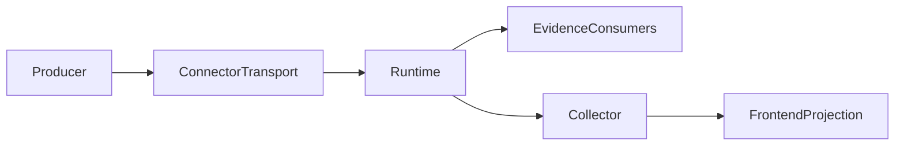

# Technical Design

## Overview

Correct usage interpretation without changing provider evidence or monetary
policy. Existing canonical accumulation selects one client perspective for
the turn; independent cache declarations then drive protocol-specific output.
Claude ACP is the first connector consumer. Unannotated input retains legacy
inclusive semantics, and absent provider totals remain absent in transport.

### Goals
- Resolve the five review findings on PR #1325 with independently reviewable fixes.
- Preserve the established read-exclusion contract and provider quantities.
- Demonstrate real executor output and connector transport, not only a fixed event.

### Non-Goals
- Other ACP connector adoption and shared published-module migration: #1324.
- Historical backfill, monetary policy, persistence, new telemetry, and alternate
  wire/large-body execution redesign are excluded by requirements.md.
- Generalized inclusive-to-Anthropic normalization is not part of this slice.

## Boundary Commitments

### This Spec Owns
- Turn-wide client usage selection in the existing canonical collector.
- Independent input/cache inclusion declarations and transport fidelity.
- OpenAI wire totals and inclusive input projection, with equivalent final
  usage in streaming and non-streaming canonical execution.

### Out of Boundary
- Provider evidence capture, customer settlement/rating policy and accounting
  plane creation remain with their existing owners; no evidence is suppressed
  globally to make frontend totals pass.
- Routing, retries, continuation, cancellation and content release are unchanged.

### Allowed Dependencies
- `pkg/lipapi` retains its existing dependencies and has no provider names in logic.
- `pkg/lipsdk/backendplugin` and the host adapter reuse existing DTO/protobuf seams.
- Frontends depend on canonical interpretation, never a concrete backend.
- Producer annotations remain inside native backend and Claude ACP adapters.
- Tests reuse real executor construction and family encoders; no new test framework.

### Revalidation Triggers
- Public fields/methods require ABI snapshots, consumer compilation and buf checks.
- Selection changes require executor-to-frontend and clone coverage.
- Any need to modify financial policy, add a plane, or alter release/terminal
  ownership stops implementation for renewed scope review.

## Architecture

### Seams Reused
- `Collected.AccumulateUsage` owns frontend aggregation for all four families.
- `ClientVisibleUsage` remains the event-local compatibility accessor; turn-wide
  precedence is collector state, not a provider identity heuristic.
- `UsageAccountingMetadata`, SDK `UsageEvidence` and `AccountingEvidence` carry
  two independent flags. The new write flag is necessary for 1.2: no existing
  field distinguishes read-exclusive/write-inclusive from fully exclusive input.
- Stream/finalizer conversion uses existing adapters. No new pipeline or store.

### Project Boundary Questions
- Selection is provider-neutral canonical behavior, not billing policy.
- Frontends own protocol totals; producers own declarations, not wire projections.
- Streaming remains primary; non-streaming uses the same accumulator.
- No SDK imports enter canonical/core packages and no retry mechanism changes.
- Secure-session event capture remains unchanged; frontend selection does not
  rewrite recorded events or remove provider evidence.

### Delivery Order
1. Prerequisite A from current main: turn-wide precedence and focused executor
   regressions. Independent of new write-exclusion fields and PR #1325 helpers.
2. Prerequisite B from current main: omitted-total preservation in the connector
   bridge. Independent of A and the new fields.
3. Rebase PR #1325 after prerequisite delivery; implement independent declarations,
   finalizer fidelity, producer annotations and protocol corrections there.
   The combined executor/connector/frontend acceptance gate runs on that head.

Approval of this design authorizes neither merge nor implementation by itself.

## File Structure Plan

### Prerequisite A — Existing Files
- `pkg/lipapi/events.go`: perspective selection and private state, no new API.
- `pkg/lipapi/collected_clone.go`: copy selection state.
- `pkg/lipapi/event_stream_test.go`: precedence, zero, ordering and clone cases.
- `internal/core/runtime/executor_token_accounting_stream_test.go`: execute a
  real turn and feed its output to existing frontend encoders; retain assertions
  that both accounting perspectives were emitted before the terminal.

### Prerequisite B — Existing Files
- `pkg/lipsdk/backendplugin/call_bridge.go`: remove missing-total synthesis.
- `pkg/lipsdk/backendplugin/call_bridge_test.go`: presence regressions through
  DTO, protobuf serialization, decode and host-compatible quantities.

### PR #1325 Remediation — Existing Files
- `pkg/lipapi/token_accounting.go`: restore read-only contract; add write flag.
- `pkg/lipapi/events.go`: independent excluded-write correction; retain legacy
  `TotalOrDerived` for protocols requiring their existing total semantics.
- `pkg/lipapi/collected_clone.go`, `pkg/lipapi/event_stream_test.go`: correction
  state and focused projection tests.
- `api/backendplugin/v1/backend.proto`, `api/backendplugin/v1/backend.pb.go`:
  additive flags and pinned regeneration.
- `pkg/lipsdk/backendplugin/types.go`, `convert.go`, `convert_frames.go`,
  `call_bridge.go`, `usage_evidence_bridge.go`: carry independent declarations
  through normal usage, sideband conversion and dedupe fingerprints.
- `internal/infra/backendplugins/adapter/convert.go`, `stream.go`,
  `finalize_billing.go`: restore both declarations on each canonical event.
- `pkg/lipsdk/backendplugin/usage_evidence_cache_read_test.go`,
  `accounting_evidence_cache_read_test.go`, `usage_evidence_bridge_test.go`:
  extend existing round-trip/fingerprint coverage, not a duplicate suite.
- `internal/infra/backendplugins/adapter/convert_usage_test.go`,
  `accounting_evidence_characterization_test.go`: normal/finalizer equivalence.
- `internal/plugins/backends/protocols/anthropicmessages/map_events.go`,
  `map_events_internal_test.go`: native producer explicitly excludes writes.
- `connectors/claudeagentacp/internal/service/engine.go`,
  `usage_semantics_test.go`: set both flags in the existing classified stream;
  remove the extra usage-only stream wrapper introduced by PR #1325.
- `connectors/gitlabduo/internal/service/provider_evidence.go`,
  `connectors/minimexoauth/internal/service/provider_evidence.go`, and
  `connectors/commandcode-anthropic/internal/anthropic/provider_evidence.go`,
  with their existing `provider_evidence_test.go` files: audit actual cache-write
  inclusion, explicitly declare excluded writes, and retain both declarations
  through partial-snapshot merges without changing native quantities.
- `internal/plugins/frontends/openailegacy/encode.go`, `encode_test.go`;
  `internal/plugins/frontends/openairesponses/encode_wire.go`;
  `internal/plugins/frontends/gemini/encode.go`: protocol-specific projections.
- `internal/plugins/frontends/parity/usage_semantics_cross_frontend_test.go`:
  extend the existing fixture for both modes and extension settings.
- `internal/archtest/testdata/backend_plugin_go_abi_baseline.json`: regenerate.
- `.kiro/steering/api-standards.md`: correct the contract introduced by this PR.

### New Files
None required beyond the existing spec documents. Extend existing tests and
helpers rather than adding a standalone framework or source-scanning guard.

## Components and Interfaces

| Component | Package | Intent | Requirements |
|---|---|---|---|
| Inclusion declarations | `pkg/lipapi` | Independent cache relations | 1.1, 1.2, 1.3 |
| Producer annotations | Native Anthropic and audited connectors | Declare actual exclusive shape | 1.4, 2.4 |
| Connector conversion | SDK and host adapter | Preserve metadata and reported presence | 2.1, 2.2, 2.3, 2.4, 5.3 |
| Collector | `pkg/lipapi` | One perspective across the turn | 3.1, 3.2, 3.3, 3.4, 5.2 |
| Frontend projection | Existing family encoders | Protocol-legal final usage | 4.1, 4.2, 4.3, 4.4, 5.1 |

### Inclusion Declarations
- Keep `InputTokensExcludeCacheRead` unchanged: reads alone are excluded.
- Add `InputTokensExcludeCacheWrite bool` with zero meaning writes are included,
  on canonical metadata and both SDK usage/evidence DTOs.
- Add `input_tokens_exclude_cache_write` as field 10 of protobuf `UsageEvidence`
  and field 13 of `AccountingEvidence`; keep read fields 9 and 12 unchanged.
- Each flag crosses normal events, finalization and V1 sideband independently.
  A changed write flag changes the existing sideband fingerprint.
- Native Anthropic and Claude ACP explicitly set both. Audit the existing
  gitlabduo, minimexoauth and commandcode-anthropic read-exclusion producers;
  where writes are also excluded, explicitly declare that relation and preserve
  it through partial snapshots. This bounded migration is owner-approved and
  does not include dependency upgrades or the other ACP adoption in #1324.
  No runtime inference from raw JSON, quantities or identity is permitted.

### Collector State Contract
- Private `clientVisibleUsageSelected` distinguishes selected perspective.
- Before explicit selection, retain the current fallback accumulation behavior.
- A client-visible scope, or top-level client-visible event without scopes,
  selects explicit usage, including explicit zero. Scoped payloads take
  precedence over the event shell; all client-visible delta entries in that
  payload contribute, never the shell or sibling accounting planes.
- On the first explicit selection, clear only usage counters, exclusion
  corrections and usage cost metadata accumulated from fallback. Preserve text,
  tools, warnings, terminal fields and other non-usage state.
- Thereafter ignore fallback quantities and costs. Accumulate explicit
  client-visible deltas, not another accounting plane in the same event.
- Clone/copy retains the selection bit and correction state. Directly populated
  `Collected` values retain legacy fallback interpretation until explicit selection.
- Selection never mutates incoming events or upstream evidence buffers.

### Connector Presence Contract
- Omitted total remains nil with presence false. Explicit zero remains a zero
  pointer with presence true. Nonzero legacy values retain existing `setUsageField`
  compatibility; no broader strict-presence rewrite is introduced.
- Stream and finalizer host conversion copy both flags without altering plane,
  provenance, dedupe keys or native counters.
- Pinned protobuf generation and ABI snapshot updates follow existing commands.
  Additive false defaults do not require a new feature handshake or reject old
  peers. Old peers cannot supply metadata they do not support; no upgraded
  interoperability claim is made for an old host or unannotated connector.

### Frontend Projection Contract
- `Collected.InclusiveInputTokens()` adds only the independently excluded
  read/write quantities accumulated from the selected perspective.
- Chat and Responses set wire total directly to inclusive input plus output.
  Remove `TotalTokensForPrompt` introduced by this unmerged PR rather than
  keeping a public helper with a misleading cross-protocol contract.
- Provider total stays in canonical/provider evidence; do not manufacture output
  or reasoning tokens to make it fit. A total-only event is not upgraded into
  invented input/output: OpenAI wire input/output/total remain zero in that case.
- Gemini uses inclusive prompt and preserves its provider total when that total
  does not fall below the inclusive prompt plus the output; otherwise it reports
  the inclusive prompt plus the output. The Gemini usage metadata defines the
  total as the prompt plus the candidates plus the thoughts plus the tool-use
  prompt tokens, so a total below the prompt would be a protocol-invalid
  payload, while a larger provider total keeps its separately represented
  reasoning tokens. Do not import the OpenAI equality rule.
- Anthropic final usage for the fully exclusive shape retains native counters.
  Initial streaming usage is provisional, not an additional delta to sum with
  final usage; tests decode the final message_delta and verify initial framing.
- Extensions remain opt-in and never control ordinary counter correction.

## Error Handling
No new I/O, errors, goroutines or retry behavior. Missing usage retains current
omission behavior; absent totals remain absent at the evidence boundary. Existing
malformed-counter and overflow validation is unchanged; this slice does not
introduce saturation or invent token quantities to repair malformed providers.

## Testing Strategy
- TDD each slice separately; reproduce pre-existing defects on its main baseline.
- Collector table: fallback only; provider then explicit; explicit then provider;
  explicit zero; multiple client scopes; opposite shell metadata; later deltas;
  clone before/after selection. Assert content and provider events are unchanged.
- Projection table: fully inclusive; read-exclusive/write-inclusive (400 input,
  600 reads, 100 writes => 1000 prompt); both-exclusive (300/600/100 => 1000).
- Connector round-trip: both flags independently, all four combinations,
  omitted/zero/nonzero totals, actual proto marshal/unmarshal and host conversion.
  Extend finalizer tests with the same counters and metadata assertions.
- Reuse the real executor fixture with StreamUsage enabled: verify two emitted
  perspectives, then parse final client usage on four frontends in both modes.
  Assert the reconstructed perspective alone wins; do not merely collect a
  synthetic scope or silently turn reconstruction off.
- Run a second executor configuration without reconstruction to prove provider
  fallback retains inclusive cache accounting. Feed a connector-round-tripped
  event into that fake backend so the ABI and frontend proof connect.
- Place this connector-to-executor integration in the existing adapter-package
  `convert_usage_test.go`, where the real host converter is accessible. Compose
  a small executor with exported `runtime.TestExecutor` and a deterministic
  backend; do not export a converter solely for tests or import private runtime
  test fixtures from another package.
- Keep the family fixture bounded: extensions on/off, unequal provider total,
  missing total, both scoped and unscoped entries. Observe terminal emission and
  parse SSE JSON rather than relying on substring matches or default zero values.
- Focused package/module tests, `make dev-contract-check`, buf contract checks,
  generic ABI gates, and delivery-budget accounting precede readiness claims.
  Remote-only race evidence remains distinct from local non-race results.

## Integration and Review
- Inline design review covers all nineteen criteria and the named file boundaries;
  no new store, accounting plane, extension stage, dependency or registry.
- Target at most 40 changed files per PR and test additions within 5x production
  changes. If proof exceeds that budget, reduce duplicated fixtures or split the
  integration delivery; never waive the budget implicitly.
- Standalone connectors cannot drop local replacements until a compatible root
  release exists. No dependency upgrade or root release is included here.
- Design and its three-producer migration amendment are approved. Task approval
  and implementation authorization remain separate gates.
