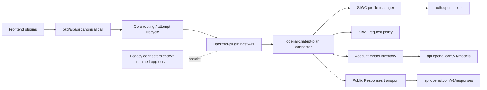
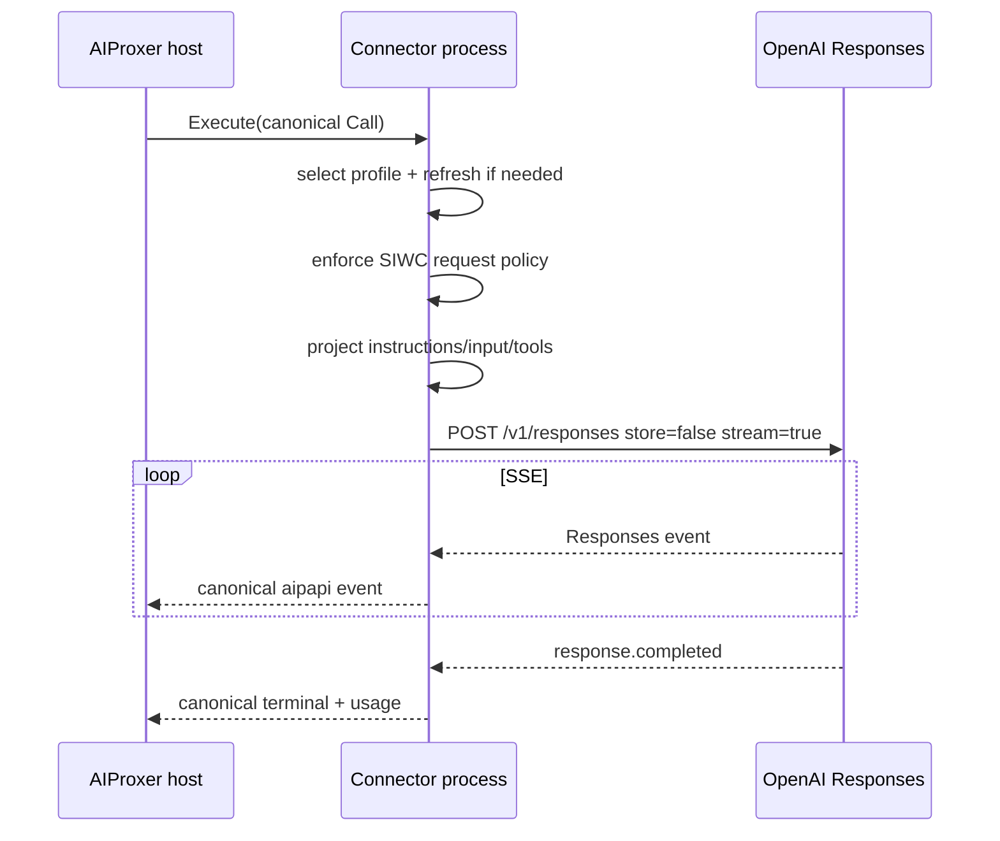
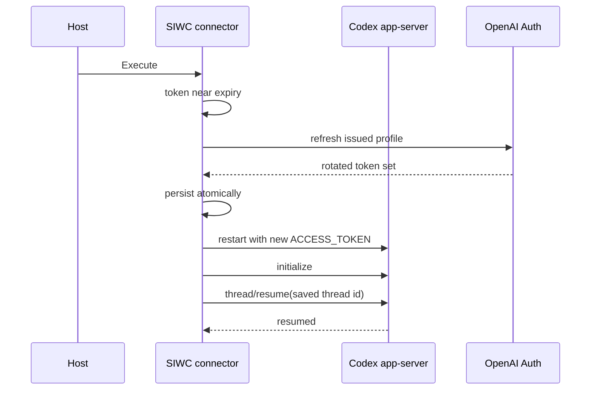
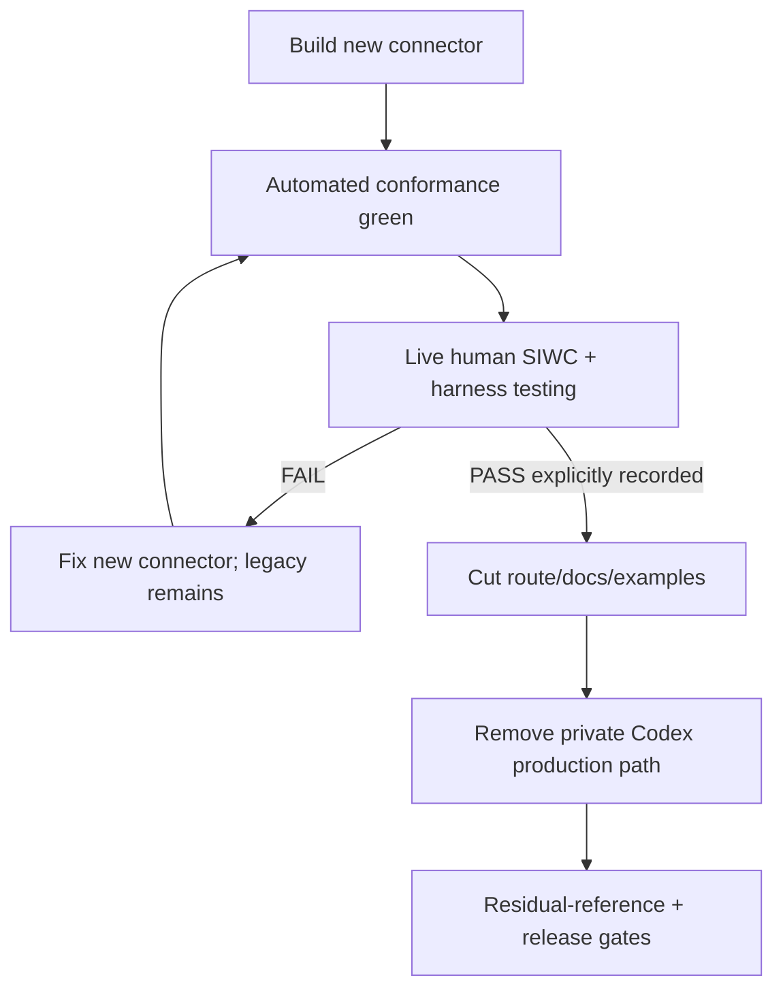

# Design Document

## Overview

This migration introduces a new external AIProxer backend connector for OpenAI ChatGPT-plan usage through official Sign in with ChatGPT (SIWC) authorization and the public Responses API. It does **not** refactor the existing private Codex HTTP engine in place. The new connector is implemented beside `connectors/codex`, validated independently, and becomes the supported subscription-backed inference path only after automated and human live gates pass.

The design preserves AIProxer's streaming-first canonical architecture and executable-connector model. Provider-specific registration, tokens, preview policy and public model inventory stay inside the new connector module. Core routing, attempt commitment, canonical events, and accounting ownership remain unchanged.

After the direct-inference empirical gate passes, this specification removes the old private `openai-codex` inference path and reconciles its obsolete compatibility references. The legacy app-server and code it needs remain supported. The SIWC-backed app-server and any later app-server replacement are deferred to [#1633](https://github.com/aiproxer/aiproxer-enterprise/issues/1633) after the OSS split.

### Goals

- Use documented SIWC/public OpenAI interfaces for ChatGPT-plan usage.
- Remove Codex CLI impersonation and the Codex identity prompt from arbitrary third-party harness traffic.
- Preserve canonical `aipapi` translation and streaming-first execution.
- Keep auth/profile state connector-owned and safe under rotating refresh tokens.
- Retire the private Codex inference factory after real-world validation without breaking the retained legacy app-server.

### Non-Goals

- No new frontend wire API.
- No OpenAI-specific canonical/core model.
- No paid/remote-host subscription-sharing product support beyond OpenAI's current OSS/local-hosted contract.
- No private ChatGPT endpoint fallback.
- No recreation of unsupported hosted tools.
- No preservation of private native compaction as a hidden fallback.

## Boundary Commitments

### This Spec Owns

- New `openai-chatgpt-plan` executable connector.
- SIWC registration/profile/refresh/host-id lifecycle.
- Direct public Responses projection and SSE normalization.
- Account-specific model inventory.
- SIWC preview request/error policy.
- Minimal OpenAI Responses hosted web-search declaration carriage: frontend preservation as a bounded opaque extension, exact extension admission, and SIWC capability/consumption.
- Coexistence, direct-inference empirical gate, cutover and legacy inference removal.
- Cleanup of obsolete Codex-only feature/config/docs/test assumptions.

### Out of Boundary

- Canonical routing/failover/commitment semantics.
- Frontend protocol redesign beyond the minimal hosted-declaration carriage owned here.
- Generic hosted-tool support, `namespace`/tool-grouping, or hosted web-search execution.
- Generic reasoning-preservation policy except adapter revalidation.
- Billing/rating redesign.
- Remote SaaS authorization architecture.
- SIWC-backed app-server and legacy app-server replacement: #1633.

### Allowed Dependencies

- Public root contracts: `pkg/aipapi`, `pkg/aipsdk/backendplugin`, `pkg/aipsdk/modelinventory`.
- Existing `openairesponses` frontend decode path and `Call.Extensions` opaque-extension admission; no `pkg/aipapi`/`pkg/aipsdk` contract change.
- Connector-support modules such as `oauthcred` and provider-neutral OpenAI-compatible helpers.
- Go standard library HTTP/crypto primitives where suitable.
- A small connector-local JWT/JWK dependency if safer than custom cryptographic parsing.
- Existing ACP/process support for app-server lifecycle where appropriate.

### Revalidation Triggers

- SIWC OAuth scope/endpoint changes.
- Responses preview field/tool changes.
- Hosted web-search declaration types or opaque-extension admission/capability changes.
- Backend-plugin ABI/credential-mode changes.
- App-server launch/RPC changes.
- Canonical reasoning/tool-item contract changes.

## Architecture

### Existing Architecture Analysis

```text
client frontend
    |
    v
canonical aipapi.Call
    |
    +-- optional codex-client-compat request hook
    |
    v
backend-plugin host
    | gRPC ABI
    v
connectors/codex
    +-- openai-codex (inference)
    |    +-- private ChatGPT Codex HTTP/WS
    |         +-- Codex CLI OAuth compatibility
    |         +-- codex_cli_rs headers
    |         +-- private model catalog
    |         +-- continuation/session state
    |         +-- native Codex compaction
    |
    +-- openai-codex-app-server (agent_runtime)
         +-- Codex CLI app-server
```

Target:

```text
client frontend
    |
    v
canonical aipapi.Call
    |
    v
backend-plugin host
    | gRPC ABI
    v
connectors/openaichatgptplan
    +-- openai-chatgpt-plan
    |    +-- SIWC profile/session
    |    +-- SIWC request policy
    |    +-- public GET /v1/models
    |    +-- public POST /v1/responses (always stream)
    |
connectors/codex
    +-- openai-codex-app-server (retained legacy agent runtime)
```

The old module remains side-by-side until the direct empirical gate; only its inference export may then be removed. Its app-server export and dependencies remain.

### Architecture Pattern & Boundary Map

**Selected pattern:** independent executable connector with provider-local auth/profile domain and public Responses driven adapter.



**Project Boundary Questions (AIProxer)**
- **Core-owned or plugin-owned?** Split by seam: the frontend preserves the wire declaration identity, the existing core opaque-extension admission gates it, and the SIWC connector owns omission/strict policy. No new core branch.
- **New canonical concept?** No. The carriage reuses the existing opaque `Call.Extensions` admission; no hosted-tool field or item type is added.
- **Streaming-first preserved?** Yes. Provider request always streams; downstream non-stream is host collection.
- **Provider SDK/wire leakage avoided?** Yes. OpenAI wire types remain inside the connector and frontend.
- **No retry after visible output?** Yes. Existing first-output commitment remains authoritative.
- **Secure-session/startup posture affected?** Yes. Local-only personal-auth policy and protected credentials must be revalidated. The posture is *declared* in the connector's manifest export (`access_scope: local_only`, `credential_mode: oauth_user`) and *enforced* once by the generic host backend security-profile gate plus the host-owned multi-user approval registry. The connector itself implements no single-user/server-mode check and is never given the deployment access mode.
- **Extension seam used?** Existing opaque-extension admission and backend-plugin ABI; no new core extension plane or public SDK field.

### Technology Stack

| Layer | Choice | Role | Notes |
|---|---|---|---|
| Connector process | Go executable backend connector | Provider boundary | Separate module/build |
| Auth | OAuth 2.0/OIDC + PKCE | SIWC registration/refresh | Dynamic public client, no secret |
| Storage | protected local JSON | host id + SIWC profiles | atomic writes, owner-only Unix |
| HTTP | `net/http` | auth/models/responses | bounded bodies/timeouts |
| Streaming | SSE → `aipapi.Event` | primary inference | completed terminal required |
| App-server | existing legacy Codex connector | retained agent runtime | SIWC-backed replacement deferred to #1633 |
| Host transport | backend-plugin gRPC ABI | host↔connector | unchanged |

## File Structure Plan

### New module

```text
connectors/openaichatgptplan/
├── go.mod
├── cmd/aip-backend-openaichatgptplan/
│   ├── main.go
│   └── login_cmd.go
├── internal/
│   ├── service/
│   │   ├── kind.go
│   │   ├── service.go
│   │   ├── config.go
│   │   ├── execute.go
│   │   └── inventory.go
│   ├── siwc/
│   │   ├── authorize.go
│   │   ├── callback.go
│   │   ├── oidc.go
│   │   ├── refresh.go
│   │   ├── hostid.go
│   │   ├── profile.go
│   │   ├── store.go
│   │   └── manager.go
│   ├── responses/
│   │   ├── policy.go
│   │   ├── payload.go
│   │   ├── input.go
│   │   ├── client.go
│   │   ├── stream.go
│   │   └── errors.go
│   └── appserver/
│       ├── config.go
│       └── connector.go
├── manifest/template.backendplugin.json
├── release.yaml
└── parity_suite_test.go
```

Exact filenames may be consolidated when Go cohesion improves, but the responsibility boundaries must remain.

### Reusable support changes

Potentially modified:
- `connector-support/oauthcred/` — only provider-neutral PKCE/redaction/protected atomic storage/serialized-refresh helpers.
- `connector-support/openaicompat/` — only genuinely generic streaming/Responses helpers; no ChatGPT-plan field names or SIWC policy.

### Root/feature/config changes after validation

- `internal/plugins/frontends/openairesponses/decode.go`, `profile.go` — bounded carrier in decode; raw-`tools`-before-`parseTools` fast-path decline in profile.
- `internal/plugins/features/codexclientcompat/` — remove retired Codex-only targeting/extensions; keep only empirically justified feature behavior.
- `internal/testkit/backendplugin/` — add new staging during coexistence, including `stage_openai_chatgpt_plan_declaration_carriage_test.go` for the end-to-end proof; remove legacy staging after cutover.
- examples/docs/release gates — introduce new route/config, then delete old references.
- `connectors/codex/` — remove the private inference export after the direct gate only; retain the app-server and any shared implementation it needs.

## System Flows

### First registration

```mermaid
sequenceDiagram
    participant U as User
    participant C as Connector CLI
    participant A as OpenAI Auth
    participant S as SIWC Store

    C->>S: load/create stable host id
    C->>C: state + nonce + PKCE
    C->>A: authorize dynamic_agent_client + host id + scopes + selected redirect_uri
    A-->>C: callback code + issued client_id + state
    C->>C: validate state; retain pending redirect_uri
    C->>A: token exchange with issued client_id + PKCE + exact same redirect_uri
    A-->>C: access/refresh/id token + scopes
    C->>C: validate JWKS/claims/scope
    C->>S: atomically persist profile
    C-->>U: signed-in local profile
```

### Direct inference



The policy consumes and removes the hosted-declaration carrier before projection, so the provider request carries only supported function tools and no web-search declaration.

### Deferred app-server token renewal (handoff to #1633)



### Migration gate



## Requirements Traceability

| Requirement | Design elements |
|---|---|
| 1 | new external module, manifest, service factory |
| 2 | SIWC authorization/profile manager |
| 3 | host-id store |
| 4 | stream-only public Responses client |
| 5 | instruction/input projector |
| 6 | centralized request policy |
| 7 | profile-aware `/v1/models` inventory |
| 8 | error mapper + explicit profile semantics + accounting evidence |
| 9 | deferred SIWC app-server adapter: #1633 |
| 10 | no private compaction; optional public reasoning replay revalidation |
| 11 | `codexclientcompat` reconciliation |
| 12 | explicit human live gate |
| 13 | post-gate legacy removal |
| 14 | tests/security/release evidence |

## Components and Interfaces

### SIWC Profile Manager

**Intent:** Own profile identity, token lifecycle, selection, persistence and reauthorization.

```go
type ProfileManager interface {
    Active(ctx context.Context) (Profile, error)
    Select(ctx context.Context, profileID string) error
    List(ctx context.Context) ([]ProfileSummary, error)
    Token(ctx context.Context, profileID string) (string, error)
    SaveAuthorized(ctx context.Context, result AuthorizedProfile) error
    Logout(ctx context.Context, profileID string) (LogoutResult, error)
}
```

**Invariants**
- one serialized refresh per profile;
- subject/issued-client-id pairing remains stable;
- rotating refresh token replacement is atomic;
- no automatic quota failover across profiles;
- logout attempts remote renewable-session revocation before local token clearing;
- `LogoutResult` distinguishes confirmed remote revocation from local-only sign-out with unconfirmed revocation;
- secrets never appear in summaries/logs.

Conceptually, `LogoutResult` carries at least `RemoteRevocationConfirmed` and `LocalTokensCleared`. Logout resolves OpenAI's `revocation_endpoint` from the OIDC discovery document and sends a form-encoded POST with the saved refresh token, `token_type_hint=refresh_token`, and the profile's issued client id. Network/5xx failures are retried with bounded backoff while the refresh token is still retained. If the operator completes sign-out without confirmation, local tokens are cleared and the result explicitly reports unconfirmed remote revocation plus guidance to disconnect the app in ChatGPT Settings.

### Authorization Service

Conceptual operations: `BeginRegistration`, `BeginReauthorization`, `HandleCallback`, `Exchange`, `ValidateIDToken`.

Each pending authorization attempt owns one immutable selected callback URI. The same exact `redirect_uri` string used in the browser authorization request—including scheme, loopback host, chosen port, and path—is carried through callback handling and supplied unchanged to the authorization-code exchange. The exchange path must never reconstruct the URI from listener state or defaults.

Browser/callback is a connector CLI/operator surface, not a core HTTP API.

### SIWC Request Policy

Pure provider policy over the canonical call and projected Responses document; it owns transport flags, unsupported fields, HTTP `previous_response_id`, system-message legality, preview diagnostics and declaration policy, not frontend parsing, routing or client families.
Hosted web-search declarations reach it only through the minimal openairesponses carriage: the frontend preserves only the closed table `web_search`, `web_search_preview`, `web_search_2025_08_26`, `web_search_preview_2025_03_11` as an array of at most `aipapi.MaxTools` type strings (carrier value ≤64 KiB) under the opaque extension key `openairesponses.web_search_declarations`; function tools stay canonical, hosted declarations are not flattened into function tools, a function/custom tool named `web_search` is not carried, every other hosted type still fails decode, and unknown/new web-search variants fail closed until a reviewed table update.
The key is not frontend round-trip metadata, so `DeriveProtocolRequirements` requires `opaque_extensions` plus the exact `call` extension; a backend that does not declare it is rejected before provider I/O, never served with the declaration silently absent. Only the SIWC connector declares the exact extension and applies the omission; the shared frontend and core never omit it. Runtime admission reads `ResolvedProfile.Capabilities`, so the SIWC connector must return `OpaqueExtensions: true` there and the exact `ResolvedProfile.DialectSupport.ExtensionTypes` entry; `FactoryDescriptor.StaticCapabilities.OpaqueExtensions` mirrors it. `Describe` alone is not admission authority. Its policy consumes the carrier before the generic protocol-extension loop.
The policy validates the bounded array; empty, malformed, unknown, or over-bound entries are refusals classified as unsupported capability, not invalid user context. In the `policy_mode` interoperable posture it removes the carrier from the cloned call and records one `Omission` per declaration with a dedicated stable reason, the carrier path with declared type in `Field` and the wire field `tools` in `Wire`. The connector's `recordOmissions` remains the connector-local detail log; because a spawned connector's stderr is not the integrated operator boundary, the connector also emits exactly one fixed, content-free canonical `EventWarning` marker after `response_started` whenever an omission occurred, and the host adapter consumes that exact marker after recording one fixed content-free operator warning. Ordinary canonical warnings are unchanged; strict posture refuses before projection or network and emits no marker.
No omission ever applies to history: an unrepresentable model-authored search input item is refused before provider execution, and an upstream `web_search_call` output remains an `unrepresentable_output_item` terminal failure, never a dropped or synthesized event.
The classification is table-driven and name-blind; `namespace` groups function/custom tools, is not a web-search synonym, and is neither parsed nor flattened here, so a namespace declaration remains outside this policy's supported declaration set.
The key literal is a documented cross-module wire contract, defined privately on both sides and pinned by a staged end-to-end test; no `pkg/aipapi`/`pkg/aipsdk` field or switch is added. The frontend wire fast path detects hosted web-search types from raw `tools` before `parseTools` and declines them to canonical processing; it never wire-executes them, independent of the selected backend or current SIWC wire-backend availability. The wire-side guard remains a defense for an already-projected document: a raw hosted declaration that bypasses the carrier is refused.

### Responses Projector

Maps `Call.Instructions` to `instructions`; folds system conversational text deterministically; preserves legal developer/user/assistant/tool chronology in `input`; projects function definitions and tool choice; projects the supported reasoning option; and carries legal image/file parts. No Codex prompt fallback is allowed.

### Responses Stream

Must emit canonical text/tool/reasoning/usage events; require terminal completion; preserve bounded parsing; surface stream-terminal subscription-sharing errors; support Close/Cancel; and never transparently retry after canonical output.

### Model Inventory

Uses the selected profile token on `/v1/models`. Cache identity includes the local registration/profile key; stale data cannot cross profile boundaries.

### Deferred SIWC App-Server Adapter (#1633)

Builds official provider flags and supplies only the selected profile access token to child environment. Token refresh restarts the child; saved thread id resumes through documented RPC.

## Data Models

### Profile record

```go
type ProfileRecord struct {
    Version        int       `json:"version"`
    ID             string    `json:"id"`
    Label          string    `json:"label,omitempty"`
    Subject        string    `json:"subject"`
    EmailHint      string    `json:"email_hint,omitempty"`
    IssuedClientID string    `json:"issued_client_id"`
    HostID         string    `json:"host_id"`
    GrantedScopes  []string  `json:"granted_scopes"`
    AccessToken    string    `json:"access_token"`
    RefreshToken   string    `json:"refresh_token"`
    IDToken        string    `json:"id_token,omitempty"`
    Expiry         time.Time `json:"expiry"`
    NeedsReauth    bool      `json:"needs_reauth,omitempty"`
}
```

Subject is authoritative identity; email is display hint only. The store is versioned and protected.

### Host record

```go
type HostRecord struct {
    Version int    `json:"version"`
    HostID  string `json:"ext_agent_host_id"`
}
```

## Error Handling

Internal error categories distinguish:
- local auth/config errors;
- ID-token/scope validation;
- terminal vs transient refresh;
- direct admission HTTP failure;
- structured subscription-sharing error;
- request-policy unsupported capability;
- stream failed/incomplete;
- EOF before terminal;
- cancellation.

Provider body text is bounded/redacted. Quota is not an authentication-refresh trigger unless the documented provider code says so.

## Testing Strategy

### Unit
- profile permissions/atomicity/versioning, host-id persistence/race;
- authorization URL parameters, PKCE/state/nonce, JWKS/claim/scope validation, rotating refresh;
- frontend hosted-declaration carriage, exact extension admission and capability parity;
- request-policy table (web-search types, strict refusal, name-blind function tools, namespace refusal, search-history refusal), instruction/system mapping, function call/result projection;
- model parsing, terminal event classification.

### Integration
- `httptest` auth/token/JWKS/models/responses services and exact public URL/header/body contract;
- forced upstream stream for downstream non-stream call;
- profile-partitioned model cache;
- token refresh during configured instance lifetime;
- backend-plugin descriptor/configure/execute/list-models path;
- staged frontend→host→SIWC carriage with real `Resolve` admission: default omission, strict refusal, non-supporting-backend rejection before provider I/O, no declaration on the upstream wire, and hosted-shape fast-path decline with a positive ordinary-request control in `frontendpipe`/`openaicompat`;
- negative proof against private Codex fields.

### Deferred app-server (#1633)
- exact launch/provider configuration;
- secret environment handling;
- truthful `clientInfo`;
- refresh restart + thread resume;
- execution-class safety.

### Race/Fuzz
- refresh serialization;
- host-id first creation;
- active-profile switch vs inventory refresh;
- callback/state/JWT/JWKS malformed inputs;
- bounded SSE/error parsing;
- shutdown during refresh; app-server restart is deferred to #1633.

### Live
A dedicated opt-in probe may automate wire checks, but final migration still requires explicit human sign-off because browser consent and real coding-harness operation are product acceptance evidence.

## Security Considerations

- Local-only access scope remains mandatory for subscription credentials. The direct export declares `access_scope: local_only` and `credential_mode: oauth_user`; the future SIWC app-server posture is deferred to #1633.
- The invariant is credential **ownership under the current AIProxer principal/credential model**, not a blanket provider-terms claim. OpenAI documents ChatGPT-plan usage for open-source and locally hosted applications, including a self-hosted-VM flow, so a same-user local deployment is legitimate. What is refused is a user-scoped ChatGPT-plan credential becoming an **operator-wide credential that unrelated downstream principals can multiplex through a shared proxy**.
- Therefore there is no pooling, failover, or quota-sharing across different users' ChatGPT-plan registrations. Active-profile selection is a single local user's registration, never an availability mechanism.
- Multi-user rejection is provided **once, by the host**, at the composition boundary: `access.mode: multi_user` rejects any enabled backend whose effective security profile is `local_only` or `oauth_user`, and additionally any factory absent from the host-owned multi-user approval registry (`internal/standardplugins/multi_user_backend_policy.go`, outside `connectors/*`). The direct SIWC factory is absent from that registry; the deferred app-server is not implemented.
- Consequence for this design: **no connector-local `is_single_user_mode()` check**. The connector is never told the deployment access mode, declares no local eligibility authority, and cannot reach host internals (enforced by architecture guards). Adding such a check would create several independently removable gates and couple connector code to deployment policy.
- No `allow_personal_auth_in_multi_user`-style knob. A future shared-service ChatGPT-plan backend would need a provider-supported service identity, explicit per-principal credential binding, no cross-user token pooling, and an explicit approval — a distinct reviewed factory, not a reclassified one.
- Credential files use owner-only Unix permissions and strongest existing Windows protection model.
- No credentials in URLs, logs, captures, metrics, examples or support errors.
- Authorization URLs containing retained ID-token hints are redacted.
- Unknown JWT algorithms/kids fail closed.
- State/nonce/PKCE are fresh per attempt and time-bounded.
- Refresh-token reuse/terminal invalidation requires reauthorization.
- Config should reference profiles/stores rather than embed long-lived OAuth secrets.
- The hosted-declaration carrier holds only documented type strings, never declaration bodies, attributes, filters, user location, or conversation content; a non-supporting backend rejects the exact extension before provider I/O.

## Performance & Scalability

This is a local personal-auth connector, not a shared high-concurrency SaaS backend. Still:
- no per-request directory scan when active profile is stable;
- model cache bounded and profile-keyed;
- refresh serialized per profile without blocking other profiles;
- bounded SSE parsing;
- no per-event goroutine spawning;
- explicit app-server child ownership is deferred to #1633.

## Migration Strategy

1. Add new connector module and opt-in docs/config.
2. Add SIWC login/profile flow.
3. Add model inventory and stream-only public Responses.
4. Defer the SIWC app-server to #1633; retain the legacy app-server.
5. Pass automated conformance.
6. Pass mandatory live/human gate while legacy routes remain untouched.
7. Switch recommended docs/routes/examples.
8. Remove the old private Codex inference factory and dead compatibility/native-context code only where unused by the retained app-server.
9. Run repository-wide residual and release certification.

Rollback before step 8 is routing/config rollback. After step 8, rollback is source-control rollback; no profile-schema downgrade should be required.

## Supporting References

See `research.md` for codebase investigation and official OpenAI documentation links.
